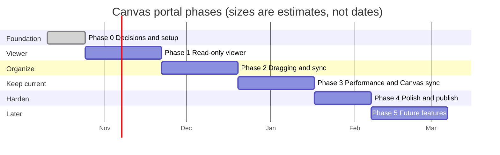

# Roadmap

**Status:** Draft · **Owner:** Team Lead · **Last updated:** 2026-10-25

## 1. Project goals

| ID | Goal |
|----|------|
| G-1 | **One place for everything due.** A student sees what they have due across all their Canvas courses, and what they're doing about it. |
| G-2 | **Read only toward Canvas.** The portal never changes anything in Canvas. Board layout and notes belong to the student and live in the portal. |
| G-3 | **Feels like Trello.** The board looks and behaves as much like [Trello](https://trello.com) as we can: lists side by side, cards you drag, a card that opens into a detailed view, colored labels, and due date badges. Someone who uses Trello should feel at home without instructions. |
| G-4 | **Follows the student everywhere.** Signing in on any device or browser shows the same board and notes. |
| G-5 | **Private and safe.** Canvas tokens and notes are protected and never shared. |

G-3 shapes most of the screen and interaction design. It means copying
Trello's *patterns* (layout and behaviors), not its name, logo, icons,
or artwork; see constraint C-4 in the [requirements](02-requirements.md).

## 2. Phases at a glance

The bars show order and rough size. There are no fixed dates; a phase is done
when its exit criteria are met. Phase 0 is done. The current phase is named in
the repo's [CLAUDE.md](../../CLAUDE.md).

Each phase ends with something a student can use, so the project is worth
having even if it stops after any phase. From Phase 1 on, each phase also
ends with a private deploy to a free test host (D-3), so deploy, backup, and
restore problems show up early. Only listed Google test users can sign in
there until Phase 4 publishes the app.

| Phase | What a student can do afterward | Goals |
|-------|---------------------------------|-------|
| 1 | Sign in anywhere (as a listed test user on the private deploy) and see everything due across all courses on one board | G-1, G-2, G-5 |
| 2 | Organize that board by dragging cards, and see the same board on every device | G-3, G-4 |
| 3 | Trust that a Refresh is quick and that the board matches Canvas | G-1 |
| 4 | Use it as a published site: any student can sign in, not only listed test users | All |
| 5 | Ideas only; each is planned into a phase when the Team Lead picks it | |

## 3. Phases in detail

### Phase 0: Decisions and setup

**Status:** done (2026-10-25).

Settle the open decisions in section 5 and set up the empty project so later
phases only add features.

- Write the design document and the User Interface Specification, then
  choose the frontend framework (D-1). Done: React.
- Create a `canvas-portal/` folder in this repo with a `frontend/` and a
  `backend/` part, each with a "hello" page or endpoint. Done.
- Add GitHub Actions CI that builds both parts and runs their tests on every
  pull request that changes the app. Done.
- Confirm the Team Lead's school allows personal access tokens (risk R-1). Done:
  the Team Lead has a student token and a parent (observer) token for testing.

**Exit criteria:** design and User Interface Specification reviewed;
decisions D-1, D-4, D-5, and D-6 recorded; CI is green on the skeleton app.
The documents were reviewed in PR #3 and again in one pull request per
document after it; they stay marked Draft until that second review is
merged.

### Phase 1: Read-only viewer (minimum viable product)

The smallest thing that is useful: connect, then see everything that's due.

**Prerequisites**, done by the Team Lead before development starts:

- Create a Google Cloud project and OAuth client for Sign in with Google
  (D-7), with the Team Lead's Google account as a test user. The client ID
  and secret go in the git-ignored `.env`, never in the repo.
- Set up a Canvas course where the Team Lead can act as teacher (a free
  Canvas account from Instructure works), with a test student enrolled, and
  check that a token from it works. It is the safe place to record Canvas
  responses for the test fixtures, and the Phase 3 change tests (TP-15)
  need it.
- Before step 6: create the free Koyeb and Neon accounts for the test
  deploy (D-3), add the test host's address as a redirect URI on the Google
  client, and add the deploy and backup secrets to a GitHub Actions
  environment that only `develop` can use, with the Team Lead as its
  required reviewer. Plain repository secrets reach workflows on any
  branch, and every thread pushes branches to this public repo. GitHub
  Actions is a new place secrets live, so the Team Lead sets them (#26).

**Before step 6 goes live**, because real tokens then sit on an
internet-facing server (R-14). Each of these is a potential data breach
if skipped, so none can be dropped or delayed without the Team Lead:

- The incident plan for a leaked token is in place (#17).
- How the token encryption key and session secret are stored, rotated,
  and replaced after a leak is written down and set up (#19).
- Secret scanning with push protection is on for the repo (#20).
- The session cookie and every write are protected on Koyeb's shared
  domain (#25). `koyeb.app` isn't on the Public Suffix List, so other
  Koyeb apps count as the same site and `SameSite=Lax` doesn't stop them.
  The Team Lead chose to keep Koyeb with these protections over moving
  to Render free (2026-10-25).
- Deploy secrets and database backups are kept private on the public
  repo (#26).

**Before step 2 starts:** the Team Lead decides how the Canvas token is
stored and sent, which the review protocol reserves for the Team Lead. The
design lists these calls in
[Open decisions raised here](03-design.md#open-decisions-raised-here),
such as encrypting tokens with Fernet (a new dependency).

**Work:**

- Sign in with Google, so the server knows whose data is whose (FR-50,
  D-7).
- Connect screen: paste a Canvas URL and personal access token (FR-1 to
  FR-4). The connection is saved, encrypted, with the student's account, so
  it works on any device they sign in from (FR-5, NFR-11).
- Backend calls Canvas for active courses and their assignments (FR-10 to
  FR-14), handling Canvas's paging and rate limits.
- Refresh is manual from the start: the portal fetches only when the
  student selects Refresh or on the very first load, and highlights Refresh
  when the data is more than an hour old (FR-15). Each Refresh shows its
  progress course by course, with a summary and Retry if anything failed
  (FR-16).
- A read-only board with the four lists Backlog, To do, In progress, and
  Done: when the board is first created, every assignment is a Trello-style
  card in Backlog, sorted by due date, with the course show/hide buttons
  (FR-20 to FR-23, FR-31, FR-34, FR-38, FR-60, FR-65, FR-66, FR-78). The
  board has Trello's visual style from the start: colored background, light
  gray rounded lists, and white cards with a soft shadow (NFR-34).
- Each list can be minimized or expanded; expanded lists share the full
  width and resize as lists open and close, and empty lists start
  minimized, so in Phase 1 Backlog fills the board (FR-61, FR-80). Moving
  cards between lists comes in Phase 2.
- With saved data the board is usable within 2 seconds (NFR-1), and it
  works in current Chrome, Firefox, Safari, and Edge (NFR-30). On the free
  test host, NFR-1 is measured once the server is awake: the first load
  after an idle hour can take a few seconds longer while it wakes. NFR-1 is
  checked on the Phase 4 host.
- Security from the first stored token: tokens never appear in logs,
  errors, or addresses; each user sees only their own data; only Canvas
  read calls; no trackers (NFR-10, NFR-12 to NFR-14).
- Backend tests run against recorded Canvas responses, so CI never needs a
  real token (NFR-41).
- Clicking a card opens that assignment's own page in Canvas, in a new tab
  (FR-26). The portal's own card detail view (the card back) is a Phase 5
  future feature.
- Clear error messages for a bad token, an expired token, or Canvas being
  unreachable (FR-6, NFR-20).
- A private deploy to the free test host (D-3): the backend ships as a
  container on Koyeb's free instance, which also serves the built frontend,
  with Neon's free Postgres in the same region. It runs over HTTPS on the
  host's default address (NFR-11), with the Google client secret, the token
  encryption key, and the session key in the host's environment settings,
  never in the repo or the build. It runs as a single backend
  instance. CI deploys it, and a bad deploy can be rolled back to the last
  good one. A nightly GitHub Actions job saves an encrypted
  `pg_dump`, kept for 30 days. Dumps are stored outside the repo and its
  workflow artifacts, where only the Team Lead and the backup job can read
  them, and the backup key is its own secret, never stored with the dumps
  (#26). A restore into a spare Neon branch has been tried once, and that
  branch is deleted afterward.
- Measure how long a full Canvas load takes with the Team Lead's real
  student account and record it as a baseline (TP-14). Tuning is Phase 3; see
  the design's [Making Canvas loads fast](03-design.md#making-canvas-loads-fast-nfr-1-nfr-2-r-3).

**Order of work.** Phase 1 is the largest phase, so it is built in small
pull requests, each one usable on its own:

1. Sign in with Google (FR-50), with the `USER` table and its sessions.
2. Connect, check, and disconnect Canvas (FR-1 to FR-6), with
   `CANVAS_CONNECTION`. This step stores the first token, so its security
   comes with it (NFR-10 to NFR-12).
3. Fetch, cache, and Refresh with progress (FR-10 to FR-16, NFR-13,
   NFR-20), with `CANVAS_CACHE` and `REFRESH_RUN`, tested against recorded
   Canvas responses (NFR-41). Milestone M1: the Refresh panel's per-course
   counts show the real assignments, so no throwaway list view is built.
4. The read-only board (FR-20 to FR-23, FR-26, FR-31, FR-34, FR-38, FR-60,
   FR-61, FR-65, FR-66, FR-78, FR-80, NFR-34), with `BOARD`, `LIST`,
   `CARD`, and `COURSE_LABEL`.
5. The Phase 1 checks: NFR-1, NFR-14, NFR-30, the TP-14 baseline, and the
   manual test pass.
6. The private test deploy, with CI deploys, rollback, and the nightly
   backup. It goes live only with the Team Lead's OK, once everything in
   *Before step 6 goes live* is done and these security checks pass: the
   automated NFR-10 to NFR-14 tests and the FR-1 address check, TP-02
   (no token in logs, NFR-10), TP-02's check that the stored token is
   encrypted (NFR-11), TP-10 step 2 (NFR-12), and TP-03's network check
   (NFR-14). Product and QA confirms the step numbers once the test plan
   review (#9) merges. Milestone M2.

Each step adds only the tables it uses, through a migration, so each pull
request stays small.

**Exit criteria:** the Team Lead can connect a real account and see the same
assignments Canvas shows. CI is green. These pass:

- TP-01, TP-02, TP-03, and TP-05.
- TP-01 and TP-03 again in each NFR-30 browser.
- TP-04 steps 5 to 7, and TP-13 steps 1 and 13.
- TP-10 step 2, for user A's cards, Canvas data, and Refresh logs
  (NFR-12).
- TP-14 has a recorded baseline, and its steps 3 and 4 pass (NFR-1,
  FR-15). Step 3 is measured locally or on the awake test deploy.
- The test deploy loads only over HTTPS, a listed test user can sign in
  there, and a rollback and a backup restore have each been tried once.

### Phase 2: Dragging and sync

This phase does one thing: the student can drag cards between lists, and
that is saved and kept in sync on every device they use. Board layout is
stored on the server (D-2), using the accounts from Phase 1. Keeping the
student's own devices in sync is needed here, but it is the simpler kind of
sync; keeping the backend in step with Canvas is the hard part and gets
Phase 3.

**Before it starts:** D-8 (polling or live push) is decided, and the drag
and drop library is chosen (design, section 2).

- The board stops being read only: drag cards between lists with Trello's
  drag feel; cards keep their due date order, and dropping a card on an
  empty minimized list expands it (FR-32, FR-38, FR-60, FR-77, FR-80,
  NFR-3).
- The layout is saved on the server and restored on any device (FR-33,
  FR-51).
- Sync: a move made on one device appears on the user's other open devices
  within 30 seconds, and no card is ever lost or duplicated (NFR-22, D-8).
  A tab stops polling while it is hidden, so the free database can sleep
  and stay within its monthly compute hours (D-3, R-15).
- Canvas merge: new assignments land in *Backlog*, cards are matched by
  Canvas ID, and they move only when the student drags them (FR-34, FR-35).

**Exit criteria:** TP-06 passes in full: layout survives reloads and Canvas
refreshes, two devices open at the same time stay in step, moving the same
card on both settles on one list everywhere, and a dropped connection never
leaves a device showing a move the server doesn't have. The concurrency tests
for NFR-22 pass, and the drag steps of the Trello comparison review (TP-13
steps 2 and 3) pass. TP-08 steps 2 and 3 pass (FR-34, FR-35: a renamed
assignment and a submitted one stay in their list), leaving out step 1's
note. The NFR-3 timing test passes. It is still to be added to the test
plan. CI is green. The phase is deployed to the test host with the Team
Lead's OK: a backup is taken first, and the migration is tried on a copy (a
Neon branch) before the live database. The copy is deleted afterward.

### Phase 3: Performance and Canvas sync

This phase makes Refresh fast and makes sure every Refresh brings the
portal's copy of Canvas data fully in step with Canvas. Refresh stays
manual: the portal never fetches on its own, and highlights Refresh when the
data is more than an hour old (FR-15). It starts from the TP-14 timings
recorded in Phase 1.

Keeping the backend in step with Canvas is the hardest part of the whole
project and gets the most testing. Teachers create, delete, and change
assignments at any time; fields such as due dates can be missing at first,
added later, changed, or cleared again; and a fetch can fail halfway. Every
one of these cases has a planned outcome in the design (*What can change in
Canvas*) and a test (TP-15).

**Before it starts:**

- Q-7 in the requirements (what happens to the cards of an ended or dropped
  course) is answered.
- The Team Lead decides whether Canvas GraphQL may be used. It reads data
  but is sent as a `POST`, and NFR-13 allows only `GET` calls to Canvas
  (see the design's
  [Open decisions raised here](03-design.md#open-decisions-raised-here)).
  If the answer is no, tuning goes straight to leaving descriptions out and
  the Planner API, which are both `GET`.

- Tune Refresh, working through the design's list in order: Canvas
  GraphQL if the Team Lead approves it, descriptions left out of the main
  load, then the Planner API as a fallback (NFR-1, NFR-2, R-3).
- Each Refresh brings in every change: new, changed, and removed
  assignments, new due dates and submission states, and course changes
  such as a new term (FR-13, FR-34, FR-35, FR-45).
- Every kind of Canvas change has a defined result on the board: new,
  deleted, unpublished and republished, renamed, fields added, changed, or
  cleared, submission state going forward or back, and courses ending or
  being dropped (FR-39, FR-45, Q-7).
- A partial or failed fetch never archives or changes cards (FR-45).
- Changes from a Refresh reach the student's other open devices through the
  Phase 2 sync (NFR-22).
- A Refresh stays within Canvas's rate limits (C-2), including when a
  second device starts a Refresh while one is running. Joining the running
  Refresh is built in Phase 1 (see the design's *Refresh progress*);
  Phase 3 tests it under load.

**Exit criteria:**

- TP-14 meets NFR-1 and NFR-2 on the Team Lead's real account, including at
  a busy time.
- Every scenario in TP-15 passes, and so does its automated replay test
  (FR-39, FR-45).
- The test for joining a running Refresh from a second device passes. That
  test is still to be added to the test plan.
- A week of daily Refreshes against the Team Lead's real account gives no
  rate-limit errors and no lost, duplicated, or wrongly archived cards.
  Each day's check (card count against Canvas, plus any archived cards) is
  recorded in the test plan's results log.
- The phase is deployed to the test host with the Team Lead's OK, taking a
  backup first and trying the migration on a copy that is deleted
  afterward, as in Phase 2.

### Phase 4: Polish and publish

**Before it starts:** the Phase 4 half of D-3 (the production host, its
database, and the domain) is decided, with its cost.

- Delete my data (FR-54).
- Accessibility pass for contrast, labels, and focus (NFR-32), and a final
  check that every browser still works (NFR-30).
- Move from the free test host to the production host chosen in D-3, on
  the app's domain, and link it from the repo's landing page. The deploy
  setup from Phase 1 carries over: HTTPS (NFR-11), secrets in the host's
  environment settings, CI deploys with rollback, and scheduled backups.
  NFR-1 is checked here without the test host's wake-up allowance.
- A home page and a privacy policy page on the app's domain, which Google
  requires before it publishes the sign-in app.
- Publish the Google OAuth client out of "testing" mode. Until then only
  listed test users can sign in, which doesn't fit "any student at any
  school" (D-5). See the design's
  [Signing in to the portal](03-design.md#5-signing-in-to-the-portal-d-7).

**Exit criteria:**

- TP-12 steps 1, 3, and 4 pass on the deployed app, and so does the
  axe-core test for NFR-32.
- TP-10 step 4 passes, along with the FR-54 API test (every row for the
  user is removed).
- A deployed smoke test passes. It is still to be added to the test plan,
  and it checks that the site loads only over HTTPS and that a Google
  account that isn't a test user can sign in.
- A rollback and a backup restore have each been tried once on the
  production host, and TP-14 step 3 passes there (NFR-1).

### Phase 5: Later ideas (not committed)

- "Log in with Canvas" (OAuth 2) instead of pasting a token (D-4).
- Calendar view of due dates; reminders.
- Grades and submission feedback view.
- Quizzes and discussions as their own kinds of item, with their own
  badges (FR-29).
- Personal cards and lists: "+ Add a card" creates a card that isn't a
  Canvas assignment, and "+ Add another list" adds lists; lists can also be
  archived (FR-71, FR-64, FR-36).
- Rename a list by clicking its title, and drag lists to reorder them
  (FR-63, FR-62).
- Quick edit menu on each card: pencil button or right-click (FR-69).
- Phone support: a layout for phone-width screens, where one list fills the
  screen and the student swipes between lists, plus nothing that depends on
  hover (NFR-33, NFR-36). The UI details come first, such as how dragging,
  minimized lists, and the course row work on a small touch screen.
- Hide assignments, such as graded or excused ones (FR-25).
- Statuses the portal works out itself, such as *Upcoming*, *Due soon* (with a
  yellow badge), and *Overdue* (FR-27).
- Show which assignments are new or were updated in Canvas since the
  student last looked, such as with a badge (FR-79).
- Checklists inside a card, with progress such as 2/5 on the card front
  (FR-70).
- Card back: clicking a card opens a dialog with its own link, showing the
  assignment's Canvas description read only (FR-28, FR-67, FR-68). Until
  then, clicking a card opens the assignment in Canvas (FR-26).
- Private notes: dated, comment-style notes on any assignment, like the
  comments on a Trello card, never sent to Canvas (FR-40 to FR-44, FR-46,
  NFR-21).
- Course label colors chosen by the student (FR-66), and the course
  show/hide choice saved with the account (FR-78).
- Trello-style filter menu with status filters and search (FR-24, FR-72).
- Board actions take no more clicks than in Trello (NFR-35).
- Archive and restore cards, as in Trello (FR-74).
- Export the board and notes as a file (FR-53).
- Background sync: refresh from Canvas on a schedule, even while the
  student is signed out, so changes appear without pressing Refresh
  (NFR-4).
- More than one board, such as one per course or term, as in Trello (FR-76).
- Board background choices and the board menu sidebar (FR-75).
- More than one school per student, such as a high school and a college
  during dual enrollment, all on one board (FR-55).
- Parent view: a parent (Canvas *observer*) token shows the courses and
  assignments of the students they observe (Q-5).

## 4. Milestones

| ID | Milestone | Phase | Shows that | Status |
|----|-----------|-------|------------|--------|
| M0 | Empty app builds in CI | 0 | Tooling works end to end | Reached 2026-10-25 |
| M1 | First real assignment list | 1 | Canvas connection works: after step 3 of Phase 1's order of work, the Team Lead's real courses and assignments come back from a Refresh | |
| M2 | Viewer complete | 1 | MVP usable day to day on the private test deploy: Phase 1's exit criteria are met | |
| M3 | Dragging saves and syncs | 2 | Core organizing feature works on every device | |
| M4 | Fast loads and Canvas sync | 3 | Board stays current without waiting on Canvas | |
| M5 | Published | 4 | Any student can sign in and use it from any laptop or desktop browser | |

## 5. Open decisions

Open decisions need the Team Lead's call; each has a recommendation, from
DevOps for D-3 and from Architecture for D-8. Settled decisions are struck
through and kept for the record.

| ID | Decision | Options | Recommendation | Needed by |
|----|----------|---------|----------------|-----------|
| ~~D-1~~ | ~~Frontend framework~~ | **React** (largest ecosystem, most tutorials, mature drag-and-drop libraries such as dnd-kit) or **Svelte** (less code, closer to QML's declarative feel, smaller community) | **Decided** (Team Lead, 2026-10-25): React, with TypeScript and Vite. React has the most Trello-style board examples and the best support from Pragmatic drag and drop. | Done |
| ~~D-2~~ | ~~Where notes and board layout are stored~~ | **Browser local storage** (no accounts, works offline, but tied to one browser and lost if site data is cleared) or **server database** (follows the user between devices, but needs portal sign-in and more security work) | **Decided** (Team Lead, 2026-10-25): server database. The user should be able to sign in from anywhere and see their saved state. | Done |
| D-3 | Hosting, including where the Postgres database lives and the app's domain | **Test deploys (Phases 1 to 3):** Koyeb free, Render free, Oracle Always Free, Google Cloud Run, or a paid host (see the DevOps comparison in PR #4). **Phase 4:** a production host and database, such as Render or Koyeb paid with managed Postgres, plus a domain. Serverless functions (such as Vercel's) are ruled out: a Refresh runs as a background task for up to several minutes (FR-16), and serverless functions stop when the request ends. | **Test deploys decided** (Team Lead, 2026-10-25): $0 on Koyeb's free instance plus Neon's free Postgres, in the same region, with Render free as the fallback. Koyeb's shared `koyeb.app` domain needs the cookie and write protections in #25 before go-live (Team Lead, 2026-10-25). The backend serves the built frontend, so the sign-in cookie stays on one site. Conditions: the database is capped at its smallest size, health checks don't touch it, hidden tabs stop polling, and a nightly encrypted backup runs from GitHub Actions. NFR-1 is measured once the server is awake. **Phase 4 still open:** the production host, database, and domain. Google's publishing review needs a home page, a privacy policy, a verified domain, and the final redirect address, and a host's shared default domain may not be accepted. DevOps priced paid hosting at about $13 to $14 a month plus a domain, which needs the Team Lead (R-13). If background sync (Phase 5) is added later, the host must also run scheduled jobs. DevOps makes the recommendation. | Test deploys: done. Production: before Phase 4 |
| ~~D-4~~ | ~~How users connect to Canvas~~ | **Personal access token** (works today, no school involvement, user must create and paste it) or **OAuth** (smooth sign-in, needs a developer key from the school's Canvas admin) | **Decided** (Team Lead, 2026-10-25): personal access token. OAuth is a Phase 5 idea if a school will issue a key. | Done |
| ~~D-5~~ | ~~Who the app is for~~ | Just the Team Lead, a few friends, or any student at any school | **Decided** (Team Lead, 2026-10-25): any student at any school (the Canvas address is a setting), tested with the Team Lead's school. | Done |
| ~~D-6~~ | ~~Backend language~~ | **Python + FastAPI** (readable, quick to write, good for learning) or **Node.js** (same language as the frontend) | **Decided** (Team Lead, 2026-10-25): Python + FastAPI. | Done |
| ~~D-7~~ | ~~How users sign in to the portal~~ | **Sign in with Google**, **email magic link**, **username and password**, or a **hosted auth service** (see [design](03-design.md#5-signing-in-to-the-portal-d-7)) | **Decided** (Team Lead, 2026-10-25): Sign in with Google for the MVP. | Done |
| D-8 | How other open devices learn about a move (NFR-22) | **Polling** (each device asks "anything new?" every 30 seconds and when its window comes back into focus; simple, works on any host) or **live push** (the server tells devices instantly over a WebSocket or server-sent events; faster, but more to build and host) | Polling for Phase 2; live push only if 30 seconds feels slow in practice. See [design](03-design.md#keeping-devices-in-sync-nfr-22-d-8). | Start of Phase 2 |

## 6. Risks

Each risk is rated Low, Medium, or High for how likely it is and how much
harm it would do, and has an owner: the team persona that watches it and
carries out its mitigation (see the [team personas](../team/README.md)).
Management keeps this list, rates each risk, assigns its owner, and reviews
it with the Team Lead at every phase boundary. A risk that is a
[potential data breach](../team/personas/security.md#potential-data-breach)
is marked **Critical**: it is must-fix, its mitigations come first in the
current phase and are done before the next deploy, and only the Team Lead
can delay one. Accepting a risk instead of
reducing it, or a mitigation that changes scope or timeline, needs the Team
Lead.

| ID | Risk | Effect | Likelihood | Impact | Owner | Mitigation |
|----|------|--------|------------|--------|-------|------------|
| R-1 | A student's school has turned off personal access tokens | Students at that school can't connect | Medium | Medium | Architecture | Cleared for the Team Lead's school in Phase 0 (A-1), but D-5 opens the portal to any school. The connect screen's error says tokens may be turned off at the student's school (FR-6), and OAuth stays the Phase 5 path (D-4). |
| R-2 | Canvas tokens are powerful; a leak exposes a student's whole account | Privacy harm | Low | High, **Critical** | Security, with Architecture making the design fixes | The backend never logs tokens (NFR-10), stores them encrypted with a key held only in the server's settings (NFR-11), never returns them to the browser, shows each user only their own data (NFR-12), and only uses Canvas read calls (NFR-13; "read-only queries" if the Team Lead approves GraphQL). Students are told to give the token an expiry and to delete it in Canvas when they leave (#21). |
| R-3 | Canvas is slow: in the Team Lead's experience a full load of courses, each with 100+ assignments, can take several minutes, and rate limits slow it further | Students wait or give up | High | Medium | Architecture | Never make the student wait on Canvas: show the last data at once, refresh only when the student asks, and highlight Refresh when the data is old (FR-15). Measure early with a real account (TP-14 baseline in Phase 1), then in Phase 3 fetch less, in fewer requests, and switch to Canvas GraphQL if needed and the Team Lead approves it against NFR-13 (see design, *Making Canvas loads fast*). |
| ~~R-4~~ | ~~Assignments change in Canvas (renamed, deleted, new due date)~~ | ~~Board shows stale or orphaned cards~~ | — | — | — | Merged into R-9. |
| R-5 | Learning web development alongside building | Slower progress | Medium | Medium | Management | Small phases, one new technology at a time, docs explain terms. |
| R-6 | A school-managed Google account blocks sign-in to outside apps | Student can't sign in | Medium | Medium | UI/UX | Allow any Google account, so a personal one works; explain this on the sign-in screen. |
| R-7 | Matching Trello too closely in look (logo, artwork, exact styling) | Trademark or copyright complaint | Low | Medium | UI/UX | Copy behavior and layout patterns only; our own name, colors, and icons (C-4). |
| R-8 | Sync bugs: two devices or two browser tabs disagree, or a card is lost or duplicated | Student stops trusting the board | Medium | High | Developer | Phase 2 is only dragging and sync; one row per card enforced by the database; concurrency tests in CI and the TP-06 sync procedure (NFR-22). |
| R-9 | The backend falls out of step with Canvas: a teacher deletes, changes, or clears something and the board shows stale data, loses a card, or archives one that still exists | Students miss or mistrust deadlines | High | High | Architecture | Phase 3 is dedicated to it; every change case has a planned outcome (design, *What can change in Canvas*); only complete fetches can archive; scenario fixtures replayed in CI and TP-15 against a real account. Until Phase 3, a complete Refresh adds new assignments to Backlog, and a card whose assignment is gone is hidden, never deleted. |
| R-10 | Scope grows faster than it is built: ideas and fixes pile into the current phase, and pull requests touch many documents at once | Phases never finish, and reviews get too big to check | High | High | Management | Section 7: new ideas go to Phase 5 by default, a phase's scope is fixed once it starts, and each pull request covers one document or one feature. |
| R-11 | One person carries every decision, every review, and every test with real accounts | Work stalls while it waits on the Team Lead | High | Medium | Management | Section 8 says which tasks need the Team Lead. Decisions are asked for before the phase that needs them ("Before it starts" in each phase), and CI uses recorded Canvas data, so only the manual passes need a real token. |
| R-12 | Google's review for publishing the sign-in app takes longer than expected, or needs things that aren't ready | Phase 4 can't let in students who aren't test users | Medium | Medium | DevOps | The app asks only for `openid email profile`, which needs the lightest review. D-3, including the domain and redirect address, is decided before Phase 4 starts, and Phase 4 adds the home page and privacy policy Google asks for. |
| R-13 | Hosting costs money from Phase 4: production hosting and its database run about $13 to $14 a month, and a custom domain is paid | A monthly bill the Team Lead didn't plan for, or a Phase 4 delay | Medium | Low | DevOps | Test deploys in Phases 1 to 3 are $0 (D-3). DevOps prices the production options in its D-3 recommendation, well before Phase 4, so the Team Lead can decide on the cost early. |
| R-14 | Real Canvas tokens sit on an internet-facing server from Phase 1, not only on the Team Lead's computer | A break-in exposes testers' Canvas accounts | Medium | High, **Critical** | DevOps, with Security | The test deploy goes live only after everything in Phase 1's *Before step 6 goes live* is done and its security checks pass, including the incident plan (#17), key handling (#19), secret scanning (#20), the shared-domain protections (#25), and private secrets and backups (#26). Only the Team Lead's own accounts connect until the client security document is published (#16) and the incident plan is in place; after that, a short list of Google test users. Until FR-54 ships in Phase 4, the Team Lead deletes a tester's data by hand on request. That doesn't reach the backups, which keep it for up to 30 days, and the tester also deletes their token in Canvas (#21). |
| R-15 | A free tier changes or runs out: Koyeb ends or limits its free instance, or the database uses up Neon's monthly compute hours and is suspended until next month | The test deploy goes down until it moves or the month ends | Medium | Low | DevOps | The backend ships as a container, with the database outside it, so moving to Render free (the fallback) means changing the deploy target and a few settings. Hidden tabs stop polling, nothing pings the app to keep it awake, and the database is capped at its smallest size. The nightly backup means Neon never holds the only copy. |

## 7. Scope control

The plan has grown quickly, so these rules keep each phase finishable:

- **New ideas go to Phase 5.** Management makes the scope call for each
  new request: the current phase, a later one, or nowhere. An idea joins an
  earlier phase only when the Team Lead approves it, in a pull request that
  updates this roadmap and the requirements'
  [Requirements by phase](02-requirements.md#requirements-by-phase)
  together.
- **A phase's scope is fixed once it starts.** If a requirement in the
  current phase turns out bigger than expected, Management recommends,
  after asking Architecture what each option costs, and the Team Lead
  either moves part of it to a later phase or accepts a later finish; it
  doesn't quietly grow.
- **Small pull requests.** Each pull request covers one document or one
  feature. A fix that a change needs in another document is noted and made in
  that document's own pull request.
- **Exit criteria decide "done".** A phase isn't done until its exit
  criteria pass, and nothing outside them is needed to call it done.
  Product and QA says whether they pass, and the Team Lead calls the phase
  done and changes the current phase in CLAUDE.md.

## 8. Roles

| Who | Does |
|-----|------|
| Team Lead | Has the final say on every decision and disagreement; decides open decisions and questions; OKs each phase's test deploy; approves every roadmap and scope change; confirms each pull request's reviewers, and approves and merges every pull request; runs the manual test procedures that need real Canvas accounts or the teacher sandbox; sets up the Google and Canvas accounts in each phase's prerequisites; changes the current phase in CLAUDE.md. |
| Team personas (Claude) | Management, Product and QA, Architecture, UI/UX, Developer, DevOps, and Security, as described in the [team README](../team/README.md) and the [review protocol](../team/review-protocol.md). Each one writes the documents and code it owns and reviews others' work when the Team Lead confirms it, in pull requests limited to the current phase; recommends but never approves or merges; lists the requirement IDs each pull request implements; brings anything outside the current phase to the Team Lead instead of building it. |

## Change log

| Date | Change |
|------|--------|
| 2026-10-25 | First draft. |
| 2026-10-25 | D-1 postponed; D-2 decided (server storage), so accounts move into Phase 2 and Phase 4 becomes polish and deploy. R-1 cleared with student and parent test tokens. Parent view added to Phase 5. |
| 2026-10-25 | D-7 decided: Sign in with Google for the MVP. Added Google setup to Phase 0 and risk R-6. |
| 2026-10-25 | Section 1 becomes Project goals, adding G-3 (feels like Trello). Phases 2 and 3 take on Trello-style board, card back, quick edit, checklists, and personal cards. Added risk R-7. |
| 2026-10-25 | Phase 2 adds course show/hide buttons (FR-78), from the Team Lead's review. |
| 2026-10-25 | Dropped the "Move to Done?" hint (FR-37) from Phase 2. |
| 2026-10-25 | Checklists (FR-70) moved from Phase 3 to Phase 5. |
| 2026-10-25 | Adding cards and lists, and archiving lists, moved to Phase 5 as future features (Q-6 answered). |
| 2026-10-25 | Phase 2 adds FR-38: cards always sorted by due date within each list. |
| 2026-10-25 | Quick edit menu (FR-69) moved from Phase 3 to Phase 5. |
| 2026-10-25 | Phase 2 board gains a Backlog list before To do for new Canvas assignments. |
| 2026-10-25 | Added FR-79 (new and updated assignment indicators) to Phase 5. |
| 2026-10-25 | Added FR-27 (Due soon status) to Phase 5. |
| 2026-10-25 | FR-27 in Phase 5 now covers all computed statuses (Upcoming, Due soon, Overdue). |
| 2026-10-25 | Hiding assignments (FR-25) moved from Phase 1 to Phase 5. |
| 2026-10-25 | Phase 3 notes are dated, comment-style entries, separate from the read-only Canvas description (FR-28). |
| 2026-10-25 | Renaming and reordering lists (FR-62, FR-63) moved from Phase 2 to Phase 5. |
| 2026-10-25 | Added more than one school per student (FR-55) to Phase 5. |
| 2026-10-25 | Table view removed; Phase 1 shows a read-only board with every card in Backlog, from the Team Lead's review. |
| 2026-10-25 | Phase 2 narrowed to accounts, dragging between lists, and sync, from the Team Lead's review; everything else moved to Phase 3. Added D-8 (how devices learn about changes) and R-8 (sync bugs). |
| 2026-10-25 | R-3 widened to slow Canvas loads, from the Team Lead's experience; Phase 1 now measures load times (TP-14) and fixes them before Phase 2. |
| 2026-10-25 | Phase 3 is now performance and Canvas sync, from the Team Lead; the card back, notes, label colors, saved course toggles, filter menu, shortcuts, and archiving move to Phase 5. Phase 1 records a TP-14 baseline instead of meeting NFR-2. |
| 2026-10-25 | Backend-to-Canvas sync named the hardest part of the project, from the Team Lead's review: Phase 3 lists the change cases (FR-39, FR-45, Q-7) and TP-15 in its exit criteria; added R-9. |
| 2026-10-25 | Export (FR-53) moved from Phase 4 to Phase 5. |
| 2026-10-25 | Whole-plan review: Gantt sections renamed, Phase 1 no longer lists Phase 5 filters (FR-24), Phase 0 adds a Canvas teacher sandbox, D-3 notes the background job and same-site cookie needs, R-4 merged into R-9. |
| 2026-10-25 | Phase 1: merged the two "opens in Canvas" lines into one clear bullet, from the Team Lead's review. |
| 2026-10-25 | Google sign-in and the saved Canvas connection (FR-50, FR-5, NFR-11) moved from Phase 2 to Phase 1, from the Team Lead; Phase 2 renamed "Dragging and sync". |
| 2026-10-25 | Minimize and expand lists (FR-80) added to Phase 1, along with the four lists (FR-31) and width-fitting lists (FR-61); Phase 2 no longer lists them. |
| 2026-10-25 | Refresh is manual (FR-15), from the Team Lead's review: Phase 3 tunes and verifies Refresh instead of running a background job; background sync (NFR-4) is a Phase 5 idea; D-3 and R-3 updated. |
| 2026-10-25 | Phone support (NFR-33, NFR-36) moved from Phase 4 to Phase 5, since its UI details need working out first; the Phase 4 exit criteria now cover laptops and desktops only. From the Team Lead's review. |
| 2026-10-25 | Phase 1 includes Trello's visual style (NFR-34), from the Team Lead. |
| 2026-10-25 | Whole-set review: Phase 4's accessibility bullet matches the requirement phases, R-2 says tokens are stored encrypted, M5 no longer promises phones. |
| 2026-10-25 | Keyboard alternative and shortcuts removed from G-3, Phase 2, Phase 4, and Phase 5 (NFR-31, FR-73). From the Team Lead's review: keyboard actions are not a requirement. |
| 2026-10-25 | D-4 (token), D-5 (any school), and D-6 (Python + FastAPI) decided; settled decisions D-2, D-4 to D-7 struck through, from the Team Lead. |
| 2026-10-25 | D-1 decided: React. |
| 2026-10-25 | Phase 0 marked done; the Google OAuth client and the Canvas teacher sandbox move to Phase 1 as prerequisites, from the Team Lead. |
| 2026-10-25 | In-depth review after PR #3: Phase 0 shown as done in the chart and its section; Phase 1 now lists every Phase 1 requirement in the requirements index (adds FR-15, FR-16, FR-34, FR-38, NFR-1, NFR-10, NFR-12 to NFR-14, NFR-30, NFR-41); Phase 2 lists FR-60 and FR-80 drops; Phase 3 no longer claims joining a running Refresh (Phase 1) and needs Q-7 answered first; Phase 4 adds HTTPS, publishing the Google OAuth client, and data deletion to the exit criteria; Phase 5 adds FR-29 and NFR-35; D-3 rules out serverless backends; R-1 marked cleared and R-4 struck through. |
| 2026-10-25 | Program-management review: section 2 says what each phase gives a student; Phase 1 gets an order of work tied to M1 and M2, and its exit criteria name the test procedures; Phases 2 to 4 list the decisions needed before they start; milestones gain a status, and M5 is renamed "Deployed"; added risks R-10 (scope growth), R-11 (one person carries every decision and test), and R-12 (Google review time); added section 7, *Scope control*, and section 8, *Roles*. Phase 3 tuning no longer lists "nearest due dates first" (it changes nothing when only a complete Refresh updates the board) and notes that GraphQL's `POST` needs a call against NFR-13, to match the design review. |
| 2026-10-25 | Risks table gains Likelihood, Impact, and Owner columns, with an owner persona for each risk, and Management reviews it at every phase boundary; section 8 names the team personas instead of a single developer. This matches the Management persona's ownership of the risk list. |
| 2026-10-25 | Aligned with the team personas and review protocol: sections 6 to 8 say which persona makes each call and what needs the Team Lead (scope calls, phase done, accepted risks, reviewers); D-3 and D-8 name the persona that recommends them; links point to the team docs. |
| 2026-10-25 | Cross-review by Product and QA, Architecture, and DevOps: Phase 1 lists the token decisions needed before step 2, and its order of work names the tables and IDs for each step; Phases 1 to 4 name the exact test steps their exit criteria need, including tests still to be added (NFR-3, joining a running Refresh, a deployed smoke test); TP-08 moves to Phase 2's exit; the GraphQL call is in Phase 3's "Before it starts"; Phase 4 adds secrets, rollback, backups, and the pages Google requires; D-3 covers the database and domain and drops Vercel; R-1, R-2, R-3, R-9, and R-12 updated, and R-13 (hosting cost) added. |
| 2026-10-25 | Deploy at the end of every phase, from the Team Lead: Phases 1 to 3 end with a private deploy to a free test host (Koyeb free plus Neon free, decided in D-3), with HTTPS, secrets, CI deploys and rollback, and a nightly encrypted backup set up in Phase 1 (new step 6 and exit criterion). NFR-1 is measured once the test server is awake and checked on the Phase 4 host. Phase 2 pauses polling in hidden tabs. Phase 4 becomes "Polish and publish" and M5 "Published". R-13 now starts in Phase 4; added R-14 (tokens on a live server from Phase 1) and R-15 (a free tier changes or runs out). |
| 2026-10-25 | Security review: Phase 1 lists what must be done before the test deploy goes live (#17, #19, #20, #25, #26), keeps deploy secrets in a `master`-only Actions environment, says where backups and their key live and that restore and migration copies are deleted, and names step 6's security checks. Risks: potential data breaches are marked Critical; R-2 is owned by Security, and R-14 is rated Medium and limited to the Team Lead's own accounts until #16 and #17. Section 8 adds Security. |
| 2026-10-25 | The Team Lead keeps Koyeb for test deploys, with the #25 protections, rather than Render free. |
