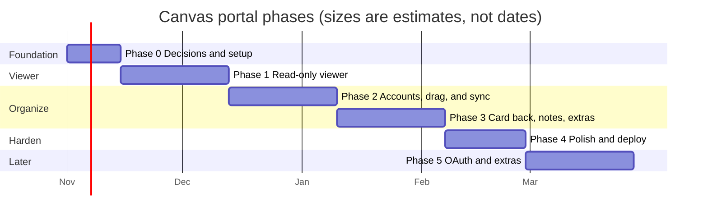

# Roadmap

**Status:** Draft · **Owner:** Team Lead · **Last updated:** 2026-10-25

## 1. Project goals

| ID | Goal |
|----|------|
| G-1 | **One place for everything due.** A student sees what they have due across all their Canvas courses, and what they're doing about it. |
| G-2 | **Read only toward Canvas.** The portal never changes anything in Canvas. Board layout and notes belong to the student and live in the portal. |
| G-3 | **Feels like Trello.** The board looks and behaves as much like [Trello](https://trello.com) as we can: lists side by side, cards you drag, a card that opens into a detailed view, colored labels, due date badges, and Trello's keyboard habits. Someone who uses Trello should feel at home without instructions. |
| G-4 | **Follows the student everywhere.** Signing in on any device or browser shows the same board and notes. |
| G-5 | **Private and safe.** Canvas tokens and notes are protected and never shared. |

G-3 shapes most of the screen and interaction design. It means copying
Trello's *patterns* (layout, behaviors, shortcuts), not its name, logo, icons,
or artwork; see constraint C-4 in the [requirements](02-requirements.md).

## 2. Phases at a glance

The bars show order and rough size. There are no fixed dates; a phase is done
when its exit criteria are met.

## 3. Phases in detail

### Phase 0: Decisions and setup

Settle the open decisions in section 5 and set up the empty project so later
phases only add features.

- Write the design document and Phase 1 wireframes, then choose the frontend
  framework (D-1). D-1 is deliberately decided after the design, because the
  features we focus on may change which framework fits best.
- Create a `canvas-portal/` folder in this repo with a `frontend/` and a
  `backend/` part, each with a "hello" page or endpoint.
- Create a Google Cloud project and OAuth client for Sign in with Google
  (D-7), with the Team Lead's Google account as a test user.
- Add GitHub Actions CI that builds both parts and runs their (empty) test
  suites on every pull request.
- Confirm the Team Lead's school allows personal access tokens (risk R-1). Done:
  the Team Lead has a student token and a parent (observer) token for testing.

**Exit criteria:** design and Phase 1 wireframes reviewed; decisions D-1, D-4,
D-5, and D-6 recorded; CI is green on an empty app;
a test Canvas account works with a token.

### Phase 1: Read-only viewer (minimum viable product)

The smallest thing that is useful: connect, then see everything that's due.

- Connect screen: paste a Canvas URL and personal access token (FR-1 to FR-5).
- Backend calls Canvas for active courses and their assignments (FR-10 to
  FR-14), handling Canvas's paging and rate limits.
- A read-only board: every assignment is a Trello-style card in the Backlog
  list, sorted by due date, with the course show/hide buttons and filters by
  course and status (FR-20 to FR-24, FR-26, FR-60, FR-65, FR-78). Moving
  cards between lists comes in Phase 2, once accounts can save it.
- Each assignment links back to its Canvas page (FR-26).
- Clear error messages for a bad token, an expired token, or Canvas being
  unreachable (FR-6, NFR-20).
- Measure how long a full Canvas load takes with the Team Lead's real
  student account (TP-14). If it misses NFR-2, apply the fixes in the
  design's [Making Canvas loads fast](03-design.md#making-canvas-loads-fast-nfr-1-nfr-2-r-3)
  before Phase 2, so sync work isn't built on a slow foundation.

**Exit criteria:** the Team Lead can connect a real account and see the same
assignments Canvas shows, verified by the Phase 1 test procedures, and the
TP-14 timings meet NFR-1 and NFR-2.

### Phase 2: Accounts, dragging, and sync

This phase does one thing: the student can drag cards between lists, and
that is saved and kept in sync on every device they use. Board layout is
stored on the server (D-2), so it needs portal accounts first. Keeping
devices in sync is the hardest part of the phase and gets the most testing.

- Portal sign-in with Google, so the server knows whose board is whose
  (FR-50, D-7).
- The user's Canvas connection is saved on the server with their account, so
  signing in on a new device doesn't require pasting the token again (FR-5,
  NFR-11).
- All four lists side by side, scrolling sideways: *Backlog*, *To do*,
  *In progress*, *Done* (FR-31, FR-60, FR-61).
- Drag cards between lists with Trello's drag feel, with a keyboard
  alternative; cards keep their due date order (FR-32, FR-38, FR-77, NFR-3,
  NFR-31).
- The layout is saved on the server and restored on any device (FR-33,
  FR-51).
- Sync: a move made on one device appears on the user's other open devices
  within 30 seconds, and no card is ever lost or duplicated (NFR-22, D-8).
- Canvas merge: new assignments land in *Backlog*, cards are matched by
  Canvas ID, and they move only when the student drags them (FR-34, FR-35).

**Exit criteria:** TP-06 passes in full: layout survives reloads and Canvas
refreshes, two devices open at the same time stay in step, moving the same
card on both settles on one list everywhere, and a dropped connection never
leaves a device showing a move the server doesn't have. The concurrency tests
for NFR-22 pass, and the drag steps of the Trello comparison review (TP-13)
pass.

### Phase 3: Card back, notes, and board extras

Everything on the board besides dragging.

- Clicking a card opens its "card back" in a dialog over the board, with its
  own link, showing the assignment's Canvas description read only (FR-28,
  FR-67, FR-68).
- Course label colors and the notes count on card fronts (FR-65, FR-66).
- The course show/hide choice is saved with the account and follows the
  student between devices (FR-78).
- Trello-style filter menu and keyboard shortcuts (FR-72, FR-73).
- Archive and restore cards, as in Trello (FR-74).
- Add dated notes to any assignment, like the comments on a Trello card, and
  edit or delete each one (FR-40 to FR-42). Notes are not the *Description*,
  which comes from Canvas and is read only. A card with notes shows how many
  (FR-43).
- Notes are never sent to Canvas (FR-44, NFR-12).

**Exit criteria:** notes survive reloads and Canvas refreshes and appear on a
second device; a network capture shows no note text going to Canvas; the
full Trello comparison review (TP-13) passes.

### Phase 4: Polish and deploy

- Export notes and board as a file (FR-53); delete my data (FR-54).
- Accessibility and mobile layout pass (NFR-30 to NFR-33).
- Deploy to the chosen host (D-3) and link it from the repo's landing page.

**Exit criteria:** the deployed app works from a laptop and a phone;
accessibility checks pass.

### Phase 5: Later ideas (not committed)

- "Log in with Canvas" (OAuth 2) instead of pasting a token (D-4).
- Calendar view of due dates; reminders.
- Grades and submission feedback view.
- Personal cards and lists: "+ Add a card" creates a card that isn't a
  Canvas assignment, and "+ Add another list" adds lists; lists can also be
  archived (FR-71, FR-64, FR-36).
- Rename a list by clicking its title, and drag lists to reorder them
  (FR-63, FR-62).
- Quick edit menu on each card: pencil button or right-click (FR-69).
- Hide assignments, such as graded or excused ones (FR-25).
- Statuses the portal works out itself, such as *Upcoming*, *Due soon* (with a
  yellow badge), and *Overdue* (FR-27).
- Show which assignments are new or were updated in Canvas since the
  student last looked, such as with a badge (FR-79).
- Checklists inside a card, with progress such as 2/5 on the card front
  (FR-70).
- More than one board, such as one per course or term, as in Trello (FR-76).
- Board background choices and the board menu sidebar (FR-75).
- More than one school per student, such as a high school and a college
  during dual enrollment, all on one board (FR-55).
- Parent view: a parent (Canvas *observer*) token shows the courses and
  assignments of the students they observe (Q-5).

## 4. Milestones

| ID | Milestone | Phase | Shows that |
|----|-----------|-------|------------|
| M0 | Empty app builds in CI | 0 | Tooling works end to end |
| M1 | First real assignment list | 1 | Canvas connection works |
| M2 | Viewer complete | 1 | MVP usable day to day |
| M3 | Dragging saves and syncs | 2 | Core organizing feature works on every device |
| M4 | Card back and notes complete | 3 | All user-requested features exist |
| M5 | Deployed with sync | 4 | Usable from any device |

## 5. Open decisions

These need the Team Lead's call. Each has a recommendation, but nothing is settled.

| ID | Decision | Options | Recommendation | Needed by |
|----|----------|---------|----------------|-----------|
| D-1 | Frontend framework | **React** (largest ecosystem, most tutorials, mature drag-and-drop libraries such as dnd-kit) or **Svelte** (less code, closer to QML's declarative feel, smaller community) | **Postponed** by the Team Lead (2026-10-25) until requirements and design are further along, since the features may change which fits best. Leaning React for learning resources and drag-and-drop support. | End of Phase 0 design |
| D-2 | Where notes and board layout are stored | **Browser local storage** (no accounts, works offline, but tied to one browser and lost if site data is cleared) or **server database** (follows the user between devices, but needs portal sign-in and more security work) | **Decided** (Team Lead, 2026-10-25): server database. The user should be able to sign in from anywhere and see their saved state. | Done |
| D-3 | Hosting | Frontend on **GitHub Pages**. Backend on **Render**, **Fly.io**, or **Vercel** serverless functions. All have free or cheap tiers with limits. | Decide in Phase 4; run locally until then. | Phase 4 |
| D-4 | How users connect to Canvas | **Personal access token** (works today, no school involvement, user must create and paste it) or **OAuth** (smooth sign-in, needs a developer key from the school's Canvas admin) | Token first; OAuth in Phase 5 if a school will issue a key. | Phase 0 |
| D-5 | Who the app is for | Just the Team Lead, a few friends, or any student at any school | Design for any school (the Canvas URL is a setting), test with one. | Phase 0 |
| D-6 | Backend language | **Python + FastAPI** (readable, quick to write, good for learning) or **Node.js** (same language as the frontend) | Python + FastAPI. | Phase 0 |
| D-7 | How users sign in to the portal | **Sign in with Google**, **email magic link**, **username and password**, or a **hosted auth service** (see [design](03-design.md#5-signing-in-to-the-portal-d-7)) | **Decided** (Team Lead, 2026-10-25): Sign in with Google for the MVP. | Done |
| D-8 | How other open devices learn about a move (NFR-22) | **Polling** (each device asks "anything new?" every 30 seconds and when its window comes back into focus; simple, works on any host) or **live push** (the server tells devices instantly over a WebSocket or server-sent events; faster, but more to build and host) | Polling for Phase 2; live push only if 30 seconds feels slow in practice. See [design](03-design.md#keeping-devices-in-sync-nfr-22-d-8). | Start of Phase 2 |

## 6. Risks

| ID | Risk | Effect | Mitigation |
|----|------|--------|------------|
| R-1 | The school has turned off personal access tokens | Phase 1 can't connect | Check early (Phase 0). Fallback: a free Canvas account from Instructure for testing; OAuth with the school later. |
| R-2 | Canvas tokens are powerful; a leak exposes a student's whole account | Privacy harm | Backend never logs tokens, stores them encrypted or not at all, and only uses read endpoints (NFR-10, NFR-11). |
| R-3 | Canvas is slow: in the Team Lead's experience a full load of courses, each with 100+ assignments, can take several minutes, and rate limits slow it further | Students wait or give up | Never make the student wait on Canvas: show cached data and refresh in the background. Measure early with a real account (TP-14, Phase 1), then fetch less, in fewer requests, and switch to Canvas GraphQL if needed (see design, *Making Canvas loads fast*). |
| R-4 | Assignments change in Canvas (renamed, deleted, new due date) | Board shows stale or orphaned cards | Match cards by Canvas assignment ID, not name; keep notes on deleted assignments in an "Archived" area (FR-35, FR-45). |
| R-5 | Learning web development alongside building | Slower progress | Small phases, one new technology at a time, docs explain terms. |
| R-6 | A school-managed Google account blocks sign-in to outside apps | Student can't sign in | Allow any Google account, so a personal one works; explain this on the sign-in screen. |
| R-7 | Matching Trello too closely in look (logo, artwork, exact styling) | Trademark or copyright complaint | Copy behavior and layout patterns only; our own name, colors, and icons (C-4). |
| R-8 | Sync bugs: two devices or two browser tabs disagree, or a card is lost or duplicated | Student stops trusting the board | Phase 2 is only dragging and sync; one row per card enforced by the database; concurrency tests in CI and the TP-06 sync procedure (NFR-22). |

## Change log

| Date | Change |
|------|--------|
| 2026-10-25 | First draft. |
| 2026-10-25 | D-1 postponed; D-2 decided (server storage), so accounts move into Phase 2 and Phase 4 becomes polish and deploy. R-1 cleared with student and parent test tokens. Parent view added to Phase 5. |
| 2026-10-25 | D-7 decided: Sign in with Google for the MVP. Added Google setup to Phase 0 and risk R-6. |
| 2026-10-25 | Section 1 becomes Project goals, adding G-3 (feels like Trello). Phases 2 and 3 take on Trello-style board, card back, quick edit, checklists, and personal cards. Added risk R-7. |
| 2026-10-25 | Phase 2 adds course show/hide buttons (FR-78), from the Team Lead's review. |
| 2026-10-25 | Dropped the "Move to Done?" hint (FR-37) from Phase 2. |
| 2026-10-25 | Checklists (FR-70) moved from Phase 3 to Phase 5. |
| 2026-10-25 | Adding cards and lists, and archiving lists, moved to Phase 5 as future features (Q-6 answered). |
| 2026-10-25 | Phase 2 adds FR-38: cards always sorted by due date within each list. |
| 2026-10-25 | Quick edit menu (FR-69) moved from Phase 3 to Phase 5. |
| 2026-10-25 | Phase 2 board gains a Backlog list before To do for new Canvas assignments. |
| 2026-10-25 | Added FR-79 (new and updated assignment indicators) to Phase 5. |
| 2026-10-25 | Added FR-27 (Due soon status) to Phase 5. |
| 2026-10-25 | FR-27 in Phase 5 now covers all computed statuses (Upcoming, Due soon, Overdue). |
| 2026-10-25 | Hiding assignments (FR-25) moved from Phase 1 to Phase 5. |
| 2026-10-25 | Phase 3 notes are dated, comment-style entries, separate from the read-only Canvas description (FR-28). |
| 2026-10-25 | Renaming and reordering lists (FR-62, FR-63) moved from Phase 2 to Phase 5. |
| 2026-10-25 | Added more than one school per student (FR-55) to Phase 5. |
| 2026-10-25 | Table view removed; Phase 1 shows a read-only board with every card in Backlog, from the Team Lead's review. |
| 2026-10-25 | Phase 2 narrowed to accounts, dragging between lists, and sync, from the Team Lead's review; everything else moved to Phase 3. Added D-8 (how devices learn about changes) and R-8 (sync bugs). |
| 2026-10-25 | R-3 widened to slow Canvas loads, from the Team Lead's experience; Phase 1 now measures load times (TP-14) and fixes them before Phase 2. |
