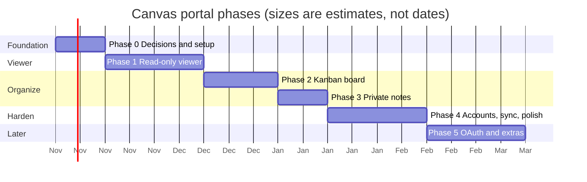

# Roadmap

**Status:** Draft · **Owner:** Bridget · **Last updated:** 2026-10-25

## 1. Goal

Give a student one page that answers "what do I have due, and what am I doing
about it?" across all their Canvas courses, without changing anything in
Canvas itself. The portal only *reads* from Canvas. Board layout and notes
belong to the student and live in the portal.

## 2. Phases at a glance

The bars show order and rough size. There are no fixed dates; a phase is done
when its exit criteria are met.

## 3. Phases in detail

### Phase 0: Decisions and setup

Settle the open decisions in section 5 and set up the empty project so later
phases only add features.

- Choose the frontend framework (D-1) and where notes are stored (D-2).
- Create a `canvas-portal/` folder in this repo with a `frontend/` and a
  `backend/` part, each with a "hello" page or endpoint.
- Add GitHub Actions CI that builds both parts and runs their (empty) test
  suites on every pull request.
- Confirm Bridget's school allows personal access tokens (risk R-1), and get a
  test token or a free Canvas account for testing.
- Write the design document and the Phase 1 wireframes.

**Exit criteria:** decisions D-1 to D-4 recorded; CI is green on an empty app;
a test Canvas account works with a token.

### Phase 1: Read-only viewer (minimum viable product)

The smallest thing that is useful: connect, then see everything that's due.

- Connect screen: paste a Canvas URL and personal access token (FR-1 to FR-5).
- Backend calls Canvas for active courses and their assignments (FR-10 to
  FR-14), handling Canvas's paging and rate limits.
- Dashboard shows courses and an upcoming-assignments list sorted by due date,
  with filters by course and status (FR-20 to FR-25).
- Each assignment links back to its Canvas page (FR-26).
- Clear error messages for a bad token, an expired token, or Canvas being
  unreachable (FR-6, NFR-20).

**Exit criteria:** Bridget can connect a real account and see the same
assignments Canvas shows, verified by the Phase 1 test procedures.

### Phase 2: Kanban board

- Board view with columns; default columns are *To do*, *In progress*, *Done*
  (FR-30, FR-31).
- Drag cards between and within columns; keyboard alternative for dragging
  (FR-32, NFR-31).
- New assignments from Canvas land in *To do*; assignments Canvas reports as
  submitted can be suggested for *Done*; cards are matched by Canvas ID (FR-34, FR-35, FR-37).
- Board layout is saved and restored (FR-33).
- Optional: rename, add, and remove columns (FR-36).

**Exit criteria:** layout survives a page reload and a Canvas refresh without
losing or duplicating cards.

### Phase 3: Private notes

- Add, edit, and delete a note on any assignment (FR-40 to FR-42).
- Notes show as an icon on the card and in full on an assignment detail panel
  (FR-43).
- Notes are never sent to Canvas (FR-44, NFR-12).

**Exit criteria:** notes survive reloads and Canvas refreshes, and a network
capture shows no note text going to Canvas.

### Phase 4: Accounts, sync, and polish

Only needed if notes and layout should follow the student between devices
(D-2).

- Portal sign-in so the server knows whose notes are whose (FR-50).
- Move board and notes from browser storage to the server database, with a
  one-time import of existing local data (FR-51, FR-52).
- Export notes and board as a file (FR-53); delete my data (FR-54).
- Accessibility and mobile layout pass (NFR-30 to NFR-33).
- Deploy to the chosen host (D-3) and link it from the repo's landing page.

**Exit criteria:** the same board and notes appear on two different browsers;
accessibility checks pass.

### Phase 5: Later ideas (not committed)

- "Log in with Canvas" (OAuth 2) instead of pasting a token (D-4).
- Calendar view of due dates; reminders.
- Grades and submission feedback view.
- Personal tasks that aren't Canvas assignments, on the same board.

## 4. Milestones

| ID | Milestone | Phase | Shows that |
|----|-----------|-------|------------|
| M0 | Empty app builds in CI | 0 | Tooling works end to end |
| M1 | First real assignment list | 1 | Canvas connection works |
| M2 | Viewer complete | 1 | MVP usable day to day |
| M3 | Board saves layout | 2 | Core organizing feature works |
| M4 | Notes complete | 3 | All user-requested features exist |
| M5 | Deployed with sync | 4 | Usable from any device |

## 5. Open decisions

These need Bridget's call. Each has a recommendation, but nothing is settled.

| ID | Decision | Options | Recommendation | Needed by |
|----|----------|---------|----------------|-----------|
| D-1 | Frontend framework | **React** (largest ecosystem, most tutorials, mature drag-and-drop libraries such as dnd-kit) or **Svelte** (less code, closer to QML's declarative feel, smaller community) | React, mainly for learning resources and drag-and-drop support. Svelte is a fine choice if the QML-like style matters more. | Phase 0 |
| D-2 | Where notes and board layout are stored | **Browser local storage** (no accounts, works offline, but tied to one browser and lost if site data is cleared) or **server database** (follows the user between devices, but needs portal sign-in and more security work) | Start in local storage for Phases 2 and 3, move to the server in Phase 4 if multi-device matters. | Phase 2 |
| D-3 | Hosting | Frontend on **GitHub Pages**. Backend on **Render**, **Fly.io**, or **Vercel** serverless functions. All have free or cheap tiers with limits. | Decide in Phase 4; run locally until then. | Phase 4 |
| D-4 | How users connect to Canvas | **Personal access token** (works today, no school involvement, user must create and paste it) or **OAuth** (smooth sign-in, needs a developer key from the school's Canvas admin) | Token first; OAuth in Phase 5 if a school will issue a key. | Phase 0 |
| D-5 | Who the app is for | Just Bridget, a few friends, or any student at any school | Design for any school (the Canvas URL is a setting), test with one. | Phase 0 |
| D-6 | Backend language | **Python + FastAPI** (readable, quick to write, good for learning) or **Node.js** (same language as the frontend) | Python + FastAPI. | Phase 0 |

## 6. Risks

| ID | Risk | Effect | Mitigation |
|----|------|--------|------------|
| R-1 | The school has turned off personal access tokens | Phase 1 can't connect | Check early (Phase 0). Fallback: a free Canvas account from Instructure for testing; OAuth with the school later. |
| R-2 | Canvas tokens are powerful; a leak exposes a student's whole account | Privacy harm | Backend never logs tokens, stores them encrypted or not at all, and only uses read endpoints (NFR-10, NFR-11). |
| R-3 | Canvas rate limits slow down large accounts | Slow loading | Cache results, fetch courses in parallel within limits, show partial results (NFR-2). |
| R-4 | Assignments change in Canvas (renamed, deleted, new due date) | Board shows stale or orphaned cards | Match cards by Canvas assignment ID, not name; keep notes on deleted assignments in an "Archived" area (FR-35, FR-45). |
| R-5 | Learning web development alongside building | Slower progress | Small phases, one new technology at a time, docs explain terms. |

## Change log

| Date | Change |
|------|--------|
| 2026-10-25 | First draft. |
