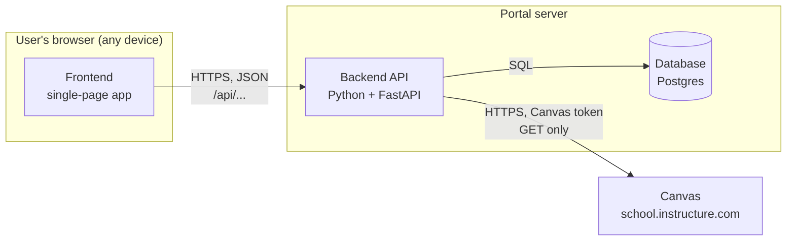
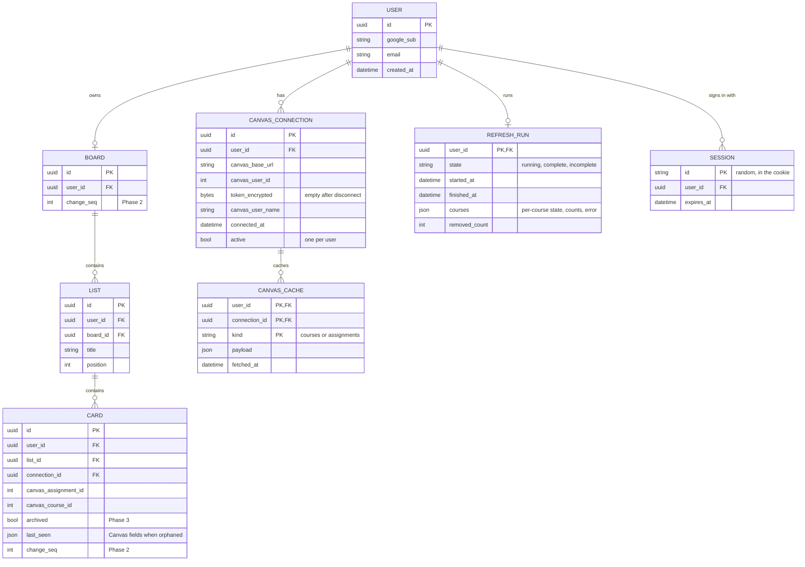
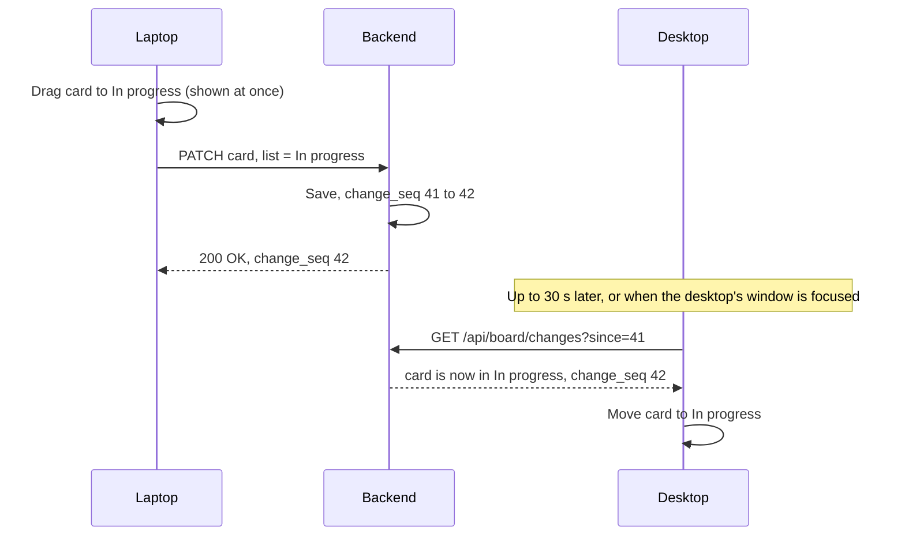
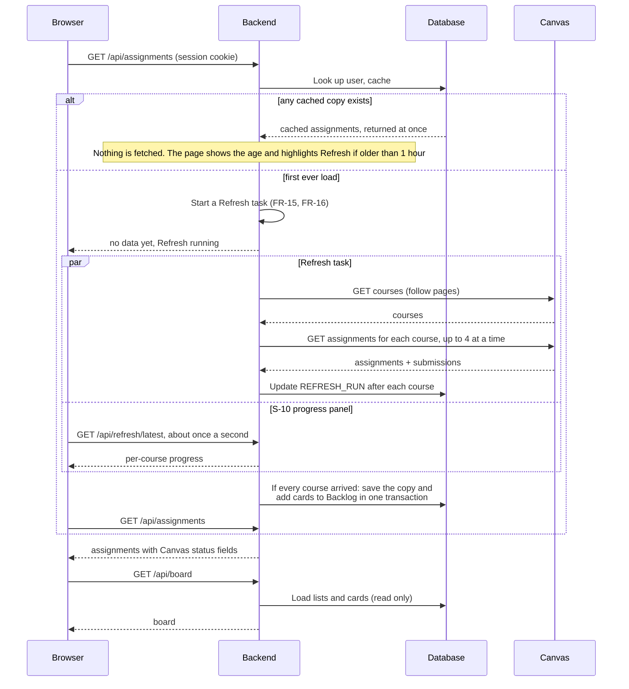
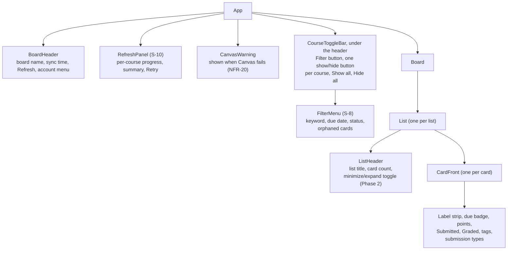

# Design

**Status:** Draft · **Owner:** Team Lead · **Last updated:** 2026-10-25

This document describes how the portal is built: its parts, the data it
stores, how those parts talk to each other, and how each part meets the
[requirements](02-requirements.md). The frontend framework (decision
D-1) was chosen after the design: React.

**Scope:** this design covers Phases 0 to 4 only. Phase 5 ideas in the
requirements and roadmap are not designed here; each gets its design when
it is moved onto the roadmap. Section 12, *Leave room for later*, lists the
few choices made now so those ideas stay possible.

### Design by phase

Build only the parts listed for the current phase (see the repo's
[CLAUDE.md](../../CLAUDE.md)). Each phase adds to the ones before it.

| Phase | Builds |
|-------|--------|
| 0 | Repository layout (section 8), empty frontend and backend, CI |
| 1 | Tables `USER`, `SESSION`, `CANVAS_CONNECTION`, `BOARD`, `LIST`, `CARD`, `CANVAS_CACHE`, `REFRESH_RUN`, without the columns marked Phase 2 or 3, and with the unique card rule; the Phase 1 endpoints in section 4; sign-in (section 5); talking to Canvas, caching, *Built from the start*, *Refresh progress*, and *Saving a complete Refresh* (section 6); security (section 7); the board with only Backlog shown, course buttons, the filter menu with its orphaned-cards option, the removed count in the Refresh summary, visual style, the Refresh progress panel, and the Phase 1 interactions (section 9) |
| 2 | Moving cards and *Keeping devices in sync* (section 4): the Phase 2 endpoints and `change_seq`; dragging, showing To do, In progress, and Done, sharing the width and scrolling sideways, and minimize and expand (section 9) |
| 3 | *Phase 3 tuning*, *Bringing the backend in step with Canvas*, and *What can change in Canvas* (section 6); `CARD.archived` |
| 4 | Deleting all of a user's data (section 4), accessibility checks, publishing the Google sign-in app (section 5), deploying (roadmap D-3) |

## 1. Architecture overview

The portal has three parts that we build, plus Canvas.



| Part | What it does | Qt comparison |
|------|--------------|---------------|
| **Frontend** | Draws every screen, handles drag and drop, and calls the backend. It is a *single-page app*: the browser loads it once, then it swaps screens itself without reloading the page. | The QML UI |
| **Backend API** | Checks who is signed in, stores and returns the board, and calls Canvas on the user's behalf. Never sends a Canvas token to the browser. | The C++ model layer, but on a server |
| **Database** | Stores accounts, encrypted Canvas tokens, board layout, and the last copy of Canvas data. | A persistent store like SQLite behind a model |
| **Canvas** | The source of courses and assignments. Read only. | An external web service |

**Why a backend at all:** browsers block the frontend from calling Canvas
directly (CORS, constraint C-1). Because the board must follow the user
to any device (D-2), we also need a server to store it. One backend covers
both.

## 2. Technology choices

| Area | Choice | Status | Why |
|------|--------|--------|-----|
| Frontend framework | React | **Decided (D-1)** | See section 10 for why |
| Frontend language | TypeScript | Decided with D-1 | JavaScript with types; catches mistakes before running, much like C++'s compiler does |
| Frontend build tool | Vite | Decided with D-1 | Fast local dev server and build for React |
| Drag and drop | Pragmatic drag and drop (Atlassian), or dnd-kit | Proposed, chosen in Phase 2 | Pragmatic drag and drop is Atlassian's open-source library behind Trello's own drag and drop and works with any framework, which suits G-3. |
| Backend | Python 3.12 + FastAPI | **Decided (D-6)** | Short, readable code; generates API docs automatically |
| Canvas client | `httpx` (Python HTTP library) | Proposed | Async requests, so courses can be fetched in parallel (NFR-2) |
| Database | Postgres in production, SQLite for local dev and tests | Proposed | Postgres is what hosts offer; SQLite needs no setup. SQLite locks the whole file on every write, so concurrency tests on SQLite say little about Postgres. How NFR-22 is tested is Product and QA's call, and CI is DevOps's |
| Database access | SQLAlchemy + Alembic | Proposed | Python models for tables; Alembic tracks schema changes over time ("migrations") |
| Portal sign-in | Sign in with Google (OAuth 2 / OpenID Connect) via the Authlib Python library | **Decided for MVP (D-7)** | No passwords to store; see section 5 |
| Sessions | Server-side `SESSION` rows, looked up by a random ID in the cookie | Proposed | Sign out and account deletion end the session at once, which a self-contained signed cookie can't do |
| Token encryption | Fernet, from the `cryptography` Python library | Proposed; needs the Team Lead (new dependency, token storage) | Authenticated encryption in one call; `MultiFernet` lets the key be replaced later without losing stored tokens |
| Background Refresh | An `asyncio` task inside the one server process | Proposed | Nothing extra to build; it needs a host that keeps one server process running, which DevOps weighs when choosing the host (roadmap D-3) |
| Hosting | See roadmap D-3 | Open | |

## 3. Data model

The database stores only what the portal owns. Course and assignment details
come from Canvas and are cached, not copied permanently.



Design notes:

- **Trello's structure:** a board holds lists, lists hold cards (goal G-3).
  Each user has one board, which holds the `change_seq` counter used for
  sync from Phase 2.
- **Fields are added with their phase.** Columns marked with a phase in the
  diagram are added by a migration when that phase starts, not before.
- **Cards key on `canvas_assignment_id`**, never the assignment name,
  so a renamed or rescheduled assignment keeps its card (FR-35).
- **Cards have no stored position.** Within a list they are always sorted by
  due date, earliest first, then by name, with no-due-date cards last
  (FR-38). The order is worked out each time the board loads, so a due date
  changed in Canvas moves the card automatically. Moving a card only changes
  its `list_id` and, from Phase 2, the board's `change_seq`, a small update
  (NFR-3).
- **Lists are fixed:** the board and its four lists (FR-31) are created
  when the user first signs in, and `position` holds their order, 1 to 4.
  In Phase 1, when nothing can be moved, the frontend shows only Backlog.
  The other three rows already exist, so Phase 2 shows them with no
  migration.
- **One active school per user.** A user has at most one *active*
  `CANVAS_CONNECTION`, and the board shows only the active connection's
  cards and cached data. Each of those records its
  `connection_id` (see section 12).
- **Disconnecting keeps the connection row.** Disconnect (FR-4) empties
  `token_encrypted` but keeps the row, so cards and cached data keep pointing at it and the board survives (FR-6). Reconnecting with
  the same Canvas address and Canvas user (`canvas_user_id`, from
  `/api/v1/users/self`) puts the new token in the same row.
- **Connecting a different account keeps the old one's cards (Q-8).** When
  the student connects a different Canvas address or Canvas user, the old
  row is made inactive and its token emptied, and a new active row is
  added. The old cards and cache stay in the database, hidden.
  Reconnecting the old account later makes its row active again, and its
  cards come back in the lists they were in. Deleting the account (FR-54)
  removes every connection row and everything under it.
- **One card per assignment, enforced by the database (FR-35):** a unique
  rule on (`connection_id`, `canvas_assignment_id`) means a card can never be added
  twice for one assignment, even if two saves race (NFR-22). It costs nothing
  to add with the first migration in Phase 1, when cards are first created.
- **`change_seq`** is a counter on the board that goes up by one with every
  change, and each card records the value from its last change. It lets a
  device ask "what changed since number 41?" (see *Keeping devices in sync*).
- **No course colors until Phase 5.** Every card's label strip and every
  course button uses the same neutral color (FR-66 is Phase 5), so Phases 1
  to 4 store no color. Which courses the course buttons
  hide (FR-78) is kept in the browser, not the database, until Phase 5. The
  course buttons are the only way to choose courses; the filter menu has no
  course list (FR-72).
- **Orphaned cards keep what they were (Phase 1).** When a complete
  Refresh no longer has a card's assignment, the new Canvas copy can't say
  what the card was. So the Refresh copies the fields the card front shows
  (name, course, due date, points, status) into `last_seen` first, and
  clears it if the assignment comes back. A card with `last_seen` set is
  *orphaned*. Orphaned cards are hidden by default, and the student can show
  them from the filter menu (FR-45).
- **Archived, not deleted (Phase 3):** Phase 3 also marks an orphaned card
  `archived` (FR-45), with the course and change rules in section 6.
- **Every row has `user_id`**, and every query filters by the signed-in user,
  so one user can never read another's data (NFR-12).

## 4. Backend API

The frontend talks to the backend through these endpoints. All return JSON
and require a signed-in session except where noted.

| Method and path | Purpose | Requirements | Phase |
|-----------------|---------|--------------|-------|
| `GET /api/health` | Answers `{"status": "ok"}` so CI and the host can check the server is up (no session needed) | NFR-40 | 0 |
| `GET /api/auth/google/login` | Send the browser to Google's sign-in page (no session needed) | FR-50 | 1 |
| `GET /api/auth/google/callback` | Google sends the user back here; backend checks the result, finds or creates the user (and, for a new user, their board and four lists), sets the session cookie (no session needed) | FR-50, FR-31 | 1 |
| `POST /api/auth/logout` | Sign out and clear the session | FR-50 | 1 |
| `GET /api/me` | Current user and whether Canvas is connected | FR-2, FR-5 | 1 |
| `PUT /api/canvas/connection` | Save Canvas URL and token, encrypted; backend verifies with Canvas first | FR-1, FR-2, FR-5, NFR-11 | 1 |
| `DELETE /api/canvas/connection` | Disconnect: delete the stored token, keep the board (section 3) | FR-4 | 1 |
| `GET /api/courses` | Active courses, from the last complete copy | FR-10, FR-14, FR-20 | 1 |
| `GET /api/assignments` | All assignments across active courses, from the last complete copy, with Canvas status fields, the Canvas link, and when they were fetched; on the very first load it starts a Refresh instead | FR-11, FR-14, FR-15, FR-21 to FR-23, FR-26 | 1 |
| `POST /api/refresh` | Start a Refresh in the background, or join the one already running; returns at once | FR-13, FR-15, FR-16 | 1 |
| `GET /api/refresh/latest` | Progress of the running Refresh, or the log of the last one | FR-16 | 1 |
| `GET /api/board` | Lists and cards, cards sorted by due date. Read only: cards are added when a Refresh is saved (section 6). Orphaned cards are included, flagged `orphaned` and shown from `last_seen`, so the frontend can show or hide them without another request | FR-31, FR-34, FR-38, FR-45, FR-65 | 1 |
| `PATCH /api/board/cards/{id}` | Move to another list; returns the new `change_seq` | FR-32, FR-33, NFR-22 | 2 |
| `GET /api/board/changes?since={seq}` | Cards changed since that `change_seq`, and the current value | NFR-22 | 2 |
| `DELETE /api/me` | Delete the account and all its data from the live database at once; backups age out (section 7) | FR-54 | 4 |

The backend only ever sends filtered, portal-shaped data to the frontend. It
does not pass Canvas responses straight through, and it never includes the
token.

**Dates** are sent as Canvas gives them, in UTC (ISO 8601), and every
comparison is made in UTC (FR-22): sorting by due date (backend and
frontend), the due badge, the "Opens …" and "Closed …" lines, and the due
date filters. In the browser that means comparing parsed instants such as
`Date.parse(due_at)` with `Date.now()`, never formatted local strings.
Only display uses the device's time zone, so the backend needs no time
zone setting. Each assignment carries `due_at`, `unlock_at`, and
`lock_at`. The frontend checks `unlock_at` and `lock_at` against the
current time, so a card turns from "Opens …" to open, or to "Closed …",
without a Refresh (FR-22, FR-65).

**Errors** all have one shape, `{"error": "<code>", "message": "<text>"}`,
so the frontend can choose a screen by code without reading the text:

| Code | HTTP status | Frontend shows (screens from the UI specification) |
|------|-------------|----------------|
| `not_signed_in` | 401 | S-1 Sign in |
| `canvas_not_connected` | 409 | S-2 Connect Canvas |
| `canvas_token_rejected` | 409 | S-2 with the reconnect message (FR-6) |
| `canvas_unreachable` | 502 | The warning banner with the last data (NFR-20) |
| `canvas_address_invalid` | 400 | "Couldn't reach that Canvas address" on S-2 (W-1) |
| `not_found` | 404 | Nothing; also what another user's IDs return (NFR-12) |

### Keeping devices in sync (NFR-22, D-8)

A student may have the board open on a laptop and a desktop computer, or
in two browser tabs, at once. The server's copy is the only real one; each device shows a copy and keeps it
up to date.

- **Saving a move:** the device moves the card on screen at once (an
  optimistic update, W-3) and sends `PATCH /api/board/cards/{id}`. The server
  saves it in one database transaction, raises the board's `change_seq`, and
  stamps the card with it. If the save fails, the card goes back.
- **Seeing other devices' moves (polling, D-8):** every 30 seconds, and
  whenever the window comes back into focus, the device calls
  `GET /api/board/changes?since=41` with the last number it knows. The server
  returns the cards changed since then, and the device moves them. A device
  that was asleep or offline catches up the same way.
- **Seeing a Refresh from another device:** the changes answer also carries
  the time of the last complete Refresh. When it is newer than the one the
  device shows, the device reloads assignments and the board, so new cards
  and changed due dates or badges appear too, not only moves. A Refresh
  stamps every card it adds (and, from Phase 3, archives) with a new
  `change_seq`.
- **Two moves of the same card:** the last save to reach the server wins.
  The other device sees the winning list on its next check, so every device
  ends up the same. For one person's board this is simpler than asking which
  move to keep.
- **Drag in progress:** a change that arrives while the student is dragging
  waits until the drop, so cards never jump under the pointer.
- **Refresh on two devices:** only one Refresh runs at a time per student
  (section 6), and the unique rule in section 3 means a card is never added
  twice.



### Assignment status

The card's status follows the rules in FR-23, from the Team Lead's review.
The backend reads these Canvas fields (the assignment's own fields, and its
`submission`, from `include[]=submission`) and works out two values, then
sends the frontend only the results:

| Shown on the card | Rule | Canvas fields |
|-------------------|------|---------------|
| *Submitted* or *Not submitted* | Submitted when `submission.submitted_at` has a date. Canvas's `has_submitted_submissions` is not used: it is not the same check | `submission.submitted_at` |
| *Graded* or *Not graded* | Graded only when all four hold: a submission exists, `graded_submissions_exist` is true, `submission.grade_matches_current_submission` is true, and `submission.graded_at` has a date | `graded_submissions_exist` (on the assignment), `submission.grade_matches_current_submission`, `submission.graded_at` |
| *Missing* | `submission.missing` is true. The card is highlighted so it stands out; the UI specification decides how | `submission.missing` |
| *Late* tag | Shown when the field is true | `submission.late` |
| *Excused* (Phase 5) | Shown as its own label when the field is true | `submission.excused` |
| Submission types | Every entry, in Canvas's order, such as "online upload, on paper" | `submission_types` (on the assignment) |
| "Opens …" or "Closed …" | Before `unlock_at`, the card is grayed out and says when it opens. After `lock_at`, it says when it closed. Worked out by the frontend against the current time, in UTC, since it changes with time, not with Canvas | `unlock_at`, `lock_at` (on the assignment, the student's own dates) |

With no submission at all, the card shows *Not submitted* and *Not graded*.
These replace Canvas's `workflow_state`, which the portal no longer reads,
so *Pending review* does not appear. The two worked-out values are rules on
Canvas fields only; statuses that compare with the clock, such as *Due
soon*, stay Phase 5 (FR-27). The rules live in one backend function with a
unit test per row, so a Canvas quirk is fixed in one place.

## 5. Signing in to the portal (D-7)

**Decision (Team Lead, 2026-10-25):** Sign in with Google for the MVP. The
other options stay listed for later.

Because data follows the user between devices, the portal needs its own
accounts, separate from Canvas. Options considered:

| Option | How it works | Pros | Cons |
|--------|--------------|------|------|
| **Sign in with Google (or GitHub)** | User clicks a button, signs in on Google, Google tells us their email | No passwords to store; familiar | Needs a Google developer app (free); student must have a Google account |
| **Email magic link** | User types email, gets a one-time sign-in link | No passwords; works with any email | Needs an email sending service |
| **Username and password** | Classic form | No outside services | We must store passwords safely and build reset flows |
| **Hosted auth service** (Auth0, Clerk, Supabase Auth) | A service handles all of the above | Least code, several options at once | Another account and dependency; free tiers have limits |

### How Sign in with Google works


- The backend asks Google only for the `openid email profile` scopes: who the
  user is, nothing from their Google Drive or Gmail.
- Users are matched by Google's stable user ID (the `sub` value), not by
  email, since an email address can change. The `USER` table's
  `google_sub` column holds it.
- The Google *client ID* and *client secret* come from a free Google Cloud
  project. The secret lives only in the server's environment settings, never
  in the repo. Setting this up is a Phase 1 prerequisite.
- While the Google app is in "testing" mode, only Google accounts added as
  test users can sign in. That suits development. Publishing it, so any
  student can sign in (D-5), is a short Google review and part of Phase 4.
- Some school-managed Google accounts block sign-in to outside apps. Students
  can use a personal Google account instead; risk R-6 in the roadmap.

After sign-in, the backend sets a **session cookie**: a small value the browser
sends back automatically with each request so the backend knows who is
asking. The cookie holds only a random session ID; the `SESSION` row says
whose it is. A session lasts 30 days. Signing out deletes the row, and
deleting the account deletes all of the user's sessions. The cookie is `HttpOnly` (page scripts can't read it), `Secure` (HTTPS
only), and `SameSite=Lax` (the browser leaves it off requests that other
sites start, except a plain link to the portal). Because a link can still
carry it, no `GET` endpoint changes the board or the account. The one
exception is the first-load Refresh that `GET /api/assignments` starts,
which runs only when the student has no data yet (FR-15).

## 6. Talking to Canvas

### Endpoints used (all `GET`, NFR-13)

| Purpose | Canvas endpoint |
|---------|-----------------|
| Verify token, get name | `/api/v1/users/self` |
| Active courses | `/api/v1/courses?enrollment_state=active&per_page=100` |
| Assignments with submission status | `/api/v1/courses/:id/assignments?include[]=submission&per_page=100` |

### Paging, rate limits, and caching

- **Paging (FR-12):** Canvas returns a `Link` header with a `rel="next"` URL
  when more results exist. The client keeps following it until there is none.
- **Rate limits (C-2):** Canvas reports remaining budget in the
  `X-Rate-Limit-Remaining` header and answers `403` with "Rate Limit Exceeded"
  when it runs out. The client fetches at most 4 courses at once, fewer when
  the remaining budget runs low, and waits and retries with increasing delays
  when limited. After 5 tries a course fails with "Canvas rate limit", so a
  Refresh always ends.
- **Last complete copy (FR-14):** results are stored in `CANVAS_CACHE`. A
  page load always gets that copy at once and never fetches from Canvas,
  except on the very first load when there is no copy yet (FR-15). Only
  *Refresh* fetches. If Canvas fails, the last copy stays, with a warning
  flag (NFR-20).

### Making Canvas loads fast (NFR-1, NFR-2, R-3)

In the Team Lead's experience, loading every course with 100+ assignments
each can take several minutes. The plan has two layers: things built from
the start, and Phase 3 tuning that starts from the Phase 1 timings
(TP-14).

**Built from the start**

- **Never wait on Canvas.** If there is any saved data, `GET /api/assignments`
  returns it at once, with the time it was fetched. Only the first ever
  load waits for Canvas, with the progress panel open (FR-16).
- **Refresh only when asked (FR-15).** The portal never starts a fetch on
  its own. The header always shows the time of the last complete Refresh
  ("Synced Oct 25, 10:42 AM", FR-13). When that is more than an hour ago,
  the frontend also highlights the Refresh button. While a Refresh runs, the
  board stays usable, the button shows progress, and the page checks back
  until it finishes.
- **Show progress as courses arrive.** The progress panel (S-10) fills in
  course by course (FR-16, NFR-2). The board itself changes once, when the
  whole Refresh is saved, because only a complete copy replaces the last
  one (FR-14).
- **Fewer, larger requests.** `per_page=100` on every list, and up to 4
  courses fetched at once (see *Paging, rate limits, and caching*).
- **Skip what isn't needed.** Only active courses are fetched; concluded
  courses never are.
- **Measure every call.** The backend logs each Canvas request's endpoint
  (without the token, NFR-10), page count, and time taken, so slow spots show
  up in numbers, not guesses. The same logs, plus how long `GET /api/board`
  takes, give the Phase 1 TP-14 baseline that NFR-1 (Phase 2) is set
  against.

**Phase 3 tuning**, starting from the TP-14 baseline, in this order:

1. **Leave descriptions out.** Descriptions are often the largest part of
   each assignment, and nothing in Phases 1 to 4 shows them, so the load
   skips them.
2. **Planner API** (`/api/v1/planner/items`), which lists due items across
   all courses in one paged `GET` list. It has fewer fields, so before
   using it, check that it carries every field the FR-23 rules need; if not,
   it can only narrow which courses to fetch in full.

Canvas GraphQL was considered and left out: its reads are sent with
`POST`, and the portal stays `GET` only (NFR-13, C-3). The Team Lead
answered Q-10: it may come back as a Phase 5 idea (section 12).

Fetching the courses with the nearest due dates first was considered and
left out: only a complete Refresh replaces the data (FR-14), so the order
courses arrive in changes nothing the student sees on the board.

### Refresh progress (FR-16)

A Refresh can take minutes, so it runs as a background task inside the
server process and reports as it goes. The host must keep that process
running between requests (roadmap D-3).

- `POST /api/refresh` starts the task and returns at once.
- **One Refresh at a time per student.** If a Refresh is already running,
  for example one started from another device, `POST /api/refresh` returns
  that one instead of starting another. The check is one conditional update
  of the student's `REFRESH_RUN` row ("set to running unless it already
  is"), so it holds even if two requests arrive together.
- The task keeps one `REFRESH_RUN` row per student up to date: the overall
  state, and for each course its state (not started, fetching with page
  number, waiting on a rate limit, done, failed), assignment and page
  counts, time taken, and any error. Only the latest run is kept.
- While a Refresh runs, the frontend asks `GET /api/refresh/latest` about
  once a second and draws S-10 from the answer.
- A request that takes longer than 30 seconds counts as timed out, and a
  failed course is reported with Canvas's error message or "timed out".
  Error text is passed through the same filter as logs, so it never holds
  the token (NFR-10).
- If any course failed, the run ends *incomplete* and the saved data is not
  replaced (FR-14); the student can retry. On the very first load there is
  no saved data, so the board shows no cards yet and S-10 offers Retry.
- **Token problems (FR-6):** if Canvas answers `401`, the Refresh stops at
  once, the run ends incomplete, and the frontend shows S-2 with the
  reconnect message. The board and saved data are kept.
- **A server restart mid-Refresh:** when the server starts, any run still
  marked *running* is marked *incomplete* ("interrupted"), so the student is
  never stuck waiting on a Refresh that no longer exists.
- **One backend instance.** The portal runs as a single backend process.
  All Refresh state is already in the database (`REFRESH_RUN`), so any
  request can join or report on a run, but the task itself lives in that one
  process, and the restart rule above assumes no other process is running a
  Refresh. Running more than one instance later would need a heartbeat on
  `REFRESH_RUN` instead of the restart rule. That is a design change, not a
  hosting setting.

### Saving a complete Refresh (FR-14, FR-34)

When every course and every page has arrived, the Refresh saves it in one
database transaction:

1. Replace the `CANVAS_CACHE` copy with the new data, with its time.
2. Add a card in Backlog for every assignment that has no card yet (FR-34).
   On the first Refresh that is every assignment. The unique rule in section
   3 means a card is never added twice.
3. Fill `last_seen` on each card whose assignment is gone, and clear it on
   each card whose assignment is back (section 3, FR-45). The run
   records how many cards became orphaned, for the summary (FR-16).
4. Mark the run *complete*. The header's "Synced" time comes from it (FR-13).

Loading the board never adds or changes cards; it only reads. An orphaned
card is kept in the database, never deleted. It is hidden by default, and
the student can show it (FR-45). Phase 3 adds comparing
and archiving to this same step (below).

### Bringing the backend in step with Canvas (Phase 3)

Canvas can't tell the portal when something changes, so each Refresh does
the checking (FR-15). Phase 1 already gives each Refresh the pieces this
builds on: one Refresh at a time, rate limit back-off, and saving only a
complete copy. Phase 3 adds:

- **Find what changed:** the Refresh compares the new data with the last
  complete copy, by Canvas ID, field by field (see *What can change in
  Canvas* below).
- **Only a complete fetch counts:** a timeout, a rate-limit stop, or an
  error halfway leaves the previous copy in place, so a missing page can
  never look like deleted assignments (FR-45).
- **Apply it to the board** in the same transaction as *Saving a complete
  Refresh*: new assignments get a card in Backlog (FR-34), removed ones are
  marked archived (FR-45), and the rest only update what the card shows
  (FR-35, FR-39). Every card added or archived gets a new `change_seq`, so
  the student's open devices pick the changes up on their next check
  (NFR-22).
- **Tested under load:** TP-14 and TP-15 check that a Refresh stays within
  the rate limit and that a second device's Refresh joins the running one.

**There is no background sync.** Refresh is the only thing that fetches
from Canvas, so there is no scheduler or always-running worker to build and
host, and the stored token is only used while the student is there and
asking.

### What can change in Canvas (Phase 3, FR-39, FR-45)

Each case below has one planned result. The card's list is the student's
choice, so no Canvas change ever moves a card to another list.

| In Canvas | On the board | Requirements |
|-----------|--------------|--------------|
| Teacher creates an assignment | New card in Backlog, in its due date place | FR-34 |
| Teacher deletes or unpublishes it | Card is orphaned (Phase 1) and marked archived (Phase 3). It is hidden unless the student shows orphaned cards; then it stays in its list, grayed out and marked as removed from Canvas | FR-45 |
| It is republished, or reappears after a fetch problem | Card comes back in its old list | FR-45 |
| Name or points change | Card shows the new value | FR-35, FR-39 |
| Description changes | Nothing to show until the card back (Phase 5, FR-28) | FR-39 |
| Due date added later (none on an earlier refresh) | Card moves from the end of its list to its due date place | FR-38, FR-39 |
| Due date changed | Card moves to its new place in the same list | FR-38 |
| Due date cleared | Card moves to the end of its list, shown with no due date | FR-38, FR-39 |
| Submission state moves forward (submitted, graded) | Badge updates; card stays put | FR-23, FR-39 |
| State goes backward (resubmission, grade removed) or a flag is cleared (no longer late, missing, or excused) | Badge shows the current Canvas value; nothing is kept from before | FR-23, FR-39 |
| Student's own due date differs from the class's (a Canvas *override*) | Card shows the date Canvas gives this student | FR-22 |
| A new course starts | Its course button appears and its cards go to Backlog | FR-34, FR-78 |
| A course ends or the student drops it | Open question Q-7; recommended: archive its cards, bring them back if it returns | FR-45 |
| A fetch fails partway | Nothing changes; the last complete data stays, with the warning banner | FR-45, NFR-20 |

Two rules make these safe:

- **Canvas is the source of truth for assignment fields; the student is the
  source of truth for the card's list.** The portal stores no copy of a
  Canvas field that could go stale; it shows whatever the last complete
  fetch said, including "empty".
- **Missing is not deleted until a complete fetch says so,** and archived is
  never final: a card is never removed from the database because of Canvas.

Open check for Phase 1: confirm with the Team Lead's real account that the
`due_at`, `unlock_at`, and `lock_at` Canvas returns for a student already
include their override. If not, the fetch adds `include[]=overrides` and
picks the student's dates.

### Loading sequence



## 7. Security

| Concern | Design | Requirements |
|---------|--------|--------------|
| Token theft from the database | Tokens are encrypted with a key held only in the server's environment settings, not in the database or the repo | NFR-11 |
| Token leaking through logs | A logging filter removes `Authorization` headers and any field named `token`; error messages never include request headers | NFR-10 |
| Token reaching the browser | No endpoint returns the token; after saving, the frontend only knows "connected as *name*" | NFR-10 |
| Token in an address | The token is sent only in the body of `PUT /api/canvas/connection` and in the `Authorization` header to Canvas, never in a URL | NFR-10 |
| Other sites acting as the user | Session cookie is `SameSite=Lax`, and no `GET` endpoint changes data (section 5) | NFR-12 |
| One user seeing another's data | Every query filters on the session's `user_id`; tests check this for every endpoint | NFR-12 |
| Writes to Canvas | The Canvas client only implements `GET` | NFR-13 |
| A Canvas address that points somewhere else | The student types the Canvas address, and the server then calls it, so a bad address could make the server call machines on its own network. The address must be `https`, must resolve only to public internet addresses, and is checked again on every call | NFR-11, NFR-12 |
| Token sent to the wrong host | The client sends the token only to the saved Canvas host. It does not follow redirects, or paging `Link` URLs, that lead to another host; that course fails instead | NFR-10 |
| Trackers | No third-party analytics or scripts | NFR-14 |
| Deleted accounts in backups | Deleting an account removes its rows from the live database at once. Database backups are kept for at most 30 days, so a deleted account, and its encrypted token, are gone from every copy within 30 days. Backups are encrypted by the host. How backups are taken is DevOps's call; the 30-day limit is the design's | FR-54, NFR-11 |
| Test tokens | Read from a git-ignored `.env` file in local dev; CI uses recorded sample data instead | A-3, NFR-41 |

## 8. Repository layout

```text
canvas-portal/
  README.md         how to run both parts locally (NFR-42)
  backend/
    app/            FastAPI app: routes, Canvas client, database models
    migrations/     Alembic schema changes (from Phase 1)
    tests/          pytest tests
      fixtures/     recorded Canvas sample data (NFR-41)
    pyproject.toml
  frontend/
    src/            screens and components, each with its Vitest test
                    beside it (App.tsx and App.test.tsx)
    e2e/            Playwright browser tests (from Phase 1)
    package.json
  .env.example      lists settings; the real .env is git-ignored. Phase 1
                    adds DATABASE_URL, SESSION_SECRET (signs the OAuth
                    "state"), and TOKEN_ENCRYPTION_KEY
docs/canvas-portal/ these documents
```

## 9. Frontend and UI design (Trello-style, goal G-3)

### Screens and links

Like Trello, the board is the home screen. Each view has its own address,
so links, reloads, and the Back button behave the way they do in Trello.

| Address | Shows | Requirements |
|---------|-------|--------------|
| `/` | The board (or S-1 / S-2 if not signed in or connected) | FR-60 |
| `/settings` | Settings: disconnect Canvas; delete my data from Phase 4 | FR-4, FR-54 |

### Component structure

A *component* is a reusable piece of UI, like a QML component file. The board
is built from these. The sign-in (S-1), connect (S-2), and settings (S-6)
screens are single components of their own:



### Visual style

Close to Trello's feel (NFR-34), with our own values (C-4). These are
starting points for the design tokens, the named colors and sizes the whole
UI uses:

| Element | Style |
|---------|-------|
| Board background | One solid color, a deep blue |
| List | From Phase 2, expanded lists share the board's width equally, at least 240 px each, and minimized lists are a 40 px strip with the title written vertically and the card count. Light gray, 12 px rounded corners, 8 px gap between lists |
| Card | White, 8 px rounded corners, soft shadow, 8 px padding; label strip at the top in one neutral color until course colors arrive in Phase 5 (FR-66) |
| Due badge | Small pill with a clock icon: green when Submitted or Graded (FR-23 rules), red when Missing, even when also Graded, plain otherwise. A Missing card is also highlighted as the UI specification says |
| Text | System font, 14 px on cards, bold list titles |

### Interaction details

| Behavior | How it works | Requirements |
|----------|--------------|--------------|
| Drag a card (Phase 2) | Card lifts and tilts about 4°, the list under it is highlighted and a gray gap shows its due date spot in that list, the board auto-scrolls near the edges; the move is saved with an optimistic update (W-3) | FR-32, FR-77 |
| Minimize or expand a list (Phase 2) | [−] or [+] in the list header; the other expanded lists widen or narrow to fill the board, with a short animation. On each load or refresh, empty lists start minimized and the rest expanded; nothing is saved, in the browser or the backend. From Phase 2, dropping a card on an empty minimized list puts it there and expands the list; dropping on a minimized list that already has cards keeps it minimized and shows the new count | FR-80 |
| Scroll the board (Phase 2) | Only when the window is too narrow for the expanded lists (240 px minimum each): horizontal scrollbar, or drag on empty background | FR-61 |
| Open a card | Click: the assignment opens in Canvas in a new tab | FR-26 |
| Filter the board | The Filter button, at the start of the course button row, opens S-8. Courses are chosen with the course buttons, not in the menu. Filtering runs in the browser over the cards already loaded: no endpoint, no table, and nothing saved, so a reload clears it. Due date filters compare in UTC with the current time. The options and wording are the UI specification's | FR-24, FR-72 |
| Show or hide a course | Tap its button on the row under the header, or Show all / Hide all; the board updates at once. The choice is kept in this browser | FR-78 |
| Show or hide orphaned cards | An option in the filter menu, with how many orphaned cards there are. Hidden by default, and like the rest of the filter, not saved. The board already holds the orphaned cards, so the change is at once. How the control and a grayed card look is the UI specification's | FR-45 |

## 10. Why React (D-1)

Nothing above depends on the framework; the backend and data model are the
same either way. The frontend's hardest parts are the Trello-style board
(smooth drag and drop of cards, FR-77) and keeping
open devices in step without cards jumping (NFR-22).

The Trello goal (G-3) led to React. React has the most examples of
Trello-style boards to learn from, and Pragmatic drag and drop ships extra
React helpers. Svelte could also have done it, but with fewer worked
examples to copy from.

## 11. Traceability

This lists the Phase 0 to 4 requirements. Phase 5 requirements are not
designed here (section 12).

| Requirements | Covered by |
|--------------|------------|
| FR-1 to FR-6 (connect) | Sections 3 (disconnecting keeps the connection row), 4, 6 (token problems), 7 |
| FR-10 to FR-16 (fetch, Refresh, progress) | Sections 4, 6 |
| FR-20 to FR-23, FR-26 (view) | Section 4 (status), 9 (open a card), User Interface Specification |
| FR-31 to FR-35, FR-38, FR-39, FR-45 (board, Canvas changes) | Sections 3, 4, 6 (saving a complete Refresh, bringing the backend in step, what can change in Canvas), 9 |
| FR-24, FR-60, FR-61, FR-65, FR-72, FR-77, FR-78, FR-80 (Trello-style, filter, course buttons, lists) | Sections 3, 4, 9 |
| FR-50, FR-51, FR-54 (accounts, data) | Sections 4, 5 |
| NFR-1 to NFR-3 (performance) | Sections 3 (sorting, list positions), 6 (caching, parallel fetch, making Canvas loads fast) |
| NFR-10 to NFR-14 (security) | Sections 5 (cookie), 7 |
| NFR-20, NFR-22 (reliability, sync) | Sections 3, 4 (keeping devices in sync), 6 |
| NFR-30, NFR-32, NFR-34 (browsers, accessibility, Trello style) | Sections 2, 9, User Interface Specification |
| NFR-40 to NFR-42 (maintainability) | Sections 4 (health check), 7, 8 |

## 12. Leave room for later

Phase 5 ideas aren't designed here, but a few cheap choices now keep them
possible without reworking what Phases 1 to 4 build:

- **Record the Canvas connection on cards and cached data**
  (`connection_id`). A user has one connection for now, but more than one
  school (FR-55) then needs no data migration, even though two schools can
  use the same Canvas ID numbers.
- **Write Refresh as one self-contained job** that takes a user and does the
  whole fetch and compare. Background sync (NFR-4) could later run the same
  job on a timer.
- **Never delete a card because of Canvas; archive it** (already Phase 3).
  Anything attached to cards later, such as notes, is then never lost.
- **Avoid hover-only controls** where it costs nothing, so phone support
  (NFR-33, NFR-36) needs less rework.
- **Keep the four lists as rows in `LIST`**, not hard-coded, so renaming or
  adding lists later is a feature, not a redesign.
- **Course colors (FR-66)** later need a table keyed by user, connection,
  and Canvas course ID, so a course keeps its color on every device. Cards
  already carry `canvas_course_id` and `connection_id`, so nothing built
  before then changes.
- **Keep every Canvas call inside the Canvas client.** Canvas GraphQL (a
  Phase 5 idea, Q-10) would then be a change to one module, if `POST`
  queries are ever allowed.

## Open decisions raised here

- **D-8** How other devices learn about a move (section 4). Recommended:
  polling every 30 seconds and on focus for Phase 2.

- ~~**D-7** How users sign in to the portal (section 5).~~ Decided: Sign in
  with Google for the MVP.

Proposed in this design and waiting on the Team Lead, because each one
adds a dependency or changes how the Canvas token is stored or sent:

- **Token encryption with Fernet** (`cryptography` library), section 2.
- **Disconnect keeps the connection row** with the token emptied, so the
  board survives (section 3).
- **The token goes only to the saved Canvas host**, never through a
  redirect or paging link to another host, and only to `https` public
  addresses (section 7).

What the connect screen says when a student connects a different account
(Q-8, answered: old cards are kept, hidden) is for UI/UX; section 3 gives
the data side.

## Change log

| Date | Change |
|------|--------|
| 2026-10-25 | First draft. |
| 2026-10-25 | D-7 decided: Sign in with Google. Added auth endpoints and sign-in sequence. |
| 2026-10-25 | Trello goal (G-3): data model now board, lists, cards, checklists, course labels; new list, card, checklist, and label endpoints; new section 9 on Trello-style UI; D-1 section updated. |
| 2026-10-25 | Course show/hide buttons (FR-78): `hidden` on course labels, toggle bar component, label endpoint. |
| 2026-10-25 | Checklists (FR-70) marked Phase 5: tables and endpoints kept for later, removed from the Phase 2 component diagram. |
| 2026-10-25 | Adding cards and lists moved to Phase 5: endpoints marked, composers removed from the component diagram. |
| 2026-10-25 | FR-38: cards always sorted by due date. Removed the card `position` column; only lists keep positions. |
| 2026-10-25 | Quick edit menu (FR-69) marked Phase 5. |
| 2026-10-25 | New assignments go to the Backlog list. |
| 2026-10-25 | Due soon removed from the status flowchart and badge colors; it is Phase 5 (FR-27). |
| 2026-10-25 | Status flowchart replaced by a direct mapping of Canvas submission fields (FR-23); computed statuses are Phase 5 (FR-27). |
| 2026-10-25 | Filter button moved from the header to the course toggle bar. |
| 2026-10-25 | Notes are now many dated entries per card (NOTE has `created_at`; new notes endpoints); the Canvas description is shown read only and cleaned against XSS (FR-28). |
| 2026-10-25 | Renaming and reordering lists (FR-62, FR-63) marked Phase 5 in the API, component, and interaction tables. |
| 2026-10-25 | Data model note on supporting more than one school per user later (FR-55). |
| 2026-10-25 | Removed the `/table` route and the header's view switch; the board is the only view. |
| 2026-10-25 | Added *Keeping devices in sync* (NFR-22, D-8): `change_seq` on boards and cards, a changes endpoint, last-save-wins, and a unique card rule per assignment. |
| 2026-10-25 | Added *Making Canvas loads fast*: show cached data and refresh in the background, per-call timing logs, and a fallback order (GraphQL, descriptions on demand, scheduled and tiered refresh, Planner API). |
| 2026-10-25 | Phase 3 is performance and Canvas sync: tuning list renamed *Phase 3 tuning*, added *Keeping the backend in step with Canvas* (NFR-4); card back, notes, label, and archive endpoints marked Phase 5. |
| 2026-10-25 | Added *What can change in Canvas* (FR-39, FR-45): one planned result per change case, the two rules behind them, and complete-fetch-only archiving. |
| 2026-10-25 | Export endpoint marked Phase 5. |
| 2026-10-25 | Whole-plan review: caching and the loading sequence now match *Never wait on Canvas*; card back, board menu, filter, and shortcuts marked Phase 5 in routes, components, style, and interactions; until Phase 5 a click opens the assignment in Canvas; section 10 updated. |
| 2026-10-25 | Lists fill the board width and can be minimized (FR-80): visual style, list header component, and interaction table updated. |
| 2026-10-25 | Refresh is manual (FR-15): caching and *Never wait on Canvas* no longer fetch on their own; the background job section is now *Bringing the backend in step with Canvas*, run by each Refresh; background sync is Phase 5 (NFR-4), with what leaving it out saves. |
| 2026-10-25 | Header shows the last sync date and time (FR-13); quick edit and a new interaction row follow NFR-36 (no hover-only actions). |
| 2026-10-25 | Minimize interaction: list state is no longer saved; dropping a card on an empty minimized list expands it. |
| 2026-10-25 | Phones are a Phase 5 platform: the device sync example uses a laptop and a desktop, and the no-hover interaction row is marked Phase 5. |
| 2026-10-25 | Traceability table refers to the renamed User Interface Specification. |
| 2026-10-25 | Design now covers Phases 0 to 4 only, from the Team Lead's review: removed Phase 5 tables (notes, checklists), fields, endpoints, routes, components, styles, and interactions; added *Design by phase*, a Phase column in the API table, and section 12, *Leave room for later*. |
| 2026-10-25 | Keyboard card moves removed (NFR-31). From the Team Lead's review: keyboard actions are not a requirement. |
| 2026-10-25 | Added *Refresh progress* (FR-16): Refresh runs as a background task tracked in a new `REFRESH_RUN` table, with a progress endpoint and a 30 second request timeout; loading sequence updated. D-6 and D-7 marked decided. |
| 2026-10-25 | D-1 decided: React with TypeScript and Vite; section 10 now explains the choice. |
| 2026-10-25 | The Google OAuth client is a Phase 1 prerequisite. |
| 2026-10-25 | In-depth review after PR #3: cards are added when a complete Refresh is saved (new *Saving a complete Refresh*, Phase 1), so loading the board only reads; the unique card rule moves to Phase 1; one Refresh at a time, token problems, and rate-limit retries are Phase 1 (*Bringing the backend in step* keeps only Phase 3 work); the board changes once per complete Refresh while S-10 shows progress (FR-14, NFR-2); a restart marks a stuck Refresh incomplete; disconnecting keeps the connection row so the board survives (FR-4, FR-6), with an open check for connecting a different account; a Refresh on another device reaches open devices through the changes endpoint; GraphQL needs a call on NFR-13 (it uses `POST`); nearest-due-first dropped; description changes have nothing to show before Phase 5; keys on `COURSE_LABEL`, `CANVAS_CACHE`, `REFRESH_RUN`, `user_id` on `LIST`, `canvas_user_id` on the connection; health endpoint and fuller requirement IDs in the API table; cookie and token-in-URL rows in security; repository layout matches the skeleton; refresh panel and warning banner in the component diagram; traceability lists only Phase 0 to 4 IDs. |
| 2026-10-25 | Architecture review: server-side sessions (new `SESSION` table), Fernet token encryption, and the in-process Refresh task in the technology table; one error shape with codes for each screen; dates sent in UTC; security rows for Canvas addresses that point elsewhere and for never sending the token to another host; Phase 1 settings listed. Matched to requirements PR #6: until Phase 3 a card with no Canvas data is hidden, not deleted (FR-45); the different-account check is Q-8; a Missing badge stays red when also Graded (FR-65). |
| 2026-10-25 | Matched to the team personas: proposals that need the Team Lead (a new dependency, token storage or sending) are listed under *Open decisions raised here*; testing, CI, hosting, and screen choices are left to the personas that own them. |
| 2026-10-25 | From the roadmap cross-review (X-24, X-25): the portal runs as one backend instance, with Refresh state in the database; backups are kept at most 30 days, so a deleted account leaves every copy within 30 days. |
| 2026-10-26 | From the Team Lead's review of requirements PR #6: *Assignment status* now follows FR-23's rules (Submitted from `submitted_at`; Graded from four checks; Missing highlighted; submission types listed; `workflow_state` no longer read). Canvas GraphQL dropped from Phase 3 tuning, since NFR-13 stays `GET` only (Q-10); it may return as a Phase 5 idea. |
| 2026-10-26 | Orphaned cards (FR-45, from the Team Lead's review of the UI specification): from Phase 3 the board response includes archived cards flagged `orphaned`, shown from a new `CARD.last_seen` snapshot, and a show/hide control on the course row keeps its choice in the browser. The phase is the Team Lead's call. |
| 2026-10-26 | Orphaned cards move to Phase 2, from the Team Lead (requirements PR #6, FR-16 and FR-45): `CARD.last_seen` is filled from Phase 1, so a card orphaned then still has its fields; the board returns flagged orphans and the show/hide control arrives in Phase 2; the Refresh run counts newly orphaned cards for the summary; Phase 3 adds archiving on top. |
| 2026-10-26 | Opens and closes dates (FR-22, FR-65, from the Team Lead's review of the UI specification): assignments carry `unlock_at` and `lock_at`, with the student's override; the frontend shows "Opens …" and "Closed …" against the device clock. |
| 2026-10-26 | Filter menu (S-8, FR-24, FR-72) moves to Phase 1, from the Team Lead's review of the UI specification: a FilterMenu component that filters loaded cards in the browser, with no endpoint, table, or saved state. |
| 2026-10-26 | Q-8 answered by the Team Lead (requirements PR #6): connecting a different Canvas account keeps the old connection's cards, hidden, and reconnecting it brings them back; `CANVAS_CONNECTION` gains `active`, and a user can have several rows with one active. FR-35 confirmed in Phase 1. |
| 2026-10-26 | Every date and time comparison is made in UTC; only display uses the device's time zone (FR-22, from the Team Lead on requirements PR #6). |
| 2026-10-26 | Phase 1 scope cut, from the Team Lead (requirements PR #6, da46dff): Phase 1 shows only Backlog, with all four list rows still created; the Filter row and menu are Phase 1, with course checkboxes; course buttons (FR-78), width sharing (FR-61), and minimize and expand (FR-80) are Phase 2; the orphaned-cards control is a filter menu option; Excused is Phase 5; NFR-1 is Phase 2, with its baseline from the Phase 1 timing logs. |
| 2026-10-26 | Course buttons (FR-78) back in Phase 1 as the only course picker, from the Team Lead (requirements PR #6, 58c1c04); the filter menu has no course list; width sharing and sideways scrolling (FR-61) stay Phase 2. |
| 2026-10-26 | Orphaned-card show/hide option, its count, and the Refresh summary's removed count move to Phase 1, from the Team Lead. |
| 2026-10-26 | Course colors (FR-66) postponed to Phase 5, from the Team Lead: `COURSE_LABEL` removed from the Phase 1 tables and the data model; strips and course buttons use one neutral color; section 12 notes the later table. |
