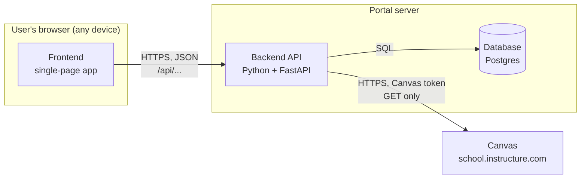
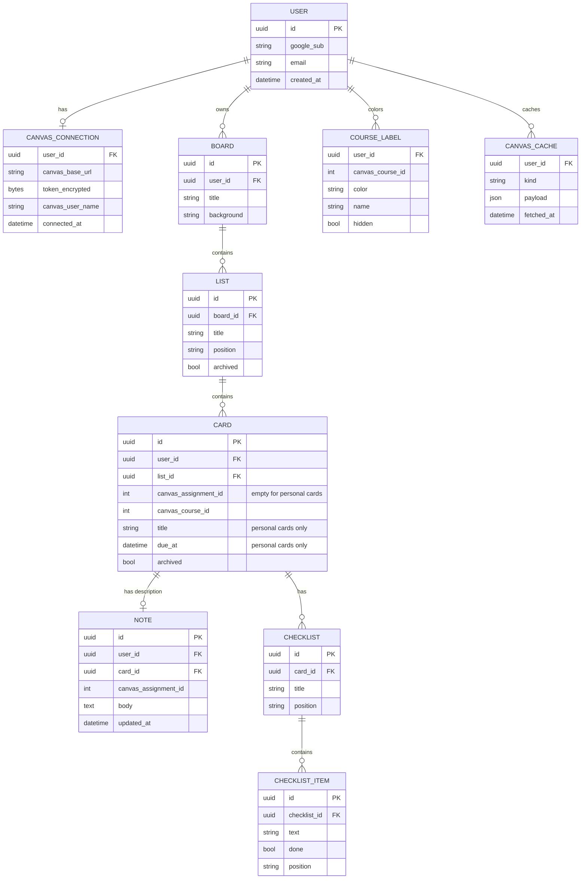
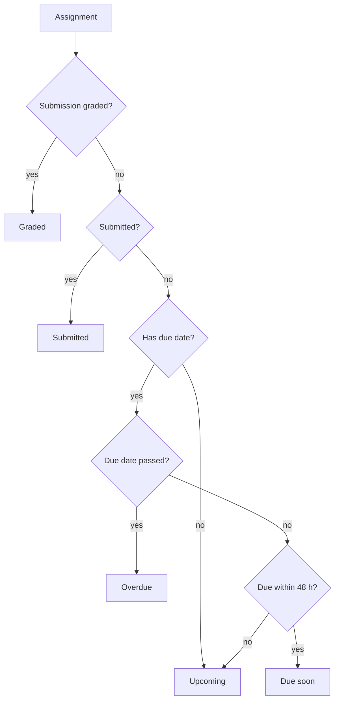
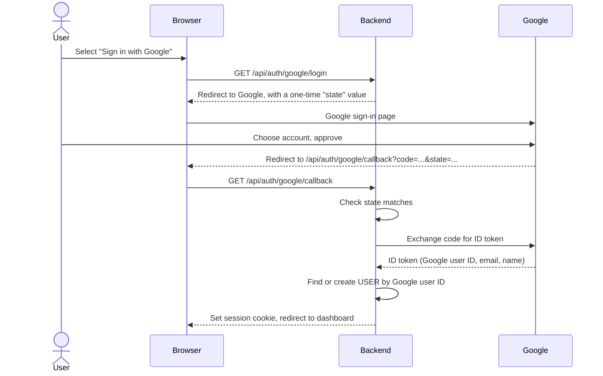
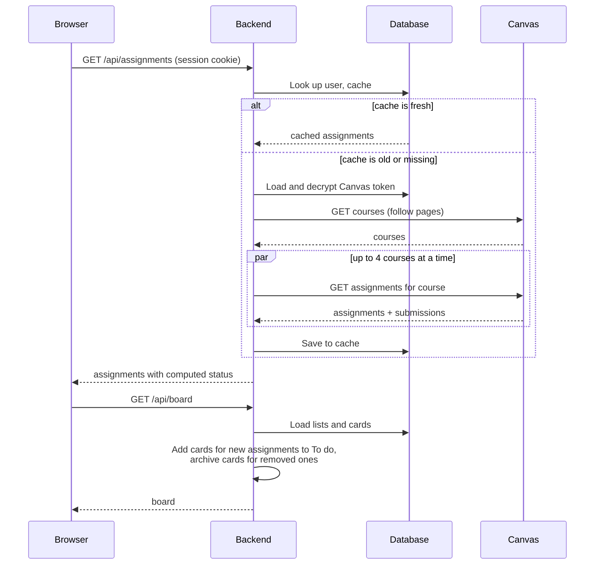
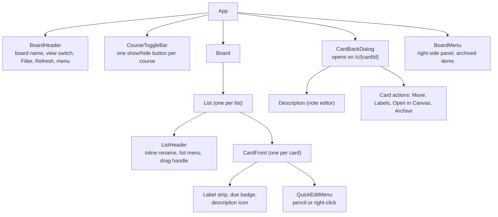

# Design

**Status:** Draft · **Owner:** Team Lead · **Last updated:** 2026-10-25

This document describes how the portal is built: its parts, the data it
stores, how those parts talk to each other, and how each part meets the
[requirements](02-requirements.md). It is written so that the frontend
framework (decision D-1) can still be chosen at the end of the design.

## 1. Architecture overview

The portal has three parts that we build, plus Canvas.



| Part | What it does | Qt comparison |
|------|--------------|---------------|
| **Frontend** | Draws every screen, handles drag and drop, and calls the backend. It is a *single-page app*: the browser loads it once, then it swaps screens itself without reloading the page. | The QML UI |
| **Backend API** | Checks who is signed in, stores and returns board and notes, and calls Canvas on the user's behalf. Never sends a Canvas token to the browser. | The C++ model layer, but on a server |
| **Database** | Stores accounts, encrypted Canvas tokens, board layout, notes, and a short-lived cache of Canvas data. | A persistent store like SQLite behind a model |
| **Canvas** | The source of courses and assignments. Read only. | An external web service |

**Why a backend at all:** browsers block the frontend from calling Canvas
directly (CORS, constraint C-1). Because board and notes must follow the user
to any device (D-2), we also need a server to store them. One backend covers
both.

## 2. Technology choices

| Area | Choice | Status | Why |
|------|--------|--------|-----|
| Frontend framework | React or Svelte | **Open (D-1)**, after design | See section 10 for how the design affects the choice |
| Frontend language | TypeScript | Proposed | JavaScript with types; catches mistakes before running, much like C++'s compiler does |
| Frontend build tool | Vite | Proposed | Fast local dev server; works with React and Svelte |
| Drag and drop | Pragmatic drag and drop (Atlassian), or dnd-kit (React) / svelte-dnd-action (Svelte) | Proposed, follows D-1 | Pragmatic drag and drop is Atlassian's open-source library behind Trello's own drag and drop and works with any framework, which suits G-3. Its keyboard support must be checked against NFR-31; the other two have it built in |
| Backend | Python 3.12 + FastAPI | Proposed (D-6) | Short, readable code; generates API docs automatically |
| Canvas client | `httpx` (Python HTTP library) | Proposed | Async requests, so courses can be fetched in parallel (NFR-2) |
| Database | Postgres in production, SQLite for local dev and tests | Proposed | Postgres is what hosts offer; SQLite needs no setup |
| Database access | SQLAlchemy + Alembic | Proposed | Python models for tables; Alembic tracks schema changes over time ("migrations") |
| Portal sign-in | Sign in with Google (OAuth 2 / OpenID Connect) via the Authlib Python library | **Decided for MVP (D-7)** | No passwords to store; see section 5 |
| Hosting | See roadmap D-3 | Open | |

## 3. Data model

The database stores only what the portal owns. Course and assignment details
come from Canvas and are cached, not copied permanently.



Design notes:

- **Trello's structure:** a board holds lists, lists hold cards (goal G-3).
  Each user gets one board for now; the `BOARD` table is there so more boards
  (FR-76) don't need a redesign.
- **Cards and notes key on `canvas_assignment_id`**, never the assignment name,
  so a renamed or rescheduled assignment keeps its card and note (FR-35).
- **Cards have no stored position.** Within a list they are always sorted by
  due date, earliest first, then by name, with no-due-date cards last
  (FR-38). The order is worked out each time the board loads, so a due date
  changed in Canvas moves the card automatically. Moving a card only changes
  its `list_id`, a one-row update (NFR-3).
- **List `position` is a sortable string** (a technique called *fractional
  indexing*: to put a list between "a" and "b", give it "an"), so dragging a
  list updates one row instead of renumbering them all (FR-62).
- **Checklists** (FR-70) are Phase 5. The `CHECKLIST` and `CHECKLIST_ITEM`
  tables are shown so the model is ready for them, but they are not built
  until then; checklist items will use the same position technique.
- **Notes are separate from cards**, so a note survives if a card is archived
  or a list is archived (NFR-21). A note also records its
  `canvas_assignment_id`, so it can be reattached if its card is rebuilt.
- **Personal cards** (FR-71, Phase 5) are cards with no `canvas_assignment_id`; their
  title and due date are stored on the card itself.
- **Course label colors** (FR-66) are stored per user and course, picked
  automatically from a fixed palette the first time a course appears. The
  same row stores whether the course is hidden by the show/hide buttons
  (FR-78), so that choice follows the user between devices.
- **Archived, not deleted:** if an assignment disappears from Canvas, its card
  is marked `archived` and its note stays (FR-45).
- **Every row has `user_id`**, and every query filters by the signed-in user,
  so one user can never read another's data (NFR-12).

## 4. Backend API

The frontend talks to the backend through these endpoints. All return JSON
and require a signed-in session except where noted.

| Method and path | Purpose | Requirements |
|-----------------|---------|--------------|
| `GET /api/auth/google/login` | Send the browser to Google's sign-in page (no session needed) | FR-50 |
| `GET /api/auth/google/callback` | Google sends the user back here; backend checks the result, finds or creates the user, sets the session cookie (no session needed) | FR-50 |
| `POST /api/auth/logout` | Sign out and clear the session | FR-50 |
| `GET /api/me` | Current user and whether Canvas is connected | FR-2, FR-5 |
| `PUT /api/canvas/connection` | Save Canvas URL and token; backend verifies with Canvas first | FR-1, FR-2 |
| `DELETE /api/canvas/connection` | Disconnect and delete the stored token | FR-4 |
| `GET /api/courses` | Active courses (cached) | FR-10, FR-20 |
| `GET /api/assignments` | All assignments across active courses, with status | FR-11, FR-21 to FR-23 |
| `POST /api/refresh` | Bypass the cache and re-fetch from Canvas | FR-13 |
| `GET /api/board` | Lists and cards with labels and badges, cards sorted by due date, after merging in new or removed assignments | FR-33, FR-34, FR-38, FR-65 |
| `POST /api/board/lists` | Phase 5: add a list at the end | FR-64 |
| `PATCH /api/board/lists/{id}` | Rename or move (new position) a list; archive and restore in Phase 5 | FR-36, FR-62, FR-63 |
| `POST /api/board/cards` | Phase 5: add a personal card | FR-71 |
| `GET /api/board/cards/{id}` | Everything for the card back | FR-67, FR-68 |
| `PATCH /api/board/cards/{id}` | Move to another list, archive, or restore a card | FR-32, FR-33, FR-74 |
| `GET /api/board/archived` | Archived lists and cards | FR-74 |
| `POST`, `PATCH`, `DELETE /api/cards/{id}/checklists/...` | Phase 5: add, rename, check off, reorder, and remove checklists and items | FR-70 |
| `PATCH /api/labels/{course_id}` | Change a course label's color or name, or hide or show the course | FR-66, FR-78 |
| `GET /api/notes/{assignment_id}` | Read a note | FR-43 |
| `PUT /api/notes/{assignment_id}` | Create or replace a note | FR-40 to FR-42 |
| `DELETE /api/notes/{assignment_id}` | Delete a note | FR-41 |
| `GET /api/export` | Download board and notes as JSON | FR-53 |
| `DELETE /api/me` | Delete the account and all its data | FR-54 |

The backend only ever sends filtered, portal-shaped data to the frontend. It
does not pass Canvas responses straight through, and it never includes the
token.

### Assignment status

The backend computes status (FR-23) from Canvas's submission data, so every
device shows the same answer:



## 5. Signing in to the portal (D-7)

**Decision (Team Lead, 2026-10-25):** Sign in with Google for the MVP. The
other options stay listed for later.

Because data follows the user between devices, the portal needs its own
accounts, separate from Canvas. Options considered:

| Option | How it works | Pros | Cons |
|--------|--------------|------|------|
| **Sign in with Google (or GitHub)** | User clicks a button, signs in on Google, Google tells us their email | No passwords to store; familiar | Needs a Google developer app (free); student must have a Google account |
| **Email magic link** | User types email, gets a one-time sign-in link | No passwords; works with any email | Needs an email sending service |
| **Username and password** | Classic form | No outside services | We must store passwords safely and build reset flows |
| **Hosted auth service** (Auth0, Clerk, Supabase Auth) | A service handles all of the above | Least code, several options at once | Another account and dependency; free tiers have limits |

### How Sign in with Google works



- The backend asks Google only for the `openid email profile` scopes: who the
  user is, nothing from their Google Drive or Gmail.
- Users are matched by Google's stable user ID (the `sub` value), not by
  email, since an email address can change. The `USER` table gains a
  `google_sub` column.
- The Google *client ID* and *client secret* come from a free Google Cloud
  project. The secret lives only in the server's environment settings, never
  in the repo. Setting this up is a Phase 0 task.
- While the Google app is in "testing" mode, only Google accounts added as
  test users can sign in. That suits development; publishing it later is a
  short Google review.
- Some school-managed Google accounts block sign-in to outside apps. Students
  can use a personal Google account instead; risk R-6 in the roadmap.

*Log in with Canvas* (OAuth, D-4) would be the
nicest option, since it signs the user in and connects Canvas in one step,
but it needs the school to issue a developer key.

After sign-in, the backend sets a **session cookie**: a small value the browser
sends back automatically with each request so the backend knows who is
asking. The cookie is `HttpOnly` (page scripts can't read it), `Secure` (HTTPS
only), and `SameSite=Lax` (other sites can't trigger requests with it).

## 6. Talking to Canvas

### Endpoints used (all `GET`, NFR-13)

| Purpose | Canvas endpoint |
|---------|-----------------|
| Verify token, get name | `/api/v1/users/self` |
| Active courses | `/api/v1/courses?enrollment_state=active&per_page=100` |
| Assignments with submission status | `/api/v1/courses/:id/assignments?include[]=submission&per_page=100` |

### Paging, rate limits, and caching

- **Paging (FR-12):** Canvas returns a `Link` header with a `rel="next"` URL
  when more results exist. The client keeps following it until there is none.
- **Rate limits (C-2):** Canvas reports remaining budget in the
  `X-Rate-Limit-Remaining` header and answers `403` with "Rate Limit Exceeded"
  when it runs out. The client fetches at most 4 courses at once and waits and
  retries with increasing delays when limited.
- **Caching (FR-14):** results are stored in `CANVAS_CACHE` for 5 minutes. A
  page load uses the cache if fresh; *Refresh* skips it. If Canvas fails, the
  last cached data is returned with a warning flag (NFR-20).

### Loading sequence



## 7. Security

| Concern | Design | Requirements |
|---------|--------|--------------|
| Token theft from the database | Tokens are encrypted with a key held only in the server's environment settings, not in the database or the repo | NFR-11 |
| Token leaking through logs | A logging filter removes `Authorization` headers and any field named `token`; error messages never include request headers | NFR-10 |
| Token reaching the browser | No endpoint returns the token; after saving, the frontend only knows "connected as *name*" | NFR-10 |
| One user seeing another's data | Every query filters on the session's `user_id`; tests check this for every endpoint | NFR-12 |
| Writes to Canvas | The Canvas client only implements `GET` | NFR-13 |
| Trackers | No third-party analytics or scripts | NFR-14 |
| Test tokens | Read from a git-ignored `.env` file in local dev; CI uses recorded sample data instead | A-3, NFR-41 |

## 8. Repository layout

```text
canvas-portal/
  backend/
    app/            FastAPI app: routes, Canvas client, database models
    migrations/     Alembic schema changes
    tests/          pytest tests and recorded Canvas sample data
    pyproject.toml
  frontend/
    src/            screens and components
    tests/          component tests and browser tests
    package.json
  .env.example      lists settings; the real .env is git-ignored
docs/canvas-portal/ these documents
```

## 9. Frontend and UI design (Trello-style, goal G-3)

### Screens and links

Like Trello, the board is the home screen and a card opens *over* it rather
than on a separate page. Each view has its own address, so links, reloads,
and the Back button behave the way they do in Trello.

| Address | Shows | Requirements |
|---------|-------|--------------|
| `/` | The board (or S-1 / S-2 if not signed in or connected) | FR-60 |
| `/c/{cardId}` | The board with that card's card back open as a dialog | FR-67 |
| `/table` | Table view of all assignments | FR-30 |
| `/settings` | Settings | FR-4, FR-53, FR-54 |

### Component structure

A *component* is a reusable piece of UI, like a QML component file. The board
is built from these:



### Visual style

Close to Trello's feel (NFR-34), with our own values (C-4). These are
starting points for the design tokens, the named colors and sizes the whole
UI uses:

| Element | Style |
|---------|-------|
| Board background | One solid color per board, user can change it later (FR-75); default a deep blue |
| List | 272 px wide, light gray, 12 px rounded corners, 8 px gap between lists |
| Card | White, 8 px rounded corners, soft shadow, 8 px padding; label strip at the top in the course color |
| Due badge | Small pill with a clock icon: green (complete), yellow (due soon), red (overdue), plain (upcoming) |
| Text | System font, 14 px on cards, bold list titles |
| Card back | Centered dialog about 768 px wide over a dimmed board; main column on the left, action buttons on the right |

### Interaction details

| Behavior | How it works | Requirements |
|----------|--------------|--------------|
| Drag a card | Card lifts and tilts about 4°, the list under it is highlighted and a gray gap shows its due date spot in that list, the board auto-scrolls near the edges; the move is saved with an optimistic update (W-3) | FR-32, FR-77 |
| Drag a list | Grab the list header; other lists slide aside | FR-62 |
| Scroll the board | Horizontal scrollbar, or drag on empty background | FR-61 |
| Rename a list | Click the title, it becomes a text box; Enter saves, Escape cancels | FR-63 |
| Open a card | Click, or focus it and press Enter; address changes to `/c/{cardId}` | FR-67 |
| Quick edit | Pencil on hover, right-click, or `e` | FR-69 |
| Show or hide a course | Tap its button in the row under the header, or Show all / Hide all; the board updates at once and the choice is saved in the background (optimistic update) | FR-78 |
| Filter | `f` or the Filter button; non-matching cards are hidden and the header shows the filter is active | FR-72 |
| Keyboard map | Kept in one file and shown by `?`; checked against Trello's shortcut page | FR-73, NFR-31 |

## 10. What this means for D-1 (React or Svelte)

Nothing above depends on the framework; the backend and data model are the
same either way. The frontend's hardest parts are the Trello-style board
(smooth, accessible drag and drop of cards and lists, FR-77 and NFR-31), the
card back dialog with its own address (FR-67), and the note editor (FR-42).

The Trello goal (G-3) leans toward React. React has the most examples of
Trello-style boards to learn from, and Pragmatic drag and drop ships extra
React helpers. Svelte can still do all of it, since Pragmatic drag and drop
works without a framework, but there are fewer worked examples to copy from.

## 11. Traceability

| Requirement group | Covered by |
|-------------------|------------|
| FR-1 to FR-6 (connect) | Sections 4, 6, 7 |
| FR-10 to FR-14 (fetch) | Section 6 |
| FR-20 to FR-26 (view) | Section 4 (status), wireframes |
| FR-30 to FR-38 (board) | Sections 3, 4, 6 (loading sequence), 9 |
| FR-40 to FR-46 (notes) | Sections 3, 4, 9 |
| FR-60 to FR-78 (Trello-style, course buttons) | Sections 3, 4, 9 |
| FR-50 to FR-54 (accounts, data) | Sections 4, 5 |
| NFR-1 to NFR-3 (performance) | Sections 3 (sorting, list positions), 6 (caching, parallel fetch) |
| NFR-10 to NFR-14 (security) | Section 7 |
| NFR-20, NFR-21 (reliability) | Sections 3, 6 |
| NFR-30 to NFR-35 (usability, Trello style) | Sections 2, 9, wireframes |
| NFR-40 to NFR-42 (maintainability) | Sections 7, 8 |

## Open decisions raised here

- **D-7** How users sign in to the portal (section 5). Decided: Sign in with
  Google for the MVP.

## Change log

| Date | Change |
|------|--------|
| 2026-10-25 | First draft. |
| 2026-10-25 | D-7 decided: Sign in with Google. Added auth endpoints and sign-in sequence. |
| 2026-10-25 | Trello goal (G-3): data model now board, lists, cards, checklists, course labels; new list, card, checklist, and label endpoints; new section 9 on Trello-style UI; D-1 section updated. |
| 2026-10-25 | Course show/hide buttons (FR-78): `hidden` on course labels, toggle bar component, label endpoint. |
| 2026-10-25 | Checklists (FR-70) marked Phase 5: tables and endpoints kept for later, removed from the Phase 2 component diagram. |
| 2026-10-25 | Adding cards and lists moved to Phase 5: endpoints marked, composers removed from the component diagram. |
| 2026-10-25 | FR-38: cards always sorted by due date. Removed the card `position` column; only lists keep positions. |
