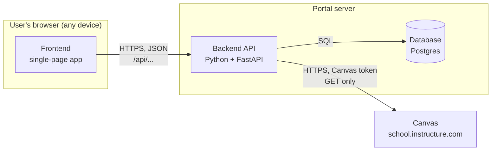
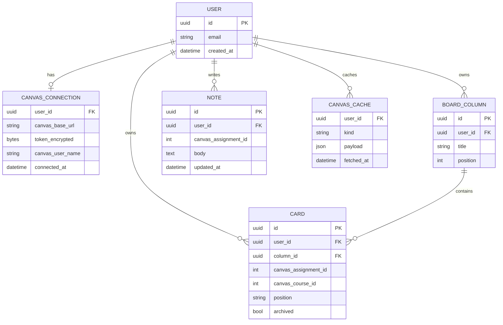
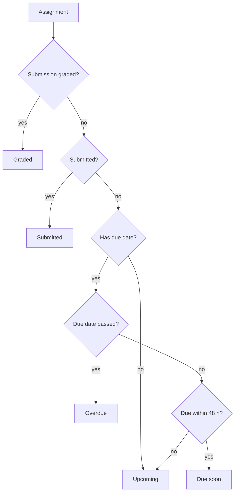
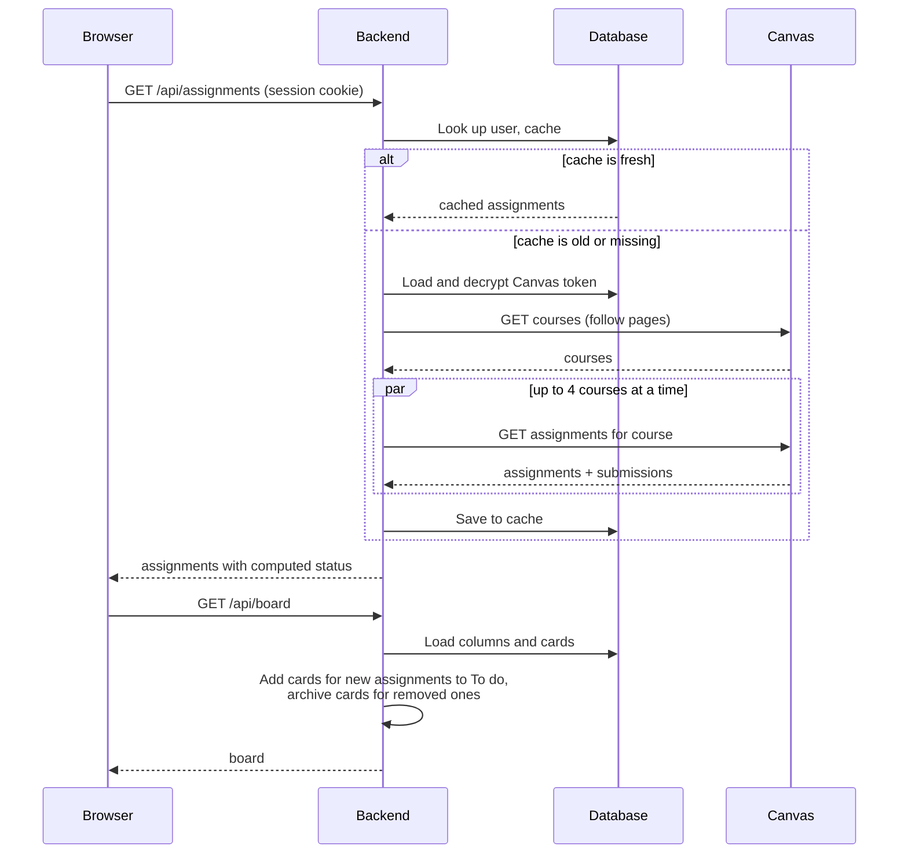

# Design

**Status:** Draft · **Owner:** Bridget · **Last updated:** 2026-10-25

This document describes how the portal is built: its parts, the data it
stores, how those parts talk to each other, and how each part meets the
[requirements](02-requirements.md). It is written so that the frontend
framework (decision D-1) can still be chosen at the end of the design.

## 1. Architecture overview

The portal has three parts that we build, plus Canvas.



| Part | What it does | Qt comparison |
|------|--------------|---------------|
| **Frontend** | Draws every screen, handles drag and drop, and calls the backend. It is a *single-page app*: the browser loads it once, then it swaps screens itself without reloading the page. | The QML UI |
| **Backend API** | Checks who is signed in, stores and returns board and notes, and calls Canvas on the user's behalf. Never sends a Canvas token to the browser. | The C++ model layer, but on a server |
| **Database** | Stores accounts, encrypted Canvas tokens, board layout, notes, and a short-lived cache of Canvas data. | A persistent store like SQLite behind a model |
| **Canvas** | The source of courses and assignments. Read only. | An external web service |

**Why a backend at all:** browsers block the frontend from calling Canvas
directly (CORS, constraint C-1). Because board and notes must follow the user
to any device (D-2), we also need a server to store them. One backend covers
both.

## 2. Technology choices

| Area | Choice | Status | Why |
|------|--------|--------|-----|
| Frontend framework | React or Svelte | **Open (D-1)**, after design | See section 9 for how the design affects the choice |
| Frontend language | TypeScript | Proposed | JavaScript with types; catches mistakes before running, much like C++'s compiler does |
| Frontend build tool | Vite | Proposed | Fast local dev server; works with React and Svelte |
| Drag and drop | dnd-kit (React) or svelte-dnd-action (Svelte) | Follows D-1 | Both support keyboard dragging (NFR-31) |
| Backend | Python 3.12 + FastAPI | Proposed (D-6) | Short, readable code; generates API docs automatically |
| Canvas client | `httpx` (Python HTTP library) | Proposed | Async requests, so courses can be fetched in parallel (NFR-2) |
| Database | Postgres in production, SQLite for local dev and tests | Proposed | Postgres is what hosts offer; SQLite needs no setup |
| Database access | SQLAlchemy + Alembic | Proposed | Python models for tables; Alembic tracks schema changes over time ("migrations") |
| Portal sign-in | See section 5 | **Open (D-7)** | |
| Hosting | See roadmap D-3 | Open | |

## 3. Data model

The database stores only what the portal owns. Course and assignment details
come from Canvas and are cached, not copied permanently.



Design notes:

- **Cards and notes key on `canvas_assignment_id`**, never the assignment name,
  so a renamed or rescheduled assignment keeps its card and note (FR-35).
- **Card `position` is a sortable string** (a technique called *fractional
  indexing*: to put a card between "a" and "b", give it "an"). Moving one card
  then updates one row instead of renumbering the whole column (NFR-3).
- **Notes are separate from cards**, so a note survives if a card is archived
  or a column is deleted (NFR-21).
- **Archived, not deleted:** if an assignment disappears from Canvas, its card
  is marked `archived` and its note stays (FR-45).
- **Every row has `user_id`**, and every query filters by the signed-in user,
  so one user can never read another's data (NFR-12).

## 4. Backend API

The frontend talks to the backend through these endpoints. All return JSON
and require a signed-in session except where noted.

| Method and path | Purpose | Requirements |
|-----------------|---------|--------------|
| `POST /api/auth/...` | Sign in, sign out (shape depends on D-7) | FR-50 |
| `GET /api/me` | Current user and whether Canvas is connected | FR-2, FR-5 |
| `PUT /api/canvas/connection` | Save Canvas URL and token; backend verifies with Canvas first | FR-1, FR-2 |
| `DELETE /api/canvas/connection` | Disconnect and delete the stored token | FR-4 |
| `GET /api/courses` | Active courses (cached) | FR-10, FR-20 |
| `GET /api/assignments` | All assignments across active courses, with status | FR-11, FR-21 to FR-23 |
| `POST /api/refresh` | Bypass the cache and re-fetch from Canvas | FR-13 |
| `GET /api/board` | Columns and cards, after merging in new or removed assignments | FR-33, FR-34 |
| `PUT /api/board/columns/{id}` / `POST` / `DELETE` | Rename, add, delete columns | FR-36 |
| `PATCH /api/board/cards/{id}` | Move a card (new column and position) | FR-32, FR-33 |
| `GET /api/notes/{assignment_id}` | Read a note | FR-43 |
| `PUT /api/notes/{assignment_id}` | Create or replace a note | FR-40 to FR-42 |
| `DELETE /api/notes/{assignment_id}` | Delete a note | FR-41 |
| `GET /api/export` | Download board and notes as JSON | FR-53 |
| `DELETE /api/me` | Delete the account and all its data | FR-54 |

The backend only ever sends filtered, portal-shaped data to the frontend. It
does not pass Canvas responses straight through, and it never includes the
token.

### Assignment status

The backend computes status (FR-23) from Canvas's submission data, so every
device shows the same answer:



## 5. Signing in to the portal (D-7, open)

Because data follows the user between devices, the portal needs its own
accounts, separate from Canvas. Options:

| Option | How it works | Pros | Cons |
|--------|--------------|------|------|
| **Sign in with Google (or GitHub)** | User clicks a button, signs in on Google, Google tells us their email | No passwords to store; familiar | Needs a Google developer app (free); student must have a Google account |
| **Email magic link** | User types email, gets a one-time sign-in link | No passwords; works with any email | Needs an email sending service |
| **Username and password** | Classic form | No outside services | We must store passwords safely and build reset flows |
| **Hosted auth service** (Auth0, Clerk, Supabase Auth) | A service handles all of the above | Least code, several options at once | Another account and dependency; free tiers have limits |

**Recommendation:** Sign in with Google to start, through a hosted auth service
if it fits the chosen host. *Log in with Canvas* (OAuth, D-4) would be the
nicest option, since it signs the user in and connects Canvas in one step,
but it needs the school to issue a developer key.

After sign-in, the backend sets a **session cookie**: a small value the browser
sends back automatically with each request so the backend knows who is
asking. The cookie is `HttpOnly` (page scripts can't read it), `Secure` (HTTPS
only), and `SameSite=Lax` (other sites can't trigger requests with it).

## 6. Talking to Canvas

### Endpoints used (all `GET`, NFR-13)

| Purpose | Canvas endpoint |
|---------|-----------------|
| Verify token, get name | `/api/v1/users/self` |
| Active courses | `/api/v1/courses?enrollment_state=active&per_page=100` |
| Assignments with submission status | `/api/v1/courses/:id/assignments?include[]=submission&per_page=100` |

### Paging, rate limits, and caching

- **Paging (FR-12):** Canvas returns a `Link` header with a `rel="next"` URL
  when more results exist. The client keeps following it until there is none.
- **Rate limits (C-2):** Canvas reports remaining budget in the
  `X-Rate-Limit-Remaining` header and answers `403` with "Rate Limit Exceeded"
  when it runs out. The client fetches at most 4 courses at once and waits and
  retries with increasing delays when limited.
- **Caching (FR-14):** results are stored in `CANVAS_CACHE` for 5 minutes. A
  page load uses the cache if fresh; *Refresh* skips it. If Canvas fails, the
  last cached data is returned with a warning flag (NFR-20).

### Loading sequence



## 7. Security

| Concern | Design | Requirements |
|---------|--------|--------------|
| Token theft from the database | Tokens are encrypted with a key held only in the server's environment settings, not in the database or the repo | NFR-11 |
| Token leaking through logs | A logging filter removes `Authorization` headers and any field named `token`; error messages never include request headers | NFR-10 |
| Token reaching the browser | No endpoint returns the token; after saving, the frontend only knows "connected as *name*" | NFR-10 |
| One user seeing another's data | Every query filters on the session's `user_id`; tests check this for every endpoint | NFR-12 |
| Writes to Canvas | The Canvas client only implements `GET` | NFR-13 |
| Trackers | No third-party analytics or scripts | NFR-14 |
| Test tokens | Read from a git-ignored `.env` file in local dev; CI uses recorded sample data instead | A-3, NFR-41 |

## 8. Repository layout

```text
canvas-portal/
  backend/
    app/            FastAPI app: routes, Canvas client, database models
    migrations/     Alembic schema changes
    tests/          pytest tests and recorded Canvas sample data
    pyproject.toml
  frontend/
    src/            screens and components
    tests/          component tests and browser tests
    package.json
  .env.example      lists settings; the real .env is git-ignored
docs/canvas-portal/ these documents
```

## 9. What this means for D-1 (React or Svelte)

Nothing above depends on the framework; the backend and data model are the
same either way. The frontend's hardest parts are the kanban board
(accessible drag and drop, NFR-31) and the note editor (autosave, optional
formatting, FR-42 and FR-46). React has more mature, accessible libraries for
both. If the board and rich notes stay in scope, that favors React. If they
shrink, Svelte's simpler style becomes more attractive.

## 10. Traceability

| Requirement group | Covered by |
|-------------------|------------|
| FR-1 to FR-6 (connect) | Sections 4, 6, 7 |
| FR-10 to FR-14 (fetch) | Section 6 |
| FR-20 to FR-26 (view) | Section 4 (status), wireframes |
| FR-30 to FR-37 (board) | Sections 3, 4, 6 (loading sequence) |
| FR-40 to FR-46 (notes) | Sections 3, 4 |
| FR-50 to FR-54 (accounts, data) | Sections 4, 5 |
| NFR-1 to NFR-3 (performance) | Sections 3 (positions), 6 (caching, parallel fetch) |
| NFR-10 to NFR-14 (security) | Section 7 |
| NFR-20, NFR-21 (reliability) | Sections 3, 6 |
| NFR-30 to NFR-33 (usability) | Section 2, wireframes |
| NFR-40 to NFR-42 (maintainability) | Sections 7, 8 |

## Open decisions raised here

- **D-7** How users sign in to the portal (section 5). Recommendation: Sign in
  with Google.

## Change log

| Date | Change |
|------|--------|
| 2026-10-25 | First draft. |
