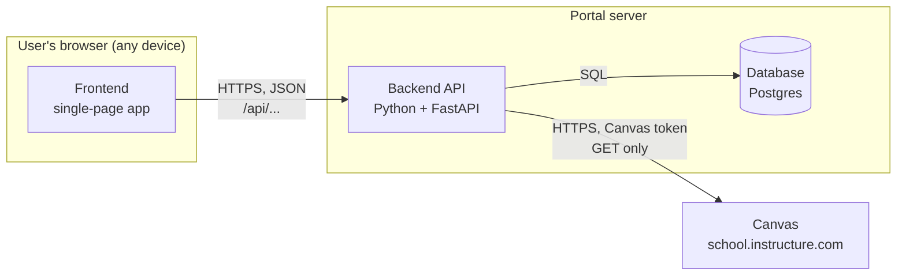
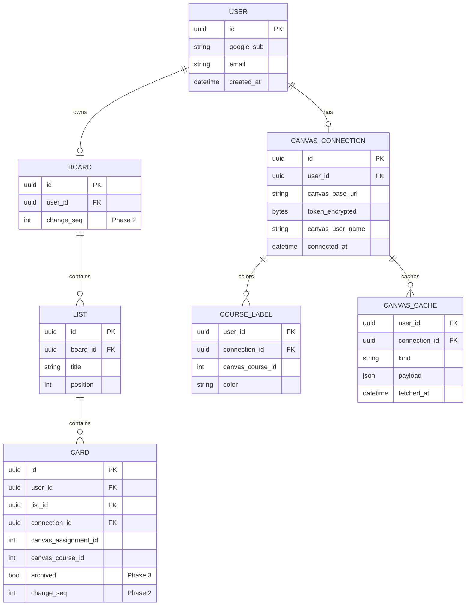
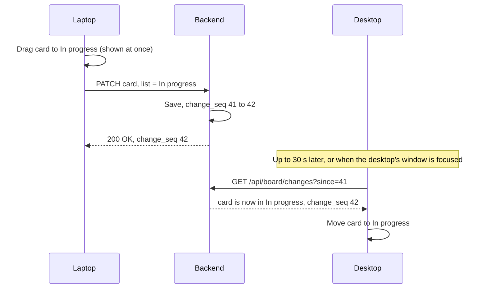
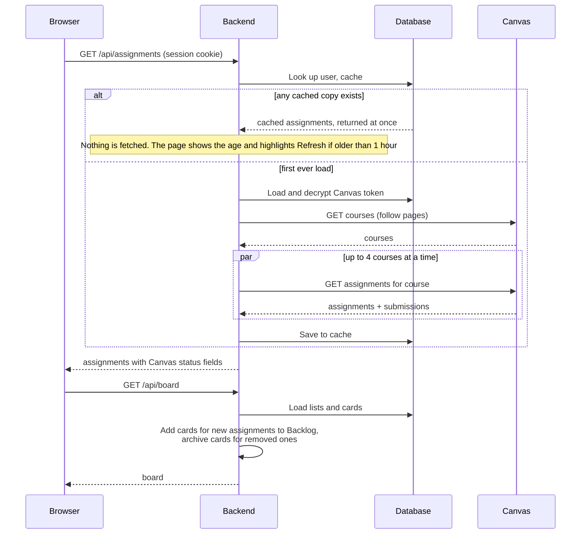
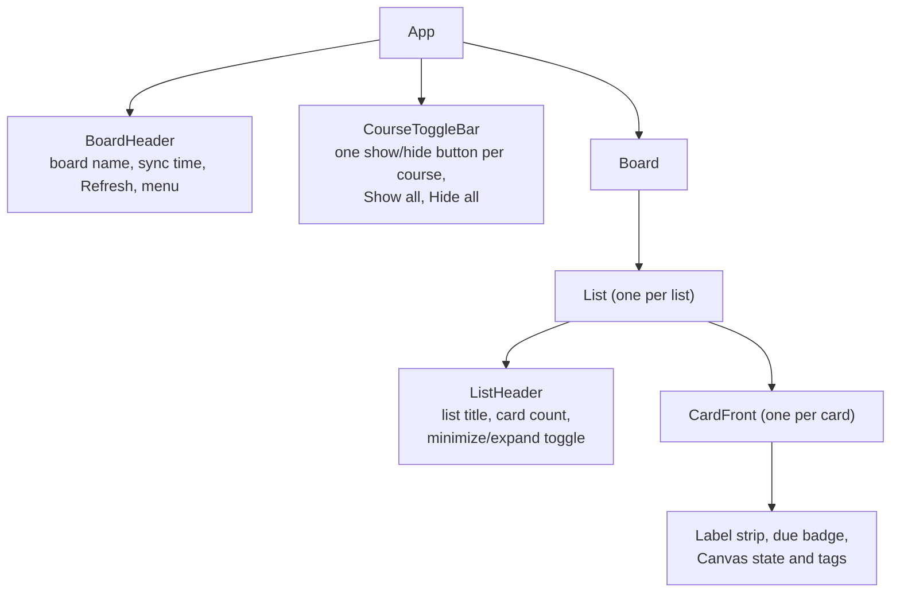

# Design

**Status:** Draft · **Owner:** Team Lead · **Last updated:** 2026-10-25

This document describes how the portal is built: its parts, the data it
stores, how those parts talk to each other, and how each part meets the
[requirements](02-requirements.md). It is written so that the frontend
framework (decision D-1) can still be chosen at the end of the design.

**Scope:** this design covers Phases 0 to 4 only. Phase 5 ideas in the
requirements and roadmap are not designed here; each gets its design when
it is moved onto the roadmap. Section 12, *Leave room for later*, lists the
few choices made now so those ideas stay possible.

### Design by phase

Build only the parts listed for the current phase (see the repo's
[CLAUDE.md](../../CLAUDE.md)). Each phase adds to the ones before it.

| Phase | Builds |
|-------|--------|
| 0 | Repository layout (section 8), empty frontend and backend, CI, the Google OAuth client (section 5) |
| 1 | Tables `USER`, `CANVAS_CONNECTION`, `BOARD`, `LIST`, `CARD` (without `archived`), `COURSE_LABEL`, `CANVAS_CACHE`; the Phase 1 endpoints in section 4; sign-in (section 5); talking to Canvas, caching, and *Built from the start* (section 6); security (section 7); the board, course buttons, minimize and expand, visual style, and the Phase 1 interactions (section 9) |
| 2 | Moving cards and *Keeping devices in sync* (section 4): the Phase 2 endpoints, `change_seq`, the unique card rule; dragging (section 9) |
| 3 | *Phase 3 tuning*, *Bringing the backend in step with Canvas*, and *What can change in Canvas* (section 6); `CARD.archived` |
| 4 | Deleting all of a user's data (section 4), accessibility checks, deploying (roadmap D-3) |

## 1. Architecture overview

The portal has three parts that we build, plus Canvas.



| Part | What it does | Qt comparison |
|------|--------------|---------------|
| **Frontend** | Draws every screen, handles drag and drop, and calls the backend. It is a *single-page app*: the browser loads it once, then it swaps screens itself without reloading the page. | The QML UI |
| **Backend API** | Checks who is signed in, stores and returns the board, and calls Canvas on the user's behalf. Never sends a Canvas token to the browser. | The C++ model layer, but on a server |
| **Database** | Stores accounts, encrypted Canvas tokens, board layout, and the last copy of Canvas data. | A persistent store like SQLite behind a model |
| **Canvas** | The source of courses and assignments. Read only. | An external web service |

**Why a backend at all:** browsers block the frontend from calling Canvas
directly (CORS, constraint C-1). Because the board must follow the user
to any device (D-2), we also need a server to store it. One backend covers
both.

## 2. Technology choices

| Area | Choice | Status | Why |
|------|--------|--------|-----|
| Frontend framework | React or Svelte | **Open (D-1)**, after design | See section 10 for how the design affects the choice |
| Frontend language | TypeScript | Proposed | JavaScript with types; catches mistakes before running, much like C++'s compiler does |
| Frontend build tool | Vite | Proposed | Fast local dev server; works with React and Svelte |
| Drag and drop | Pragmatic drag and drop (Atlassian), or dnd-kit (React) / svelte-dnd-action (Svelte) | Proposed, follows D-1 | Pragmatic drag and drop is Atlassian's open-source library behind Trello's own drag and drop and works with any framework, which suits G-3. Its keyboard support must be checked against NFR-31; the other two have it built in |
| Backend | Python 3.12 + FastAPI | Proposed (D-6) | Short, readable code; generates API docs automatically |
| Canvas client | `httpx` (Python HTTP library) | Proposed | Async requests, so courses can be fetched in parallel (NFR-2) |
| Database | Postgres in production, SQLite for local dev and tests | Proposed | Postgres is what hosts offer; SQLite needs no setup |
| Database access | SQLAlchemy + Alembic | Proposed | Python models for tables; Alembic tracks schema changes over time ("migrations") |
| Portal sign-in | Sign in with Google (OAuth 2 / OpenID Connect) via the Authlib Python library | **Decided for MVP (D-7)** | No passwords to store; see section 5 |
| Hosting | See roadmap D-3 | Open | |

## 3. Data model

The database stores only what the portal owns. Course and assignment details
come from Canvas and are cached, not copied permanently.



Design notes:

- **Trello's structure:** a board holds lists, lists hold cards (goal G-3).
  Each user has one board, which holds the `change_seq` counter used for
  sync from Phase 2.
- **Fields are added with their phase.** Columns marked with a phase in the
  diagram are added by a migration when that phase starts, not before.
- **Cards key on `canvas_assignment_id`**, never the assignment name,
  so a renamed or rescheduled assignment keeps its card (FR-35).
- **Cards have no stored position.** Within a list they are always sorted by
  due date, earliest first, then by name, with no-due-date cards last
  (FR-38). The order is worked out each time the board loads, so a due date
  changed in Canvas moves the card automatically. Moving a card only changes
  its `list_id`, a one-row update (NFR-3).
- **Lists are fixed:** the four lists (FR-31) are created with the board,
  and `position` holds their order, 1 to 4.
- **One school per user.** `USER` has at most one `CANVAS_CONNECTION`.
  Cards, course labels, and cached data still record their `connection_id`
  (see section 12).
- **One card per assignment, enforced by the database (Phase 2):** a unique
  rule on (`connection_id`, `canvas_assignment_id`) means two devices loading the board at
  the same moment can't both add a card for a new assignment (NFR-22).
- **`change_seq`** is a counter on the board that goes up by one with every
  change, and each card records the value from its last change. It lets a
  device ask "what changed since number 41?" (see *Keeping devices in sync*).
- **Course label colors** (FR-66) are stored per user and course, picked
  automatically from a fixed palette the first time a course appears, so a
  course keeps its color on every device. Which courses are hidden by the
  show/hide buttons (FR-78) is kept in the browser, not the database.
- **Archived, not deleted (Phase 3):** if an assignment disappears from
  Canvas, its card is marked `archived` (FR-45).
- **Every row has `user_id`**, and every query filters by the signed-in user,
  so one user can never read another's data (NFR-12).

## 4. Backend API

The frontend talks to the backend through these endpoints. All return JSON
and require a signed-in session except where noted.

| Method and path | Purpose | Requirements | Phase |
|-----------------|---------|--------------|-------|
| `GET /api/auth/google/login` | Send the browser to Google's sign-in page (no session needed) | FR-50 | 1 |
| `GET /api/auth/google/callback` | Google sends the user back here; backend checks the result, finds or creates the user, sets the session cookie (no session needed) | FR-50 | 1 |
| `POST /api/auth/logout` | Sign out and clear the session | FR-50 | 1 |
| `GET /api/me` | Current user and whether Canvas is connected | FR-2, FR-5 | 1 |
| `PUT /api/canvas/connection` | Save Canvas URL and token; backend verifies with Canvas first | FR-1, FR-2 | 1 |
| `DELETE /api/canvas/connection` | Disconnect and delete the stored token | FR-4 | 1 |
| `GET /api/courses` | Active courses (cached) | FR-10, FR-20 | 1 |
| `GET /api/assignments` | All assignments across active courses, with Canvas status fields | FR-11, FR-21 to FR-23 | 1 |
| `POST /api/refresh` | Re-fetch from Canvas | FR-13, FR-15 | 1 |
| `GET /api/board` | Lists and cards with labels and badges, cards sorted by due date, after merging in new assignments | FR-31, FR-34, FR-38, FR-65 | 1 |
| `PATCH /api/board/cards/{id}` | Move to another list; returns the new `change_seq` | FR-32, FR-33, NFR-22 | 2 |
| `GET /api/board/changes?since={seq}` | Cards changed since that `change_seq`, and the current value | NFR-22 | 2 |
| `DELETE /api/me` | Delete the account and all its data | FR-54 | 4 |

The backend only ever sends filtered, portal-shaped data to the frontend. It
does not pass Canvas responses straight through, and it never includes the
token.

### Keeping devices in sync (NFR-22, D-8)

A student may have the board open on a laptop and a desktop computer at once
The server's copy is the only real one; each device shows a copy and keeps it
up to date.

- **Saving a move:** the device moves the card on screen at once (an
  optimistic update, W-3) and sends `PATCH /api/board/cards/{id}`. The server
  saves it in one database transaction, raises the board's `change_seq`, and
  stamps the card with it. If the save fails, the card goes back.
- **Seeing other devices' moves (polling, D-8):** every 30 seconds, and
  whenever the window comes back into focus, the device calls
  `GET /api/board/changes?since=41` with the last number it knows. The server
  returns the cards changed since then, and the device moves them. A device
  that was asleep or offline catches up the same way.
- **Two moves of the same card:** the last save to reach the server wins.
  The other device sees the winning list on its next check, so every device
  ends up the same. For one person's board this is simpler than asking which
  move to keep.
- **Drag in progress:** a change that arrives while the student is dragging
  waits until the drop, so cards never jump under the pointer.
- **Canvas refresh on two devices:** adding cards for new assignments relies
  on the unique rule in section 3, so a second device's attempt just finds
  the card already there.



### Assignment status

The portal shows status exactly as Canvas reports it (FR-23) and works
nothing out itself. Canvas returns these fields on each assignment's
`submission`:

| Canvas field | Values | Shown as |
|--------------|--------|----------|
| `workflow_state` | `unsubmitted`, `submitted`, `graded`, `pending_review` | The state: *Not submitted*, *Submitted*, *Graded*, *Pending review* |
| `late` | true or false | A *Late* tag when true |
| `missing` | true or false | A *Missing* tag when true, and a red due badge |
| `excused` | true or false | An *Excused* tag when true |

The state and the tags can appear together, for example *Graded* with *Late*.
The portal works out no statuses of its own.

## 5. Signing in to the portal (D-7)

**Decision (Team Lead, 2026-10-25):** Sign in with Google for the MVP. The
other options stay listed for later.

Because data follows the user between devices, the portal needs its own
accounts, separate from Canvas. Options considered:

| Option | How it works | Pros | Cons |
|--------|--------------|------|------|
| **Sign in with Google (or GitHub)** | User clicks a button, signs in on Google, Google tells us their email | No passwords to store; familiar | Needs a Google developer app (free); student must have a Google account |
| **Email magic link** | User types email, gets a one-time sign-in link | No passwords; works with any email | Needs an email sending service |
| **Username and password** | Classic form | No outside services | We must store passwords safely and build reset flows |
| **Hosted auth service** (Auth0, Clerk, Supabase Auth) | A service handles all of the above | Least code, several options at once | Another account and dependency; free tiers have limits |

### How Sign in with Google works


- The backend asks Google only for the `openid email profile` scopes: who the
  user is, nothing from their Google Drive or Gmail.
- Users are matched by Google's stable user ID (the `sub` value), not by
  email, since an email address can change. The `USER` table gains a
  `google_sub` column.
- The Google *client ID* and *client secret* come from a free Google Cloud
  project. The secret lives only in the server's environment settings, never
  in the repo. Setting this up is a Phase 0 task.
- While the Google app is in "testing" mode, only Google accounts added as
  test users can sign in. That suits development; publishing it later is a
  short Google review.
- Some school-managed Google accounts block sign-in to outside apps. Students
  can use a personal Google account instead; risk R-6 in the roadmap.

After sign-in, the backend sets a **session cookie**: a small value the browser
sends back automatically with each request so the backend knows who is
asking. The cookie is `HttpOnly` (page scripts can't read it), `Secure` (HTTPS
only), and `SameSite=Lax` (other sites can't trigger requests with it).

## 6. Talking to Canvas

### Endpoints used (all `GET`, NFR-13)

| Purpose | Canvas endpoint |
|---------|-----------------|
| Verify token, get name | `/api/v1/users/self` |
| Active courses | `/api/v1/courses?enrollment_state=active&per_page=100` |
| Assignments with submission status | `/api/v1/courses/:id/assignments?include[]=submission&per_page=100` |

### Paging, rate limits, and caching

- **Paging (FR-12):** Canvas returns a `Link` header with a `rel="next"` URL
  when more results exist. The client keeps following it until there is none.
- **Rate limits (C-2):** Canvas reports remaining budget in the
  `X-Rate-Limit-Remaining` header and answers `403` with "Rate Limit Exceeded"
  when it runs out. The client fetches at most 4 courses at once and waits and
  retries with increasing delays when limited.
- **Last complete copy (FR-14):** results are stored in `CANVAS_CACHE`. A
  page load always gets that copy at once and never fetches from Canvas,
  except on the very first load when there is no copy yet (FR-15). Only
  *Refresh* fetches. If Canvas fails, the last copy stays, with a warning
  flag (NFR-20).

### Making Canvas loads fast (NFR-1, NFR-2, R-3)

In the Team Lead's experience, loading every course with 100+ assignments
each can take several minutes. The plan has two layers: things built from
the start, and Phase 3 tuning that starts from the Phase 1 timings
(TP-14).

**Built from the start**

- **Never wait on Canvas.** If there is any saved data, `GET /api/assignments`
  returns it at once, with the time it was fetched. Only the first ever
  load waits for Canvas.
- **Refresh only when asked (FR-15).** The portal never starts a fetch on
  its own. The header always shows the last sync time ("Synced Oct 25,
  10:42 AM", FR-13). When the data is more than an hour old, the frontend
  also highlights the Refresh button. While a Refresh runs, the board stays usable, the button
  shows progress, and the page checks back until it finishes.
- **Show results as they arrive.** Courses fill in one by one instead of
  the page staying empty (NFR-2).
- **Fewer, larger requests.** `per_page=100` on every list, and up to 4
  courses fetched at once, raised or lowered by watching
  `X-Rate-Limit-Remaining`.
- **Skip what can't change.** Only active courses are fetched; concluded
  courses are never refetched.
- **Measure every call.** The backend logs each Canvas request's endpoint
  (without the token, NFR-10), page count, and time taken, so slow spots show
  up in numbers, not guesses.

**Phase 3 tuning**, starting from the TP-14 baseline, in this order:

1. **Canvas GraphQL.** Canvas also has a GraphQL API (`POST /api/graphql`),
   where one request names exactly the fields wanted. A single query can
   return every active course's assignments with only name, due date,
   points, and submission state, which replaces dozens of REST calls. *GraphQL*
   is a query language for APIs: the caller describes the shape of the data
   it wants, a little like a QML property binding listing only the
   properties it uses.
2. **Leave descriptions out.** Descriptions are often the largest part of
   each assignment, and nothing in Phases 1 to 4 shows them, so the load
   skips them.
3. **Nearest due dates first.** A Refresh fetches the courses with the
   soonest due dates first, so the cards that matter most update first.
   Nothing is archived until the whole Refresh completes (FR-45).
4. **Planner API** (`/api/v1/planner/items`), which lists due items across
   all courses in one paged list. It has fewer fields, so it's a fallback if
   GraphQL is not available at the school.

### Bringing the backend in step with Canvas (Phase 3)

Canvas can't tell the portal when something changes, so each Refresh does
the checking (FR-15).

- **One Refresh at a time per student.** A Refresh started from a second
  device while one is running joins the running one.
- **Find what changed:** the Refresh compares the new data with the last
  complete copy, by Canvas ID, field by field (see *What can change in
  Canvas* below).
- **Only a complete fetch counts:** the Refresh keeps the new data only if every
  course and every page arrived. A timeout, a rate-limit stop, or an error
  halfway leaves the previous copy in place, so a missing page can never
  look like deleted assignments (FR-45).
- **Apply it to the board** in one database transaction: new assignments
  get a card in Backlog (FR-34), removed ones are marked archived (FR-45),
  and the rest only update what the card shows (FR-35). The board's
  `change_seq` goes up, so the student's open devices pick the changes up on
  their next check (NFR-22).
- **Stay within the rate limit:** the Refresh backs off when
  `X-Rate-Limit-Remaining` runs low (C-2).
- **Token problems:** if Canvas rejects the token, the Refresh stops and the
  board shows the reconnect message (FR-6).

**There is no background sync.** Refresh is the only thing that fetches
from Canvas, so there is no scheduler or always-running worker to build and
host, and the stored token is only used while the student is there and
asking.

### What can change in Canvas (Phase 3, FR-39, FR-45)

Each case below has one planned result. The card's list is the student's
choice, so no Canvas change ever moves a card to another list.

| In Canvas | On the board | Requirements |
|-----------|--------------|--------------|
| Teacher creates an assignment | New card in Backlog, in its due date place | FR-34 |
| Teacher deletes or unpublishes it | Card is marked archived and leaves the board | FR-45 |
| It is republished, or reappears after a fetch problem | Card comes back in its old list | FR-45 |
| Name, points, or description changes | Card shows the new value | FR-35, FR-39 |
| Due date added later (none on an earlier refresh) | Card moves from the end of its list to its due date place | FR-38, FR-39 |
| Due date changed | Card moves to its new place in the same list | FR-38 |
| Due date cleared | Card moves to the end of its list, shown with no due date | FR-38, FR-39 |
| Submission state moves forward (submitted, graded) | Badge updates; card stays put | FR-23, FR-39 |
| State goes backward (resubmission, grade removed) or a flag is cleared (no longer late, missing, or excused) | Badge shows the current Canvas value; nothing is kept from before | FR-23, FR-39 |
| Student's own due date differs from the class's (a Canvas *override*) | Card shows the date Canvas gives this student | FR-22 |
| A new course starts | Its course button and cards appear; cards go to Backlog | FR-34, FR-78 |
| A course ends or the student drops it | Open question Q-7; recommended: archive its cards, bring them back if it returns | FR-45 |
| A fetch fails partway | Nothing changes; the last complete data stays, with the warning banner | FR-45, NFR-20 |

Two rules make these safe:

- **Canvas is the source of truth for assignment fields; the student is the
  source of truth for the card's list.** The portal stores no copy of a
  Canvas field that could go stale; it shows whatever the last complete
  fetch said, including "empty".
- **Missing is not deleted until a complete fetch says so,** and archived is
  never final: a card is never removed from the database because of Canvas.

Open check for Phase 1: confirm with the Team Lead's real account that the
`due_at` Canvas returns for a student already includes their override. If
not, the fetch adds `include[]=overrides` and picks the student's date.

### Loading sequence



## 7. Security

| Concern | Design | Requirements |
|---------|--------|--------------|
| Token theft from the database | Tokens are encrypted with a key held only in the server's environment settings, not in the database or the repo | NFR-11 |
| Token leaking through logs | A logging filter removes `Authorization` headers and any field named `token`; error messages never include request headers | NFR-10 |
| Token reaching the browser | No endpoint returns the token; after saving, the frontend only knows "connected as *name*" | NFR-10 |
| One user seeing another's data | Every query filters on the session's `user_id`; tests check this for every endpoint | NFR-12 |
| Writes to Canvas | The Canvas client only implements `GET` | NFR-13 |
| Trackers | No third-party analytics or scripts | NFR-14 |
| Test tokens | Read from a git-ignored `.env` file in local dev; CI uses recorded sample data instead | A-3, NFR-41 |

## 8. Repository layout

```text
canvas-portal/
  backend/
    app/            FastAPI app: routes, Canvas client, database models
    migrations/     Alembic schema changes
    tests/          pytest tests and recorded Canvas sample data
    pyproject.toml
  frontend/
    src/            screens and components
    tests/          component tests and browser tests
    package.json
  .env.example      lists settings; the real .env is git-ignored
docs/canvas-portal/ these documents
```

## 9. Frontend and UI design (Trello-style, goal G-3)

### Screens and links

Like Trello, the board is the home screen. Each view has its own address,
so links, reloads, and the Back button behave the way they do in Trello.

| Address | Shows | Requirements |
|---------|-------|--------------|
| `/` | The board (or S-1 / S-2 if not signed in or connected) | FR-60 |
| `/settings` | Settings: disconnect Canvas; delete my data from Phase 4 | FR-4, FR-54 |

### Component structure

A *component* is a reusable piece of UI, like a QML component file. The board
is built from these:



### Visual style

Close to Trello's feel (NFR-34), with our own values (C-4). These are
starting points for the design tokens, the named colors and sizes the whole
UI uses:

| Element | Style |
|---------|-------|
| Board background | One solid color, a deep blue |
| List | Expanded lists share the board's width equally, at least 240 px each; minimized lists are a 40 px strip with the title written vertically and the card count. Light gray, 12 px rounded corners, 8 px gap between lists |
| Card | White, 8 px rounded corners, soft shadow, 8 px padding; label strip at the top in the course color |
| Due badge | Small pill with a clock icon: green (Canvas says Submitted or Graded), red (Canvas flags Missing), plain otherwise |
| Text | System font, 14 px on cards, bold list titles |

### Interaction details

| Behavior | How it works | Requirements |
|----------|--------------|--------------|
| Drag a card (Phase 2) | Card lifts and tilts about 4°, the list under it is highlighted and a gray gap shows its due date spot in that list, the board auto-scrolls near the edges; the move is saved with an optimistic update (W-3) | FR-32, FR-77 |
| Minimize or expand a list | [−] or [+] in the list header; the other expanded lists widen or narrow to fill the board, with a short animation. On each load or refresh, empty lists start minimized and the rest expanded; nothing is saved, in the browser or the backend. From Phase 2, dropping a card on an empty minimized list puts it there and expands the list; dropping on a minimized list that already has cards keeps it minimized and shows the new count | FR-80 |
| Scroll the board | Only when the window is too narrow for the expanded lists (240 px minimum each): horizontal scrollbar, or drag on empty background | FR-61 |
| Open a card | Click, or focus it and press Enter: the assignment opens in Canvas in a new tab | FR-26 |
| Show or hide a course | Tap its button in the row under the header, or Show all / Hide all; the board updates at once. The choice is kept in this browser | FR-78 |
| Move a card by keyboard (Phase 2) | Focus a card, then move it to the next or previous list with the keyboard | NFR-31 |

## 10. What this means for D-1 (React or Svelte)

Nothing above depends on the framework; the backend and data model are the
same either way. The frontend's hardest parts are the Trello-style board
(smooth, accessible drag and drop of cards, FR-77 and NFR-31) and keeping
open devices in step without cards jumping (NFR-22).

The Trello goal (G-3) leans toward React. React has the most examples of
Trello-style boards to learn from, and Pragmatic drag and drop ships extra
React helpers. Svelte can still do all of it, since Pragmatic drag and drop
works without a framework, but there are fewer worked examples to copy from.

## 11. Traceability

| Requirement group | Covered by |
|-------------------|------------|
| FR-1 to FR-6 (connect) | Sections 4, 6, 7 |
| FR-10 to FR-14 (fetch) | Section 6 |
| FR-20 to FR-26 (view) | Section 4 (status), User Interface Specification |
| FR-30 to FR-39 (board, Canvas changes) | Sections 3, 4, 6 (loading sequence, keeping the backend in step, what can change in Canvas), 9 |
| FR-60 to FR-80 (Trello-style, course buttons, lists) | Sections 3, 4, 9 |
| FR-50 to FR-54 (accounts, data) | Sections 4, 5 |
| NFR-1 to NFR-3 (performance) | Sections 3 (sorting, list positions), 6 (caching, parallel fetch, making Canvas loads fast, bringing the backend in step with Canvas) |
| NFR-10 to NFR-14 (security) | Section 7 |
| NFR-20 to NFR-22 (reliability, sync) | Sections 3, 4 (keeping devices in sync), 6 |
| NFR-30 to NFR-32, NFR-34 (usability, Trello style) | Sections 2, 9, User Interface Specification |
| NFR-40 to NFR-42 (maintainability) | Sections 7, 8 |

## 12. Leave room for later

Phase 5 ideas aren't designed here, but a few cheap choices now keep them
possible without reworking what Phases 1 to 4 build:

- **Record the Canvas connection on cards, course labels, and cached data**
  (`connection_id`). A user has one connection for now, but more than one
  school (FR-55) then needs no data migration, even though two schools can
  use the same Canvas ID numbers.
- **Write Refresh as one self-contained job** that takes a user and does the
  whole fetch and compare. Background sync (NFR-4) could later run the same
  job on a timer.
- **Never delete a card because of Canvas; archive it** (already Phase 3).
  Anything attached to cards later, such as notes, is then never lost.
- **Avoid hover-only controls** where it costs nothing, so phone support
  (NFR-33, NFR-36) needs less rework.
- **Keep the four lists as rows in `LIST`**, not hard-coded, so renaming or
  adding lists later is a feature, not a redesign.

## Open decisions raised here

- **D-8** How other devices learn about a move (section 4). Recommended:
  polling every 30 seconds and on focus for Phase 2.

- **D-7** How users sign in to the portal (section 5). Decided: Sign in with
  Google for the MVP.

## Change log

| Date | Change |
|------|--------|
| 2026-10-25 | First draft. |
| 2026-10-25 | D-7 decided: Sign in with Google. Added auth endpoints and sign-in sequence. |
| 2026-10-25 | Trello goal (G-3): data model now board, lists, cards, checklists, course labels; new list, card, checklist, and label endpoints; new section 9 on Trello-style UI; D-1 section updated. |
| 2026-10-25 | Course show/hide buttons (FR-78): `hidden` on course labels, toggle bar component, label endpoint. |
| 2026-10-25 | Checklists (FR-70) marked Phase 5: tables and endpoints kept for later, removed from the Phase 2 component diagram. |
| 2026-10-25 | Adding cards and lists moved to Phase 5: endpoints marked, composers removed from the component diagram. |
| 2026-10-25 | FR-38: cards always sorted by due date. Removed the card `position` column; only lists keep positions. |
| 2026-10-25 | Quick edit menu (FR-69) marked Phase 5. |
| 2026-10-25 | New assignments go to the Backlog list. |
| 2026-10-25 | Due soon removed from the status flowchart and badge colors; it is Phase 5 (FR-27). |
| 2026-10-25 | Status flowchart replaced by a direct mapping of Canvas submission fields (FR-23); computed statuses are Phase 5 (FR-27). |
| 2026-10-25 | Filter button moved from the header to the course toggle bar. |
| 2026-10-25 | Notes are now many dated entries per card (NOTE has `created_at`; new notes endpoints); the Canvas description is shown read only and cleaned against XSS (FR-28). |
| 2026-10-25 | Renaming and reordering lists (FR-62, FR-63) marked Phase 5 in the API, component, and interaction tables. |
| 2026-10-25 | Data model note on supporting more than one school per user later (FR-55). |
| 2026-10-25 | Removed the `/table` route and the header's view switch; the board is the only view. |
| 2026-10-25 | Added *Keeping devices in sync* (NFR-22, D-8): `change_seq` on boards and cards, a changes endpoint, last-save-wins, and a unique card rule per assignment. |
| 2026-10-25 | Added *Making Canvas loads fast*: show cached data and refresh in the background, per-call timing logs, and a fallback order (GraphQL, descriptions on demand, scheduled and tiered refresh, Planner API). |
| 2026-10-25 | Phase 3 is performance and Canvas sync: tuning list renamed *Phase 3 tuning*, added *Keeping the backend in step with Canvas* (NFR-4); card back, notes, label, and archive endpoints marked Phase 5. |
| 2026-10-25 | Added *What can change in Canvas* (FR-39, FR-45): one planned result per change case, the two rules behind them, and complete-fetch-only archiving. |
| 2026-10-25 | Export endpoint marked Phase 5. |
| 2026-10-25 | Whole-plan review: caching and the loading sequence now match *Never wait on Canvas*; card back, board menu, filter, and shortcuts marked Phase 5 in routes, components, style, and interactions; until Phase 5 a click opens the assignment in Canvas; section 10 updated. |
| 2026-10-25 | Lists fill the board width and can be minimized (FR-80): visual style, list header component, and interaction table updated. |
| 2026-10-25 | Refresh is manual (FR-15): caching and *Never wait on Canvas* no longer fetch on their own; the background job section is now *Bringing the backend in step with Canvas*, run by each Refresh; background sync is Phase 5 (NFR-4), with what leaving it out saves. |
| 2026-10-25 | Header shows the last sync date and time (FR-13); quick edit and a new interaction row follow NFR-36 (no hover-only actions). |
| 2026-10-25 | Minimize interaction: list state is no longer saved; dropping a card on an empty minimized list expands it. |
| 2026-10-25 | Phones are a Phase 5 platform: the device sync example uses a laptop and a desktop, and the no-hover interaction row is marked Phase 5. |
| 2026-10-25 | Traceability table refers to the renamed User Interface Specification. |
| 2026-10-25 | Design now covers Phases 0 to 4 only, from the Team Lead's review: removed Phase 5 tables (notes, checklists), fields, endpoints, routes, components, styles, and interactions; added *Design by phase*, a Phase column in the API table, and section 12, *Leave room for later*. |
