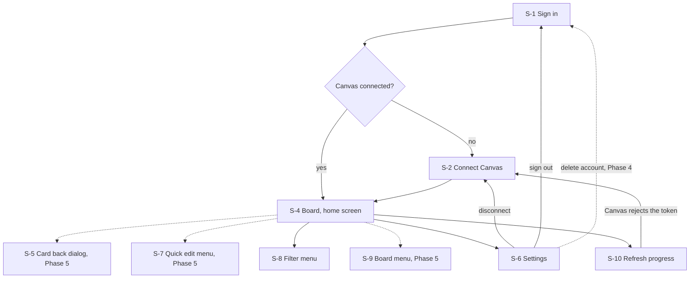
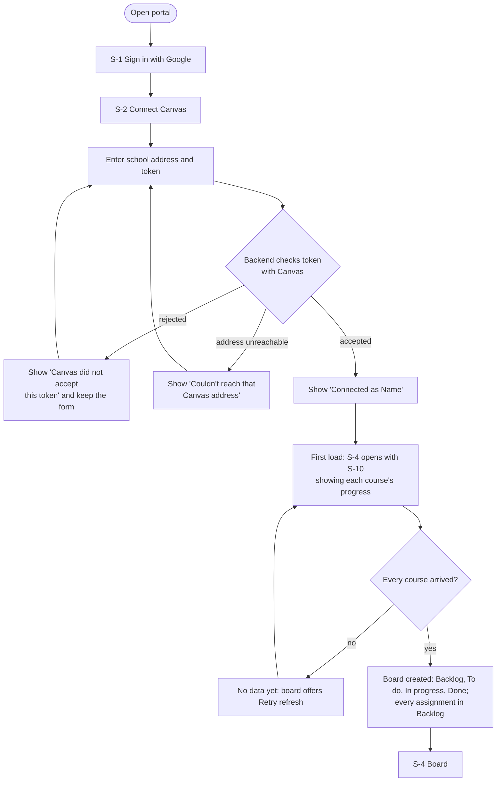
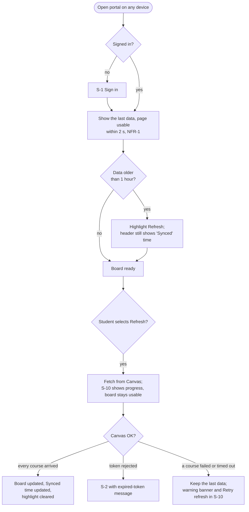
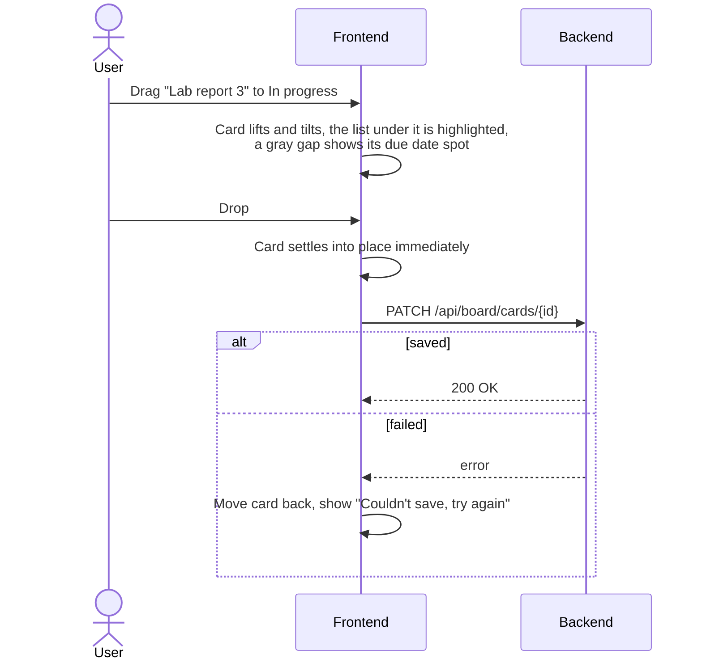
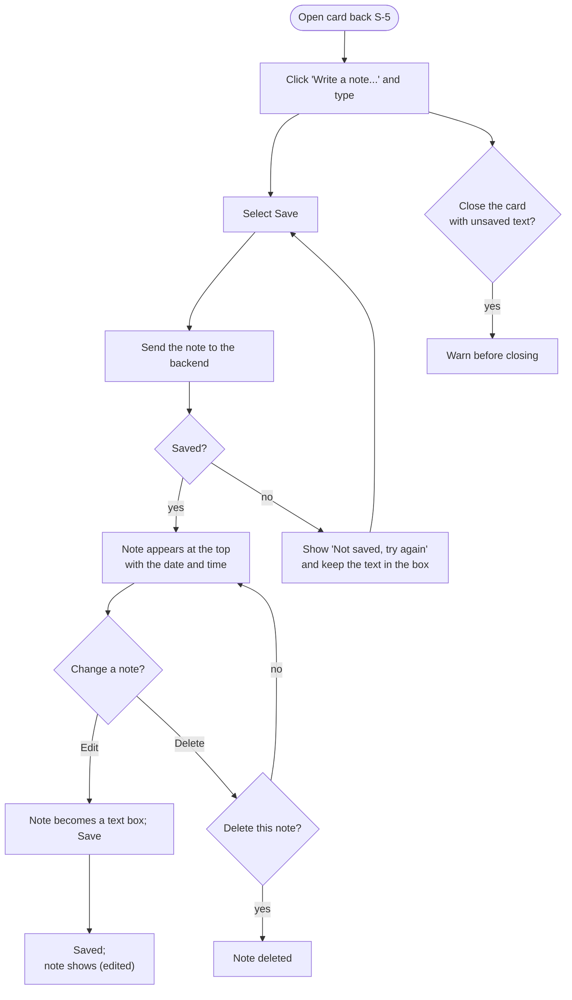
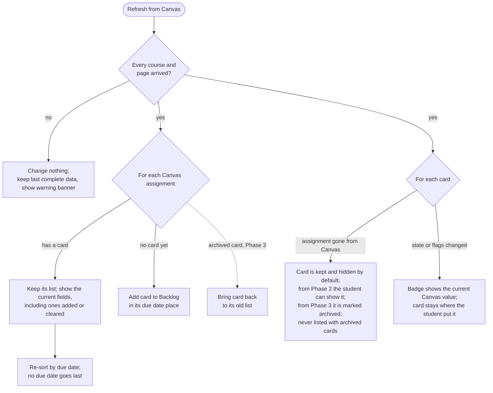
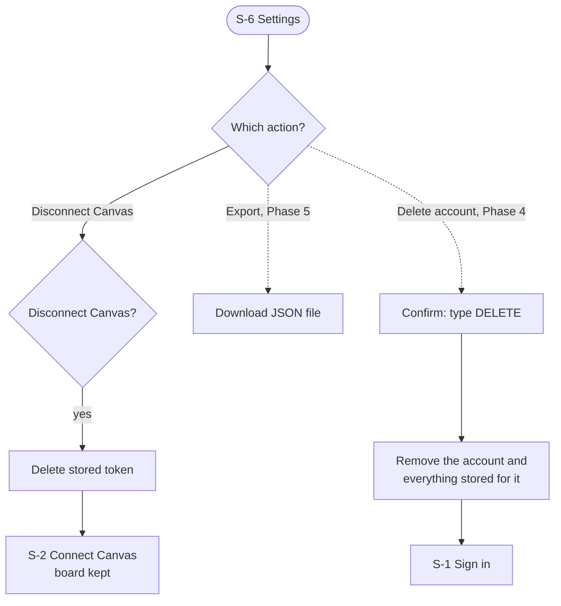
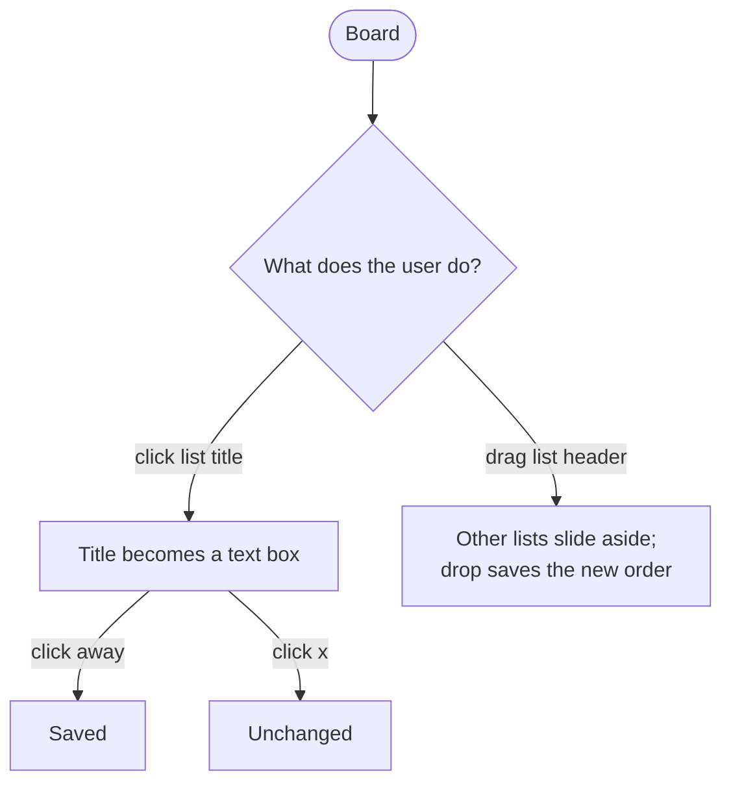
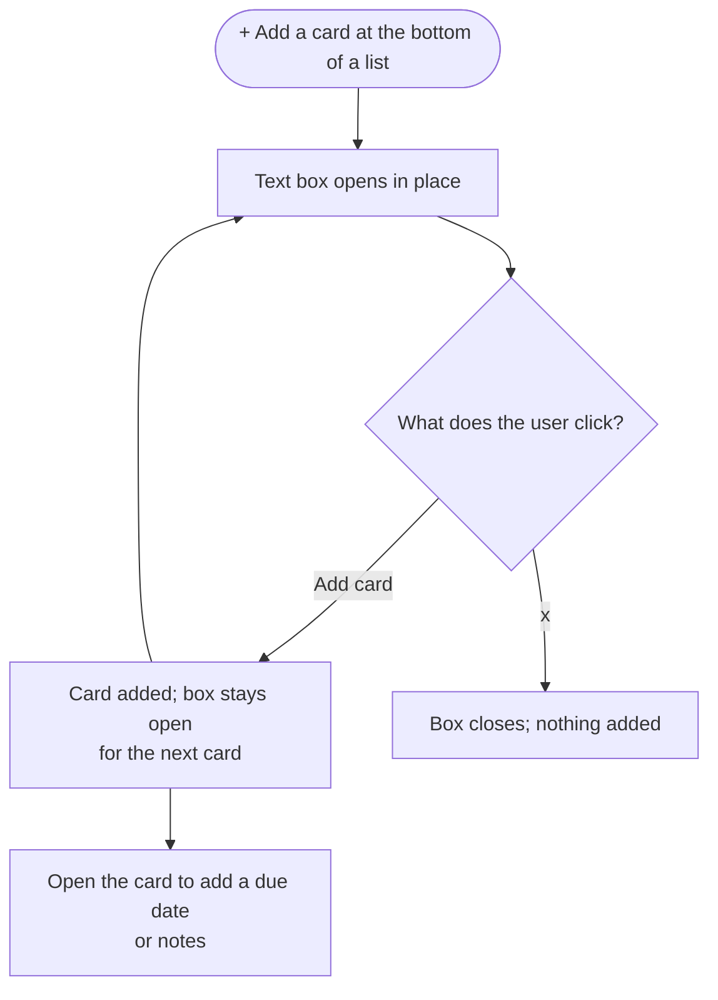

# User Interface Specification

**Status:** Draft · **Owner:** Team Lead · **Last updated:** 2026-10-25

This document specifies the portal's user interface through wireframes and
workflows. Wireframes are rough sketches of each screen: what is on it and where, not
colors or fonts. They are drawn here as text so they can be reviewed and
changed in pull requests. Workflows show how a user moves between screens to
get something done.

Screen IDs (`S-1`, `S-2`, ...) and workflow IDs (`W-1`, `W-2`, ...) are
used by the design and the test procedures. Terms such as board, list,
card, Refresh, and Missing are defined in the [glossary](glossary.md).

### UI by phase

Build only what is listed for the current phase (see the repo's
[CLAUDE.md](../../CLAUDE.md) and
[Requirements by phase](02-requirements.md#requirements-by-phase)). The
Phase 5 sketches are kept as a starting point for later; they are out of
scope until the Team Lead plans them into a phase. This table only mirrors the
requirements index, which Product and QA owns; where they differ, the
requirements index wins.

| Phase | Screens and workflows |
|-------|-----------------------|
| 1 | Header, S-1, S-2, S-4 (read only), S-6 (disconnect and sign out), S-8, S-10; W-1, W-2, and W-5's complete-fetch check and new cards in Backlog |
| 2 | Dragging cards on S-4, and its button that shows cards removed from Canvas; W-3 |
| 3 | W-5's archiving and returning cards (FR-45) |
| 4 | S-6 and W-6's account deletion (FR-54) |
| 5 | S-5, S-7, S-9, the phone layout, S-6 and W-6's export; W-4, W-7, W-8 |

## 1. Screen map

The layout follows Trello (goal G-3): the board is home, a card opens as a
dialog over the board, and menus open in place instead of on new pages.



Dashed arrows lead to screens and actions from later phases.

Every signed-in screen shares a header bar, like Trello's board header. It
sits on the board's background color:

```text
+--------------------------------------------------------------------------+
| Canvas Portal  My assignments          Synced Oct 25, 10:42 AM  [⟳] [⚙]  |
+--------------------------------------------------------------------------+
  "Synced ..." always shows the date and time of the last complete
  Refresh, with nothing hidden behind hover (FR-13). A Refresh that fails
  or stops partway leaves it unchanged (FR-14). Selecting [⟳] starts a
  Refresh. The portal never refreshes on its own (FR-15): when the data
  is more than an hour old, [⟳] is highlighted. During a Refresh [⟳]
  spins and the board stays usable; selecting [⟳] or the "Synced" time
  then opens S-10 with the Refresh's progress. When no Refresh is
  running, the "Synced" time opens the last Refresh's log in S-10.
  [⚙] opens the account menu: Settings, Sign out. Selecting "My assignments"
  goes back to the board from any screen.
  From Phase 5, a [⋯] board menu button before [⚙] opens S-9.
```

S-2 has a smaller header with only "Canvas Portal" and [⚙], so the student
can still sign out, since there is no board or sync time to show yet.

### Conventions on every screen

These keep the screens consistent and cost little to build from Phase 1,
even though the formal accessibility check (NFR-32) is Phase 4.

- **Color is never the only signal.** A red or green due badge always
  comes with the status text and tags on the card (FR-23), and a green
  badge also shows ✓. Course buttons show ● or ○ as well as their color.
- **Every button has an ID and a label.** The ID is in capitals with
  underscores, such as `REFRESH`, so it stands out in logs, docs, code,
  and tests; the table below lists them. The label is plain words, such
  as "Refresh from Canvas", and is what screen readers announce, since
  they would read an ID out letter by letter. Icon buttons show only
  their icon, so the label is their only name. How the ID appears in code,
  such as a test ID, is the Developer's call.
- **Dates and times look the same everywhere,** in the device's time
  zone (FR-22): "Oct 28, 11:59 PM", so "Synced Oct 25, 10:42 AM" and a
  due badge read the same way.
- **One word per idea.** The action is always "Refresh", lists are
  "lists", and courses are "courses" (not "labels"). Screen words match
  the [glossary](glossary.md); a new or changed word goes into it in the
  same PR.
- **Messages say what happened and what to do next,** in plain words,
  with the button that does it, such as [Retry refresh]. They never show
  error codes or the token.
- **Mouse and touch, not keyboard shortcuts:** every action is a button
  or link the student clicks or taps, and no key does anything special.
  Buttons and checkboxes are real browser controls, so the browser's own
  Tab key and screen readers still reach them without extra design.
- **Destructive actions ask first:** disconnecting Canvas, deleting the
  account (Phase 4), and from Phase 5 deleting a note (FR-41) or an
  orphaned card (S-4).

Button IDs for Phases 1 to 4. Later phases add theirs when they are
planned.

| ID | Label | Screen | Shown as |
|----|-------|--------|----------|
| `SIGN_IN_GOOGLE` | Sign in with Google | S-1 | [G Sign in with Google] |
| `SHOW_TOKEN` | Show token / Hide token | S-2 | [show] |
| `TOKEN_HELP` | How do I get a token? | S-2 | > How do I get a token? |
| `CONNECT_CANVAS` | Connect | S-2 | [Connect] |
| `REFRESH` | Refresh from Canvas | Header | [⟳] |
| `SYNC_TIME` | Synced *date and time*, show the Refresh log | Header | Synced Oct 25, 10:42 AM |
| `ACCOUNT_MENU` | Account menu | Header | [⚙] |
| `SETTINGS` | Settings | Account menu | Settings |
| `FILTER` | Filter | S-4 | [⚲ Filter] |
| `CLOSE_FILTER` | Close filter | S-8 | [x] |
| `CLEAR_FILTER` | Clear filter | S-4, S-8 | (x) Clear |
| `COURSE_TOGGLE` | Show *course* / Hide *course* | S-4 | [● BIO 101] |
| `SHOW_ALL_COURSES` | Show all | S-4 | [Show all] |
| `HIDE_ALL_COURSES` | Hide all | S-4 | [Hide all] |
| `SHOW_ORPHANS` | Show cards removed from Canvas / Hide cards removed from Canvas | S-4 (Phase 2) | [◌ Removed from Canvas (2)] |
| `MINIMIZE_LIST` | Minimize *list* | S-4 | [−] |
| `EXPAND_LIST` | Expand *list* | S-4 | [+] |
| `OPEN_IN_CANVAS` | *Assignment name*, opens in Canvas | S-4 | The whole card |
| `REFRESH_DETAILS` | Details | S-4 banner | [Details] |
| `SHOW_PROGRESS` | Show progress | S-4 | [Show progress] |
| `RETRY_REFRESH` | Retry refresh | S-4, S-10 | [Retry refresh] |
| `CLOSE_REFRESH_PANEL` | Close | S-10 | [x] |
| `SHOW_REMOVED_CARDS` | Show cards removed from Canvas | S-10 (Phase 2) | [Show them] |
| `DISCONNECT_CANVAS` | Disconnect Canvas | S-6 | [Disconnect Canvas] |
| `SIGN_OUT` | Sign out | S-6, account menu | [Sign out] |
| `DELETE_ACCOUNT` | Delete my account and all data | S-6 (Phase 4) | [Delete my account and all data] |

IDs that name one of several, such as `COURSE_TOGGLE` and `MINIMIZE_LIST`,
are paired with the course or list they act on, such as
`COURSE_TOGGLE` for BIO 101.

## 2. Screens

### S-1 Sign in

Requirements: FR-50; decision D-7; risk R-6. Shown when no one is signed in.

```text
+--------------------------------------------------+
|                                                  |
|                 Canvas Portal                    |
|                                                  |
|   All your Canvas assignments in one place,      |
|   on a board you can arrange.                    |
|                                                  |
|                                                  |
|          [  G  Sign in with Google  ]            |
|                                                  |
|   Any Google account works. If your school       |
|   account is blocked, use a personal one.        |
|                                                  |
|   We only read from Canvas. We never change      |
|   anything there.                                |
+--------------------------------------------------+
```

If Google sign-in fails or is cancelled, S-1 stays open and says "Sign-in
didn't finish. Try again, or use a personal Google account."

### S-2 Connect Canvas

Requirements: FR-1 to FR-3, FR-6. Shown after first sign-in, after
disconnecting, or when Canvas rejects the saved token.

```text
+--------------------------------------------------------------+
|  Connect your Canvas account                                 |
|                                                              |
|  [!] Canvas no longer accepts your saved token.   <- FR-6,   |
|      Please create a new one. Your board is          shown   |
|      safe.                                           only on |
|                                                      error   |
|  School Canvas address                                       |
|  [ https://myschool.instructure.com            ]             |
|                                                              |
|  Access token                                                |
|  [ ••••••••••••••••••••••••••••••••••          ] [show]      |
|                                                              |
|  > How do I get a token?                       <- expands    |
|    1. In Canvas, open Account, then Settings.                |
|    2. Under Approved Integrations, choose                    |
|       New Access Token.                                      |
|    3. Enter a purpose such as "Canvas Portal".               |
|       Set an expiry date, such as the end of                 |
|       the term, so a lost token stops working.               |
|       Then generate it.                                      |
|    4. Copy the token and paste it here. Canvas               |
|       only shows it once.                                    |
|                                                              |
|                                  [ Connect ]                 |
+--------------------------------------------------------------+
```

The token steps ask the student to give the token an expiry date, which
limits the harm if it ever leaks (risk R-2). When it expires, Canvas
rejects it and S-2 opens with the "no longer accepts your saved token"
message, so the student makes a new one.

The message at the top depends on why S-2 is shown. Each keeps what the
student typed in the address field:

| When | Message |
|------|---------|
| First connection | None |
| After disconnecting (risk R-2) | "Disconnected. To be safe, also delete the token in Canvas: Account, Settings, Approved Integrations." |
| Canvas rejects the saved token during a Refresh (FR-6) | "Canvas no longer accepts your saved token. Please create a new one. Your board is safe." |
| Canvas rejects the token just entered | "Canvas did not accept this token." |
| The address can't be reached, isn't a Canvas site, or doesn't start with `https://` | "Couldn't reach that Canvas address. Check that it starts with https://." |

On success the portal shows "Connected as *Name*" (FR-2) and opens S-4. On
the very first connection there is no data yet, so S-4 opens with S-10
showing the first load (FR-15, FR-16).

### S-3 Table view (removed)

Removed from the Team Lead's review: the board is the only view. The ID is
kept so the other screen numbers don't change.

### S-4 Board (home screen)

Requirements: FR-13 to FR-16, FR-20 to FR-23, FR-26, FR-31, FR-34, FR-35,
FR-38, FR-45 (keeping cards), FR-60, FR-61, FR-65, FR-66, FR-78, FR-80,
NFR-1, NFR-20, NFR-34. From Phase 2: FR-32, FR-33, FR-77, NFR-3. The sketches show Phases 1 to
4 only.

The board is the only view. In Phase 1 it is read only: every card is in
Backlog, so the other three lists are empty and start minimized, and
dragging between lists arrives in Phase 2 (FR-60). This is the Phase 1
board:

```text
+--------------------------------------------------------------------------+
| Canvas Portal  My assignments          Synced Oct 25, 10:42 AM  [⟳] [⚙]  |
+--------------------------------------------------------------------------+
| [⚲ Filter] [● BIO 101] [● HIST 210] [● MATH 152]  [Show all] [Hide all]  |
+--------------------------------------------------------------------------+
|  board background color                                                  |
| +------------------------------------------------+ +----+ +----+ +----+  |
| | Backlog                                    [−] | |[+] | |[+] | |[+] |  |
| | #============================================# | | T  | | I  | | D  |  |
| | # ⚠ MISSING                                  # | | o  | | n  | | o  |  |
| | # ▬▬ HIST 210                                # | |    | |    | | n  |  |
| | # Chapter 4 questions                        # | | d  | | p  | | e  |  |
| | # (◷ Oct 20, 11:59 PM)  10 pts               # | | o  | | r  | |    |  |
| | # Text entry                                 # | |    | | o  | | 0  |  |
| | # Not submitted · Not graded                 # | | 0  | | g  | +----+  |
| | #============================================# | +----+ | r  |         |
| | +--------------------------------------------+ |        | e  |         |
| | | ▬▬ BIO 101                                 | |        | s  |         |
| | | Lab report 2                               | |        | s  |         |
| | | (✓ Oct 22, 11:59 PM)  20 pts               | |        |    |         |
| | | File upload                                | |        | 0  |         |
| | | Submitted · Graded  [Late]                 | |        +----+         |
| | +--------------------------------------------+ |                       |
| | +--------------------------------------------+ |                       |
| | | ▬▬ BIO 101                                 | |                       |
| | | Lab report 3                               | |                       |
| | | (◷ Oct 28, 11:59 PM)  20 pts               | |                       |
| | | 🔒 Opens Oct 27, 8:00 AM                   | |                       |
| | | File upload or text entry                  | |                       |
| | | Not submitted · Not graded                 | |                       |
| | +--------------------------------------------+ |                       |
| | +--------------------------------------------+ |                       |
| | | ▬▬ HIST 210                                | |                       |
| | | Reading reflection                         | |                       |
| | | (no due date)  15 pts                      | |                       |
| | | On paper                                   | |                       |
| | | Not submitted · Not graded                 | |                       |
| | +--------------------------------------------+ |                       |
| +------------------------------------------------+                       |
+--------------------------------------------------------------------------+
```

From Phase 2 the student drags cards between lists. This sketch shows a
later day, with Done empty and minimized. Its cards are abbreviated: they
show the same fields as the Phase 1 sketch.

```text
+--------------------------------------------------------------------------+
| Canvas Portal  My assignments          Synced Oct 25, 10:42 AM  [⟳] [⚙]  |
+--------------------------------------------------------------------------+
| [⚲ Filter] [● BIO 101] [● HIST 210] [● MATH 152]  [Show all] [Hide all]  |
+--------------------------------------------------------------------------+
|  board background color                                                  |
| +-------------------+ +-------------------+ +-------------------+ +----+ |
| | Backlog       [−] | | To do         [−] | | In progress   [−] | |[+] | |
| | +---------------+ | | +---------------+ | | +---------------+ | | D  | |
| | | ▬▬ HIST 210   | | | | ▬▬ MATH 152   | | | | ▬▬ BIO 101    | | | o  | |
| | | Chapter 5     | | | | Problem set 7 | | | | Lab report 3  | | | n  | |
| | | questions     | | | | (◷ Oct 29)    | | | | (◷ Oct 28)    | | | e  | |
| | | (◷ Nov 8)     | | | +---------------+ | | |               | | |    | |
| | +---------------+ | | +---------------+ | | +---------------+ | | 0  | |
| | +---------------+ | | | ▬▬ HIST 210   | | | ┌ ─ ─ ─ ─ ─ ─ ┐   | +----+ |
| | | ▬▬ HIST 210   | | | | Essay draft:  | | | │  drop gap   │   |        |
| | | Reading       | | | | causes of WWI | | | │  (Phase 2)  │   |        |
| | | reflection    | | | | (◷ Nov 3)     | | | └ ─ ─ ─ ─ ─ ─ ┘   |        |
| | | (no due date) | | | +---------------+ | +-------------------+        |
| | +---------------+ | +-------------------+                              |
| +-------------------+                                                    |
+--------------------------------------------------------------------------+
  Card fronts (FR-22, FR-23, FR-65), top to bottom: ▬▬ label strip in
  the course's automatic color (FR-66); the title; the due badge and the
  points; the submission types, written as in the table below; then
  "Submitted" or "Not submitted", "Graded" or "Not graded", and a [Late]
  or [Excused] tag when Canvas sets one. The due badge shows the date and
  time in the device's time zone, such as "Oct 28, 11:59 PM". It is red
  when the card is Missing, even if it is also graded; otherwise green
  with ✓ when Submitted or Graded; and plain otherwise.
  Start and end dates (FR-22): Canvas's "Available from" (`unlock_at`)
  and "Until" (`lock_at`). Before an assignment opens, the card is
  slightly grayed and shows a muted line with a lock icon, "🔒 Opens Oct
  27, 8:00 AM", under the due badge. After its Until date, it shows
  "🔒 Closed Nov 10, 11:59 PM". The lock is never the only signal: the
  words say the same thing for screen readers (alt text "Locked"). In the
  sketch the lock takes two columns, so that row has one space less. Otherwise it shows neither, so open assignments stay
  uncluttered. The card keeps its due date place either way. These lines
  compare the date with the device's clock when the board is drawn; they
  are dates, not statuses (FR-23).
  Missing cards (# border in the sketch) stand out at a glance in three
  ways at once, so color is never the only signal: a thick red border
  round the whole card, a red "⚠ MISSING" bar across its top, and the
  red due badge. From Phase 5, cards with
  notes also show a ✎ note count (FR-43).
  Clicking a card opens the assignment in Canvas in a new tab (FR-26).
  From Phase 5 it opens the card back (S-5) instead.
  Cards in every list are always sorted by due date, earliest at the top;
  cards with no due date come last. Cards with the same due date, or no
  due date, are in name order (FR-38). Missing cards keep their place;
  the highlight is what makes them stand out.

  Cards removed from Canvas (orphaned cards, FR-45): a card whose
  assignment is gone from the last complete Canvas data is kept, never
  deleted, and hidden by default. From Phase 2, a [◌ Removed from Canvas
  (2)] button at the end of the course row shows or hides them, with
  the count of such cards. It appears only when there is at least one,
  and the choice is kept in this browser, like the course buttons.
  Shown, each one stays in its list, in its due date place, grayed out
  with a dashed border, and says "Removed from Canvas" instead of its
  status. It can't be opened in Canvas, since the assignment is gone.
  The screen says "Removed from Canvas", not "orphaned", which is the
  team's word for it. It comes in Phase 2, with dragging, because a
  student may already have moved the card or started the work, and the
  teacher's change is out of their control: a card that just vanished
  would leave them wondering where it went. When a Refresh removes cards,
  its S-10 summary says so, such as "2 assignments were removed from
  Canvas", with [Show them], which turns the button on.
  This button is the only place to find these cards, in every phase:
  they are never listed with archived cards (S-9). From Phase
  5, a shown one has a [Delete] button, which removes it for good, with
  its notes, after asking: "Delete this card and its notes? This can't
  be undone." The portal never deletes a card on its own (FR-45), and
  Delete is only offered for cards that are gone from Canvas. If the
  teacher republishes the assignment, the card is no longer removed and
  shows as usual, in the list it was in.

  Lists: Backlog, To do, In progress, and Done, always in that order
  (FR-31). New assignments from Canvas land in Backlog until the student
  sorts them (FR-34). The lists are fixed: they can't be renamed or
  reordered. Renaming (FR-63), dragging lists (FR-62), adding cards and
  lists (FR-64, FR-71), and archiving lists (FR-36) are Phase 5 ideas.
  [−] in a list header minimizes it to a narrow strip with its title and
  card count; [+] expands it again (FR-80). Expanded lists share the
  board's whole width and resize whenever a list is minimized or
  expanded. The board only scrolls sideways if the window is too narrow
  for every expanded list to be at least 240 px wide (FR-61). Each time
  the board loads or is refreshed, empty lists start minimized and the
  rest start expanded; this state is not saved.

  Course buttons (FR-78): one per active course, in its label color.
  Each shows the course code and, below it in smaller text, the course
  name, shortened with "..." when long (FR-20). The sketches show only
  the codes.
  ● shown, ○ hidden; selecting one hides or shows that course's cards.
  [Show all] and [Hide all] show or hide every course at once. With every
  course hidden, the board says "All courses are hidden" with a Show all
  link. Hidden cards keep their list. Until Phase 5 the choice is kept in
  this browser. The [⚲ Filter] button starts the course row and opens
  the filter menu, S-8 (FR-24, FR-72).

  Dragging (Phase 2, FR-32, FR-77): dragging only chooses the list; the
  card slots into its due date place, which the gray gap shows. Dropping
  a card on an empty minimized list expands it; dropping it on a
  minimized list that has cards keeps the list minimized and updates its
  count (FR-80). Cards move between lists only when the student drags
  them; the portal never moves a card to another list on its own, even
  when Canvas marks it submitted.
```

Messages on the board:

| When | The board shows |
|------|-----------------|
| A Refresh fails or stops partway (NFR-20) | A warning banner between the course row and the lists: "Couldn't refresh from Canvas. Showing data from Oct 25, 10:42 AM." with [Details], which opens S-10. It stays until a Refresh completes. |
| First load still running and S-10 closed | "Loading your assignments from Canvas..." with [Show progress], which reopens S-10. |
| First load failed, so there is no data at all | "Couldn't load your assignments from Canvas." with [Retry refresh] and [Details]. |
| Canvas has no active courses for this account | "Canvas shows no active courses for this account." The course row is empty. |
| Active courses, but none has assignments | The course buttons show, Backlog is empty, and it says "No assignments in your courses yet." |

How each Canvas submission type is written on a card (FR-23). The words
follow what Canvas itself shows the student on the assignment page. When
an assignment has several types, they are joined with "or", in Canvas's
order, with only the first word capitalized: "File upload or text entry".

| Canvas `submission_types` value | On the card |
|---------------------------------|-------------|
| `online_upload` | File upload |
| `online_text_entry` | Text entry |
| `online_url` | Website URL |
| `media_recording` | Media recording |
| `student_annotation` | Student annotation |
| `online_quiz` | Quiz |
| `discussion_topic` | Discussion |
| `external_tool` | External tool |
| `on_paper` | On paper |
| `none` | No submission |
| `not_graded` | Not for a grade |
| Any other value | The value with underscores as spaces, first letter capitalized |

### S-5 Card back (Phase 5, future feature)

Requirements: FR-22, FR-26, FR-28, FR-40 to FR-44, FR-46, FR-67, FR-68.
Opens as a dialog over the dimmed board at `/c/{cardId}`. On phones it fills
the screen.

```text
+--------------------------------------------------------------------------+
| (dimmed board behind)                                                    |
|   +------------------------------------------------------------------+   |
|   | ▭ Lab report 3                                              [x]  |   |
|   |   in list In progress  <- click to move                          |   |
|   |                                                                  |   |
|   | Course          Due date                       |                 |   |
|   | [■ BIO 101]     [ ] Wed Oct 28, 11:59 PM       |                 |   |
|   |                                                |                 |   |
|   | 20 pts · File upload · Not submitted           | Actions         |   |
|   |                                                | [→ Move      ]  |   |
|   | ≡ Description           from Canvas, read only | [↗ Open in   ]  |   |
|   |   Write up the photosynthesis lab using the    | [   Canvas   ]  |   |
|   |   template. Include a graph of O2 vs. light.   | [▤ Archive   ]  |   |
|   |   [Show more]                                  |                 |   |
|   |                                                |                 |   |
|   | ✎ Notes            private, not sent to Canvas |                 |   |
|   | +------------------------------------------+   |                 |   |
|   | | Write a note...                          |   |                 |   |
|   | +------------------------------------------+   |                 |   |
|   | Oct 24, 10:51 AM                               |                 |   |
|   |   Ask Dr. Lee about graph axes.                |                 |   |
|   |   [Edit] · [Delete]                            |                 |   |
|   | Oct 22, 4:05 PM (edited)                       |                 |   |
|   |   Data is in the shared folder.                |                 |   |
|   |   [Edit] · [Delete]                            |                 |   |
|   +------------------------------------------------------------------+   |
+--------------------------------------------------------------------------+
  The due-date checkbox is display only for Canvas cards: completion comes
  from Canvas.
  Description is the assignment's instructions from Canvas, shown read only
  with Canvas's formatting (FR-28). Notes work like the comments at the
  bottom of a Trello card ("Comments and activity"): the student can add as
  many as they like, each stamped with the date and time, newest first
  (FR-40). Clicking "Write a note..." opens the box with a [Save] button
  (FR-42). Edit and Delete work on one note at a time, an
  edited note says "(edited)", and Delete asks first (FR-41, NFR-21).
  [x], clicking outside, or the browser's Back button closes the
  dialog.
```

### S-6 Settings

Requirements: FR-4, FR-50, FR-53 (Phase 5), FR-54 (Phase 4).

```text
+--------------------------------------------------------------+
| Settings                                                     |
|                                                              |
| Canvas                                                       |
|   Connected as Alex S. at myschool.instructure.com           |
|   [ Disconnect Canvas ]                                      |
|                                                              |
| Your data                                                    |
|   [ Export board and notes (.json) ]   (Phase 5)             |
|   [ Delete my account and all data ]   (Phase 4)             |
|                                                              |
| Account                                                      |
|   Signed in as alex@example.com        [ Sign out ]          |
+--------------------------------------------------------------+
  After disconnecting, S-2 reminds the student to also delete the token
  in Canvas, under Account, Settings, Approved Integrations (risk R-2).
  Disconnect Canvas and Delete my account both ask to confirm first
  (W-6). Until Phase 4, "Your data" is not shown.
```

### S-7 Quick edit menu (Phase 5, future feature)

Requirements: FR-69, NFR-36. Opens from a ✎ button on each card
(shown on hover on desktop, always shown on touch screens), by
right-clicking, or by a long press on a phone. The card is shown raised,
with a menu beside it, as in Trello.

```text
+--------------------------------------------------------------+
| (dimmed board)                                               |
|   +------------------+  +------------------------+           |
|   | ▬▬ BIO 101       |  | [▭ Open card        ]  |           |
|   | Lab report 3     |  | [→ Move             ]  |           |
|   | (◷ Oct 28)    ≡  |  | [■ Change label color] |           |
|   |                  |  | [↗ Open in Canvas   ]  |           |
|   +------------------+  | [▤ Archive          ]  |           |
|                         +------------------------+           |
+--------------------------------------------------------------+
```

### S-8 Filter menu

Requirements: FR-24, FR-72, from Phase 1. A dropdown under the
[⚲ Filter] button at the start of the course row. Filtering only hides
cards on the screen; it never changes them or what Canvas holds.

```text
+------------------------------------------+
| Filter                               [x] |
| Keyword                                  |
| [ Enter a keyword...                 ]   |
|                                          |
| Due date                                 |
| [ ] No dates                             |
| [ ] Due date passed                      |
| [ ] Due in the next day                  |
| [ ] Due in the next week                 |
| [ ] Due in the next month                |
|                                          |
| Status                                   |
| [ ] Submitted      [ ] Not submitted     |
| [ ] Graded         [ ] Not graded        |
| [ ] Missing  [ ] Late  [ ] Excused       |
|                                          |
| Courses                                  |
| [ ] ■ BIO 101                            |
| [ ] ■ HIST 210                           |
| [ ] ■ MATH 152                           |
+------------------------------------------+
  With a filter on, the course row shows
  [Filter · 3 cards match  (x) Clear], and x clears it.
```

- Choices in one group widen the filter, and groups narrow it: ticking
  Submitted and Missing shows cards that are either, and adding BIO 101
  keeps only those in BIO 101.
- Keyword matches the assignment name as the student types, ignoring
  capitals (FR-24).
- Due date choices compare the due date with the device's clock, like
  the start and end date lines on cards (FR-22).
- Status choices use the same Canvas fields and words as the card front
  (FR-23).
- Courses are the same setting as the course buttons: ticking a course
  here shows it there, and the other way round.
- Minimized lists count only the cards that match.
- The menu closes with [x] or a click outside it. Every choice is a
  real checkbox with a label, so screen readers say whether it is ticked.
- The filter lasts until it is cleared or the page is reloaded. It is not
  saved, so a forgotten filter never hides a new assignment the next day.
  Saved filters are a future feature (Phase 5).
  The "3 cards match" line keeps it visible while it is on.

| When | Message |
|------|---------|
| No cards match | "No cards match this filter." with a Clear filter link, in place of the lists' cards |

### S-9 Board menu (Phase 5, future feature)

Requirements: FR-75. A small menu under the [⋯] button, holding only
board settings. It never lists cards, since a student may have many.

```text
                          +------------------------+
                          | Board              [x] |
                          |------------------------|
                          | [■ Course colors]      |
                          | [▧ Change background]  |
                          +------------------------+
```

Archived cards and lists (FR-74) are found the way cards removed from
Canvas are: on the board itself, with a filter. From Phase 5 the filter
menu (S-8) ends with an Archived group, "[ ] Show archived cards" and
"[ ] Show archived lists". Shown, an archived card stays in its old list,
in its due date place, grayed out with a dashed border and a [Restore]
button; an archived list appears grayed out after Done, with [Restore]
in its header. The keyword filter finds an archived card by name, so a
long archive needs no separate search. Restore puts it back as it was,
with its notes. Cards removed from Canvas have their own
[◌ Removed from Canvas] button (S-4).

### S-10 Refresh progress

Requirements: FR-6, FR-14, FR-15, FR-16, NFR-20. A panel that opens below
the header, over the board.

```text
+--------------------------------------------------+
| Refresh from Canvas                          [x] |
| 5 of 8 courses · 132 assignments · 0:48          |
| [████████████████░░░░░░░░░░░░░]                  |
|--------------------------------------------------|
| ✓ BIO 101      34 assignments   2 pages   0:12   |
| ✓ HIST 210     21 assignments   1 page    0:06   |
| ✓ MATH 152     58 assignments   1 page    0:19   |
| ✓ CHEM 110     19 assignments   1 page    0:08   |
| ✗ ART 105      timed out after 30 s              |
| ⟳ ENG 101      page 2 of 3                       |
| ⏸ SPAN 201     waiting: Canvas rate limit, 5 s   |
| · PE 100       not started                       |
+--------------------------------------------------+
  Opens on its own for the very first load, when there is no data to show
  yet. On later Refreshes the board stays usable, [⟳] spins, and selecting
  [⟳] or the "Synced" time opens the panel.
  Each course shows one state: · not started, ⟳ being fetched (with its
  page), ⏸ waiting on a Canvas rate limit, ✓ done (with its assignment
  count, pages, and time), or ✗ failed (with the reason, such as a timeout
  or Canvas's error message, never the token).
  When the Refresh ends, the top line becomes a summary: "Synced 8 courses,
  214 assignments in 1:42", or, if any course failed, "Refresh incomplete:
  1 course failed. Still showing data from Oct 25, 10:42 AM" with
  [Retry refresh]. Only a complete Refresh replaces the saved data (FR-14).
  From Phase 2, when a complete Refresh finds assignments gone from
  Canvas, the summary adds "2 assignments were removed from Canvas" with
  [Show them], which shows those cards on the board (S-4).
  The log of the last Refresh stays available from the "Synced" time until
  the next Refresh starts.
  [x] closes the panel; the Refresh keeps running. If Canvas rejects the
  token, the Refresh stops and the portal opens S-2 with the
  expired-token message (FR-6).
```

### Phone layout (Phase 5)

Requirement: NFR-33. Phase 5: this sketch is a starting point, and the UI
details are worked out before phone support is built. As in Trello's phone
layout, one list fills the screen.
The user swipes sideways between lists, and dots show which list is shown.

```text
+----------------------------+
| ‹  My assignments  [⟳] [⋯] |
| Synced Oct 25, 10:42 AM    |
+----------------------------+
| [⚲] [● BIO] [● HIST] [● MA›|
+----------------------------+
| In progress                |
| +------------------------+ |
| | ▬▬ BIO 101             | |
| | Lab report 3           | |
| | (◷ Oct 28) ✎ 2         | |
| +------------------------+ |
| +------------------------+ |
| | ▬▬ MATH 152            | |
| | Problem set 7          | |
| | (◷ Oct 29)             | |
| +------------------------+ |
|                            |
|                            |
|          ○ ● ○ ○           |
+----------------------------+
  [⚲] opens the filter menu (S-8). The course buttons scroll sideways
  when they don't fit; Show all and Hide all are at the end of the row
  (FR-78). [⋯] opens the board menu (S-9), which also holds Settings and
  Sign out on phones.
  To move a card, press and hold it, then drag it to a screen edge to go
  to the next list, or use Move on the card back.
  Minimized lists are skipped when swiping (FR-80).
```

## 3. Workflows

### W-1 First-time setup



### W-2 Daily check



### W-3 Move a card (Phase 2)



Moving the card on screen before the server answers is called an
*optimistic update*. It keeps dragging fast (NFR-3), and the card snaps back
if the save fails, so the screen never keeps a move the server didn't save.

### W-4 Add, edit, or delete a note (Phase 5, future feature)



### W-5 Assignment changes in Canvas

Phase 1 builds the complete-fetch check, showing the current fields,
adding new assignments to Backlog, and hiding (not deleting) cards whose
assignments are gone (FR-14, FR-34, FR-35, FR-38, FR-45). Archiving cards
and bringing them back come in Phase 3 (FR-39, FR-45).



### W-6 Disconnect and delete data



### W-7 Arrange the lists (Phase 5, future feature)

Until Phase 5 the board always has the same four lists, in this order:
Backlog, To do, In progress, and Done. Renaming and reordering them (FR-62,
FR-63), and adding and archiving lists, are Phase 5 ideas.



### W-8 Add a personal card (Phase 5, future feature)



## Change log

| Date | Change |
|------|--------|
| 2026-10-25 | First draft. |
| 2026-10-25 | Trello goal (G-3): board is home; S-3 becomes Table view; S-4 and S-5 redrawn as Trello board and card back; added S-7 quick edit, S-8 filter, S-9 board menu; Trello-style phone layout; W-7 and W-8 added. |
| 2026-10-25 | Added the course show/hide button row under the header on S-3, S-4, and the phone layout (FR-78), from the Team Lead's review. |
| 2026-10-25 | Added Hide all next to Show all on the course button row (FR-78). |
| 2026-10-25 | Removed the "Move to Done?" hint (FR-37) from S-4 and W-5; students drag cards to Done themselves. |
| 2026-10-25 | Checklists (FR-70) moved to Phase 5: removed checklist badges and the card back checklist section. |
| 2026-10-25 | Adding cards and lists moved to Phase 5: removed "+ Add a card" and "+ Add another list" from S-4 and the phone layout; W-7 now covers rename and reorder only; W-8 marked Phase 5. |
| 2026-10-25 | Cards always sorted by due date within each list (FR-38): S-4 notes, S-9 restore, W-3, and W-5 updated. |
| 2026-10-25 | Quick edit menu (S-7, FR-69) moved to Phase 5; removed the ✎ hover button from S-4. |
| 2026-10-25 | Added a Backlog list before To do for new, unsorted Canvas assignments: S-4 redrawn, S-3, W-1, W-5, and W-7 updated. |
| 2026-10-25 | Removed the NEW badge from S-4 and W-5; marking new and updated assignments is now a Phase 5 idea (FR-79). |
| 2026-10-25 | Due soon removed (Phase 5, FR-27): no yellow badges in S-3, S-4, S-5, or the filter menu. |
| 2026-10-25 | Statuses now come straight from Canvas fields (FR-23): S-4 badge notes, S-5, and the S-8 filter menu updated. |
| 2026-10-25 | Filter button moved from the header to the start of the course button row (S-3, S-4, phone), from the Team Lead's review. |
| 2026-10-25 | The filter menu and card back say "Courses"/"Course" instead of "Labels", from the Team Lead's review. |
| 2026-10-25 | Notes are now dated, comment-style entries (like Trello's "Comments and activity"), separate from the read-only Canvas description: S-5 redrawn, note count badges on S-3, S-4, and phone, W-4 rewritten, from the Team Lead's review. |
| 2026-10-25 | Renaming and reordering lists moved to Phase 5: list menus removed from S-4 and the phone layout, W-7 marked Phase 5, from the Team Lead's review. |
| 2026-10-25 | Table view (S-3) removed: no view switch in the header, S-2 opens the board, and the board takes over S-3's requirements and Canvas warning banner, from the Team Lead's review. |
| 2026-10-25 | Card back (S-5), filter menu (S-8), board menu and archive (S-9), and notes (W-4) marked Phase 5; until then clicking a card opens it in Canvas. From the Team Lead. |
| 2026-10-25 | W-5 now covers partial fetches, fields added or cleared, and republished assignments, from the Team Lead's review. |
| 2026-10-25 | Export marked Phase 5 on S-6 and W-6. |
| 2026-10-25 | Whole-plan review: S-1 no longer promises notes, S-4 and the phone layout mark notes, the filter menu, and the card back as Phase 5. |
| 2026-10-25 | Lists can be minimized and expanded (FR-80): S-4 redrawn with Done minimized and the other lists sharing the width; empty lists start minimized; phone layout skips minimized lists. From the Team Lead's review. |
| 2026-10-25 | Header legend and W-2 now show manual Refresh: no automatic fetch, Refresh highlighted when data is over an hour old (FR-15), from the Team Lead's review. |
| 2026-10-25 | Header always shows the last sync date and time instead of a hover tooltip, from the Team Lead's review; quick edit (S-7) no longer depends on hover (NFR-36). |
| 2026-10-25 | S-4 notes: list state is set fresh on each load, not saved; dropping a card on an empty minimized list expands it. |
| 2026-10-25 | Phone layout marked Phase 5, a starting sketch whose UI details are still to be worked out, from the Team Lead's review. |
| 2026-10-25 | Renamed from "Wireframes and workflows" to "User Interface Specification" (file `04-ui-specification.md`), from the Team Lead's request. |
| 2026-10-25 | S-4 and the header now show only Phases 1 to 4: the [Filter] button, note counts, and [⋯] board menu are described as Phase 5 additions instead of drawn; S-2's error no longer mentions notes. From the whole-set review. |
| 2026-10-25 | S-4 no longer lists NFR-31. From the Team Lead's review: keyboard actions are not a requirement. |
| 2026-10-25 | Added S-10 Refresh progress (FR-16): per-course states, errors and timeouts, a summary, and the last Refresh's log, from the Team Lead's review. |
| 2026-10-25 | In-depth UI/UX review after PR #3: added *UI by phase* and *Conventions on every screen* (color never the only signal, named icon buttons, one date format, consistent words, helpful messages); S-4 has a Phase 1 sketch, and card fronts show the due date and time, points, and Canvas status, with red winning over green on the due badge (FR-22, FR-65); course buttons show the course name under the code (FR-20); cards of removed assignments are hidden but kept until Phase 3 (FR-45); board messages for a failed Refresh, the first load, no courses, and no assignments; the header's "Synced" time is the last complete Refresh (FR-13), and [⟳] starts a Refresh; S-1 says a personal Google account works (R-6); S-2 lists its messages; S-10 closes without stopping the Refresh and uses ⏸ for rate limits, so ◷ only means a due date; S-6 marks deletion Phase 4; S-8 adds Excused; Ctrl+Enter and the `f` key removed (keyboard actions are not a requirement); W-3 marked Phase 2; W-5 marks its Phase 3 parts; W-4 no longer names undesigned Phase 5 endpoints; Oct 28, 2026 is a Wednesday. |
| 2026-10-26 | Card status follows the new FR-23 and FR-65, from the Team Lead's review of the requirements: cards show their submission types (with a table of how each is written), Submitted or Not submitted, Graded or Not graded, and Late or Excused tags; Pending review is gone; Missing cards get a red border and a "⚠ MISSING" bar as well as the red badge; S-5 and S-8 updated to match. |
| 2026-10-26 | The account menu button is a gear, [⚙], instead of (A), from the Team Lead's review. |
| 2026-10-26 | Every button has an ID in capitals with underscores for logs, docs, code, and tests, and a plain-words label for screen readers, with a table of Phase 1 to 4 button IDs, from the Team Lead's review. Dates use the device's time zone (FR-22). |
| 2026-10-26 | Deleting a note or an orphaned card (Phase 5) joins the destructive actions that ask first; S-9 adds Delete for orphaned cards, those whose assignment is gone from Canvas. From the Team Lead's review. |
| 2026-10-26 | Links to the new [glossary](glossary.md), and screen words follow it, from the Team Lead's review. |
| 2026-10-26 | S-2's token steps ask for an expiry date, and disconnecting reminds the student to delete the token in Canvas (risk R-2), from the Team Lead's review. |
| 2026-10-26 | Cards removed from Canvas are hidden by default, not for good: from Phase 2 a [◌ Removed from Canvas] button on the course row shows them, grayed out in their lists. From the Team Lead's review. |
| 2026-10-26 | The [◌ Removed from Canvas] button moves to Phase 2, with dragging, and the S-10 summary says when a Refresh removed cards, from the Team Lead's review. |
| 2026-10-26 | Cards show when an assignment opens (Canvas "Available from") until it does, and when it closed (Canvas "Until") after that, from Phase 1, from the Team Lead's review. |
| 2026-10-26 | The board menu (S-9) lists no cards, from the Team Lead's review: it holds only course colors and the background. Archived cards and lists are shown on the board with a Phase 5 Archived group in the filter menu, grayed out with [Restore]. |
| 2026-10-26 | No keyboard shortcuts, from the Team Lead's review: a new convention says every action is clicked or tapped; Escape and Enter removed from S-5, S-8, W-7, and W-8. Saved filters are a future feature. |
| 2026-10-26 | Cards removed from Canvas are found only with the [◌ Removed from Canvas] button, never in the board menu's Archived items (S-9); from Phase 5 Delete is on the card itself. From the Team Lead's review. |
| 2026-10-26 | The filter menu (S-8, FR-24, FR-72) moves to Phase 1, from the Team Lead's review: the [⚲ Filter] button is drawn in the S-4 course row, with button IDs, how choices combine, keyboard and screen reader behavior, and a message when nothing matches. The filter is not saved. |
| 2026-10-26 | The S-4 sketch shows the 🔒 lock on the "Opens" line, and the notes quote it on both the "Opens" and "Closed" lines, from the Team Lead's review. |
