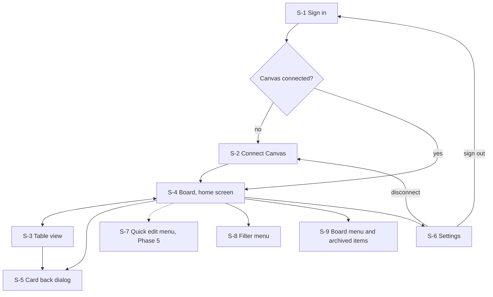
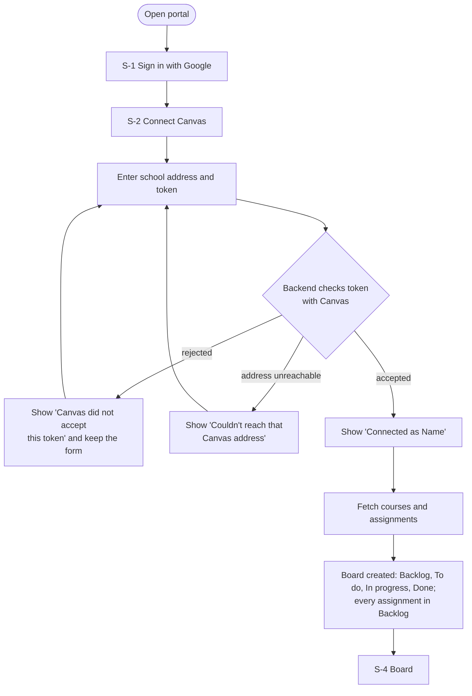
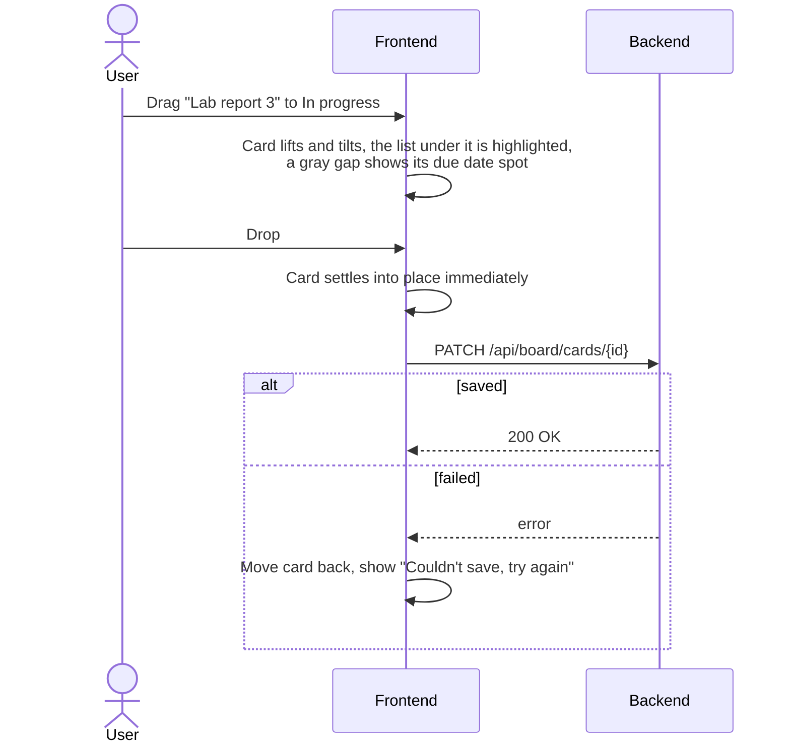
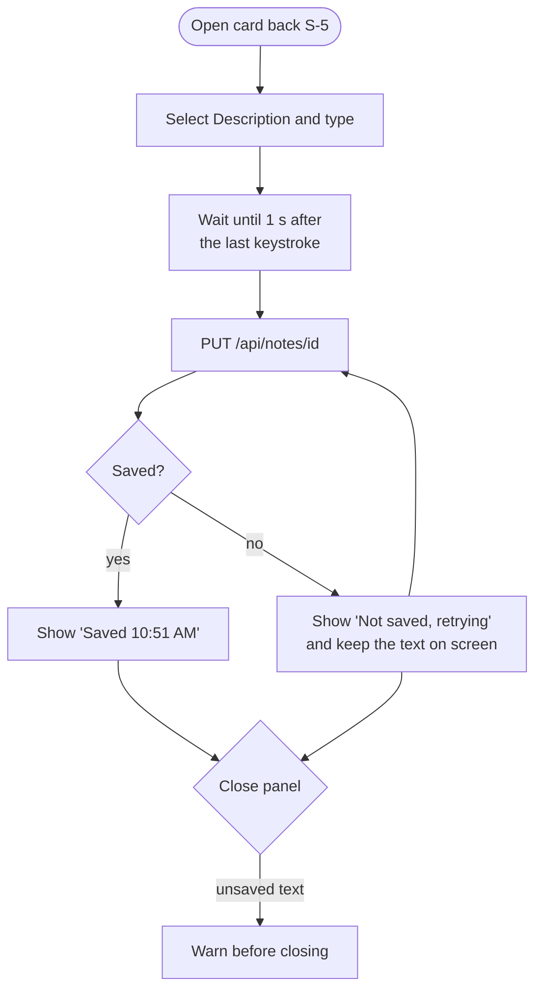
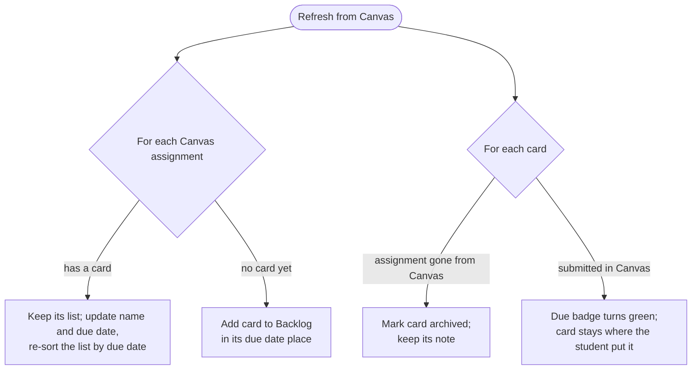
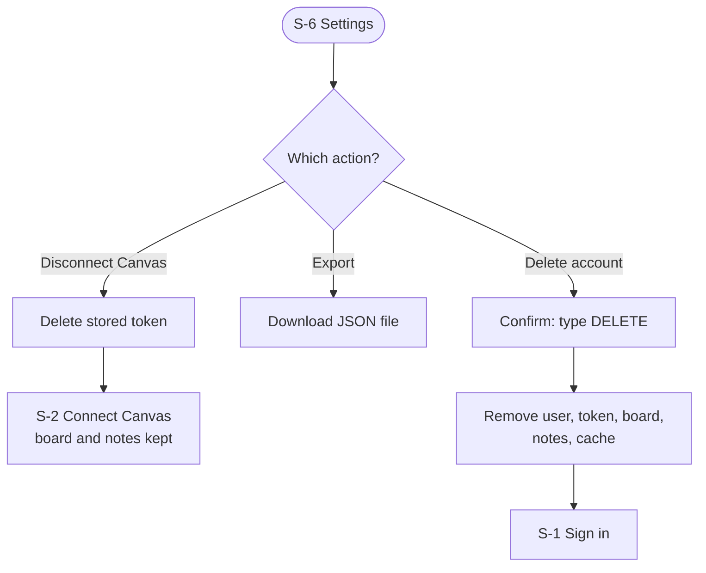
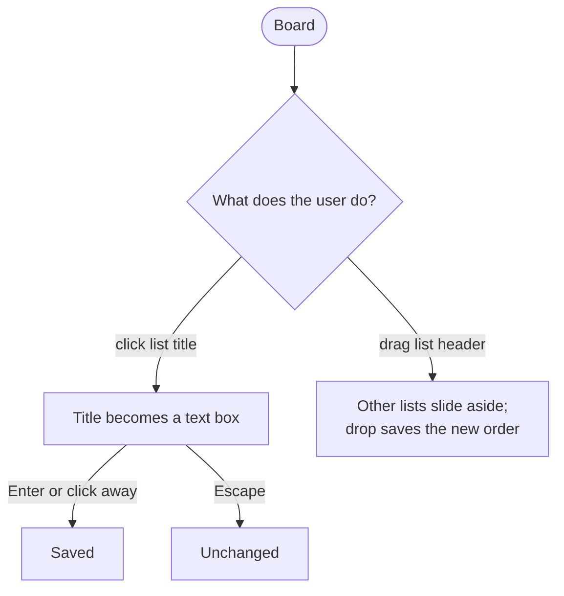
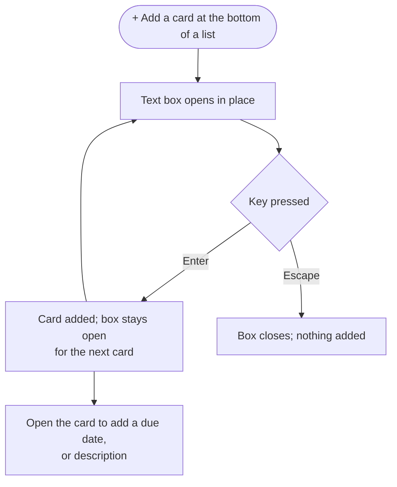

# Wireframes and workflows

**Status:** Draft · **Owner:** Team Lead · **Last updated:** 2026-10-25

Wireframes are rough sketches of each screen: what is on it and where, not
colors or fonts. They are drawn here as text so they can be reviewed and
changed in pull requests. Workflows show how a user moves between screens to
get something done.

Screen IDs (`S-1`, `S-2`, ...) are used by the test procedures.

## 1. Screen map

The layout follows Trello (goal G-3): the board is home, a card opens as a
dialog over the board, and menus open in place instead of on new pages.



Every signed-in screen shares a header bar, like Trello's board header. It
sits on the board's background color:

```text
+--------------------------------------------------------------------------+
| Canvas Portal  My assignments  [*Board*| Table ]            [⟳] [⋯] (A)  |
+--------------------------------------------------------------------------+
  [⟳] refreshes from Canvas; hovering shows "Updated 3 min
  ago". [⋯] opens S-9. (A) is the account menu: Settings, Sign out.
```

## 2. Screens

### S-1 Sign in

Requirements: FR-50, D-7. Shown when no one is signed in.

```text
+--------------------------------------------------+
|                                                  |
|                 Canvas Portal                    |
|                                                  |
|   All your Canvas assignments in one place,      |
|   on a board you can arrange, with your own      |
|   private notes.                                 |
|                                                  |
|          [  G  Sign in with Google  ]            |
|                                                  |
|   We only read from Canvas. We never change      |
|   anything there.                                |
+--------------------------------------------------+
```

### S-2 Connect Canvas

Requirements: FR-1 to FR-3, FR-6. Shown after first sign-in, after
disconnecting, or when Canvas rejects the saved token.

```text
+--------------------------------------------------------------+
|  Connect your Canvas account                                 |
|                                                              |
|  [!] Canvas no longer accepts your saved token.   <- FR-6,   |
|      Please create a new one. Your board and         shown   |
|      notes are safe.                                 only on |
|                                                      error   |
|  School Canvas address                                       |
|  [ https://myschool.instructure.com            ]             |
|                                                              |
|  Access token                                                |
|  [ ••••••••••••••••••••••••••••••••••          ] [show]      |
|                                                              |
|  > How do I get a token?                       <- expands    |
|    1. In Canvas, open Account, then Settings.                |
|    2. Under Approved Integrations, choose                    |
|       New Access Token.                                      |
|    3. Enter a purpose such as "Canvas Portal"                |
|       and generate it.                                       |
|    4. Copy the token and paste it here. Canvas               |
|       only shows it once.                                    |
|                                                              |
|                                  [ Connect ]                 |
+--------------------------------------------------------------+
```

On success the portal shows "Connected as *Name*" (FR-2) and opens S-3.

### S-3 Table view

Requirements: FR-13, FR-20 to FR-26, FR-30, FR-65, FR-78, NFR-20. In Phase 1 this
is the only view. From Phase 2 it is the secondary view behind the board.
Each row uses the same label colors and due badges as the cards.

```text
+--------------------------------------------------------------------------+
| Canvas Portal  My assignments  [ Board |*Table*]            [⟳] [⋯] (A)  |
+--------------------------------------------------------------------------+
| [Filter] | [● BIO 101] [● HIST 210] [● MATH 152]  [Show all] [Hide all]  |
+--------------------------------------------------------------------------+
| [!] Canvas isn't responding. Showing data from 10:42 AM.  <- NFR-20 only |
+--------------------------------------------------------------------------+
| Card               | List         | Label      | Due          | Points   |
|--------------------+--------------+------------+--------------+----------|
| Lab report 3     ≡ | In progress  | ■ BIO 101  | (◷ Tue 11:59)| 20       |
|                    |              |            |              |          |
| Problem set 7      | To do        | ■ MATH 152 | (◷ Wed 9:00) | 10       |
|                    |              |            |              |          |
| Essay draft      ≡ | To do        | ■ HIST 210 | (◷ Nov 3)    | 50       |
| Reading reflection | Backlog      | ■ HIST 210 | none         | 5        |
+--------------------------------------------------------------------------+
  ≡ = has a description (note), FR-43. ■ = course label color, FR-66.
  Clicking a row opens S-5. The List column appears from Phase 2.
  The course buttons are the same as on the board, and hiding a course on one
  view hides it on the other (FR-78).
```

### S-4 Board (home screen)

Requirements: FR-31 to FR-35, FR-38, FR-60 to FR-63, FR-65, FR-66, FR-72 to FR-74, FR-77, FR-78,
NFR-3, NFR-31, NFR-34.

```text
+--------------------------------------------------------------------------+
| Canvas Portal  My assignments  [*Board*| Table ]            [⟳] [⋯] (A)  |
+--------------------------------------------------------------------------+
| [Filter] | [● BIO 101] [● HIST 210] [● MATH 152]  [Show all] [Hide all]  |
+--------------------------------------------------------------------------+
|  board background color                                       Done ──>   |
|  +--------------------+ +--------------------+ +--------------------+    |
|  | Backlog        […] | | To do          […] | | In progress    […] |    |
|  | +----------------+ | | +----------------+ | | +----------------+ |    |
|  | | ▬▬ HIST 210    | | | | ▬▬ MATH 152    | | | | ▬▬ BIO 101     | |    |
|  | | Chapter 5      | | | | Problem set 7  | | | | Lab report 3   | |    |
|  | | questions      | | | | (◷ Wed 9:00)   | | | | (◷ Tue 11:59)  | |    |
|  | | (◷ Nov 8)      | | | +----------------+ | | | ≡              | |    |
|  | +----------------+ | | +----------------+ | | +----------------+ |    |
|  | +----------------+ | | | ▬▬ HIST 210    | | | ┌ ─ ─ ─ ─ ─ ─ ─ ┐  |    |
|  | | ▬▬ HIST 210    | | | | Essay draft:   | | | │   drop gap    │  |    |
|  | | Reading        | | | | causes of WWI  | | | │   (FR-77)     │  |    |
|  | | reflection     | | | | (◷ Nov 3) ≡    | | | └ ─ ─ ─ ─ ─ ─ ─ ┘  |    |
|  | | (no due date)  | | | +----------------+ | +--------------------+    |
|  | +----------------+ | +--------------------+                           |
|  +--------------------+                                                  |
+--------------------------------------------------------------------------+
  [Filter] at the start of the course row opens S-8 (FR-72).
  Course buttons (FR-78): one per active course, in its label color. ● shown,
  ○ hidden; tapping one hides or shows that course's cards. [Show all] and
  [Hide all] show or hide every course at once. With every course hidden, the
  board says "All courses are hidden" with a Show all link. Hidden cards keep
  their list.
  ▬▬ label strip in the course color (FR-66). (◷ ...) due badge: red
  when Canvas flags Missing, green with ✓ when Submitted or Graded, plain
  otherwise (FR-65). ≡ has a description.
  The lists are fixed. List title: click to rename (FR-63). Drag a list
  by its header to reorder (FR-62). […] list menu: Move list.
  Adding cards and lists (FR-64, FR-71) and archiving lists (FR-36) are
  Phase 5 ideas.
  The four lists are Backlog, To do, In progress, and Done; Done is off to
  the right, and the board scrolls sideways. New assignments from Canvas land
  in Backlog until the student sorts them (FR-31, FR-34).
  Cards in every list are always sorted by due date, earliest at the top
  (FR-38). Dragging only chooses the list; the card slots into its due date
  place, which the gray gap shows. Cards move between lists only when the
  student drags them; the portal never moves a card to another list on its
  own, even when Canvas marks it submitted.
```

### S-5 Card back

Requirements: FR-22, FR-26, FR-40 to FR-44, FR-46, FR-67, FR-68.
Opens as a dialog over the dimmed board at `/c/{cardId}`. On phones it fills
the screen.

```text
+--------------------------------------------------------------------------+
| (dimmed board behind)                                                    |
|   +------------------------------------------------------------------+   |
|   | ▭ Lab report 3                                              [x]  |   |
|   |   in list In progress  <- click to move                          |   |
|   |                                                                  |   |
|   | Course          Due date                       |                 |   |
|   | [■ BIO 101]     [ ] Tue Oct 28, 11:59 PM       |                 |   |
|   |                                                |                 |   |
|   | 20 points · Not submitted                      | Actions         |   |
|   |                                                | [→ Move      ]  |   |
|   | ≡ Description            private, never sent   | [↗ Open in   ]  |   |
|   |                          to Canvas             | [   Canvas   ]  |   |
|   | +------------------------------------------+   | [▤ Archive   ]  |   |
|   | | Ask Dr. Lee about graph axes.            |   |                 |   |
|   | | Data is in the shared folder.            |   |                 |   |
|   | +------------------------------------------+   |                 |   |
|   | Saved 10:51 AM                     [Edit]      |                 |   |
|   +------------------------------------------------------------------+   |
+--------------------------------------------------------------------------+
  The due-date checkbox is display only for Canvas cards: completion comes
  from Canvas. Escape, [x], clicking
  outside, or the browser's Back button closes the dialog.
```

### S-6 Settings

Requirements: FR-4, FR-53, FR-54.

```text
+--------------------------------------------------------------+
| Settings                                                     |
|                                                              |
| Canvas                                                       |
|   Connected as Alex S. at myschool.instructure.com           |
|   [ Disconnect Canvas ]                                      |
|                                                              |
| Your data                                                    |
|   [ Export board and notes (.json) ]                         |
|   [ Delete my account and all data ]   <- asks to confirm    |
|                                                              |
| Account                                                      |
|   Signed in as alex@example.com        [ Sign out ]          |
+--------------------------------------------------------------+
```

### S-7 Quick edit menu (Phase 5, future feature)

Requirements: FR-69. Phase 5. Opens from a ✎ button on hover or by
right-clicking a card. The card is shown raised, with a menu beside it,
as in Trello.

```text
+--------------------------------------------------------------+
| (dimmed board)                                               |
|   +------------------+  +------------------------+           |
|   | ▬▬ BIO 101       |  | [▭ Open card        ]  |           |
|   | Lab report 3     |  | [→ Move             ]  |           |
|   | (◷ Tue 11:59) ≡  |  | [■ Change label color] |           |
|   |                  |  | [↗ Open in Canvas   ]  |           |
|   +------------------+  | [▤ Archive          ]  |           |
|                         +------------------------+           |
+--------------------------------------------------------------+
```

### S-8 Filter menu

Requirements: FR-72. A dropdown under the Filter button at the start of the
course row, opened with `f`.

```text
+------------------------------------------+
| Filter                               [x] |
| Keyword                                  |
| [ Enter a keyword...                 ]   |
|                                          |
| Due date                                 |
| [ ] No dates                             |
| [ ] Due date passed                      |
| [ ] Due in the next day                  |
| [ ] Due in the next week                 |
| [ ] Due in the next month                |
|                                          |
| Canvas status                            |
| [ ] Not submitted  [ ] Submitted         |
| [ ] Graded         [ ] Missing  [ ] Late |
|                                          |
| Courses                                  |
| [ ] ■ BIO 101                            |
| [ ] ■ HIST 210                           |
| [ ] ■ MATH 152                           |
+------------------------------------------+
  With a filter on, the course row shows
  [Filter · 3 cards match  (x) Clear], and x clears it.
```

### S-9 Board menu and archived items

Requirements: FR-74, FR-75. A panel that slides in from the right edge of the
board.

```text
                          +------------------------------------+
                          | Menu                           [x] |
                          |------------------------------------|
                          | [▤ Archived items]                 |
                          | [■ Course colors]     (Phase 5)    |
                          | [▧ Change background] (Phase 5)    |
                          |------------------------------------|
                          | Archived items                     |
                          | [Search archive...]  [Cards|Lists] |
                          | +--------------------------------+ |
                          | | ▬▬ BIO 101                     | |
                          | | Old lab (removed from Canvas)  | |
                          | +--------------------------------+ |
                          | [Restore]  ≡ note kept             |
                          +------------------------------------+
  Cards for assignments removed from Canvas land here (FR-45).
  Restore puts a card back in its old list, in its due date place.
```

### Phone layout

Requirement: NFR-33. As in Trello's phone layout, one list fills the screen.
The user swipes sideways between lists, and dots show which list is shown.

```text
+----------------------------+
| ‹  My assignments  [⟳] [⋯] |
+----------------------------+
| [⚲] [● BIO] [● HIST] [● MA›|
+----------------------------+
| In progress            […] |
| +------------------------+ |
| | ▬▬ BIO 101             | |
| | Lab report 3           | |
| | (◷ Tue 11:59) ≡        | |
| +------------------------+ |
| +------------------------+ |
| | ▬▬ MATH 152            | |
| | Problem set 7          | |
| | (◷ Wed 9:00)           | |
| +------------------------+ |
|                            |
|                            |
|          ○ ● ○ ○           |
+----------------------------+
  [⚲] opens the filter menu. The course buttons scroll sideways when they
  don't fit; Show all and Hide
  all are at the end of the row (FR-78).
  To move a card, press and hold it, then drag it to a screen edge to go
  to the next list, or use Move on the card back.
```

## 3. Workflows

### W-1 First-time setup



### W-2 Daily check


### W-3 Move a card



Moving the card on screen before the server answers is called an
*optimistic update*. It keeps dragging fast (NFR-3), and the card snaps back
if the save fails, so the screen never shows a state the server doesn't have.

### W-4 Write a note (card description)



### W-5 Assignment changes in Canvas



### W-6 Disconnect and delete data



### W-7 Arrange the lists

The board always has the same four lists: Backlog, To do, In progress, and
Done. Students can rename and reorder
them; adding and archiving lists are Phase 5 ideas.



### W-8 Add a personal card (Phase 5, future feature)



## Change log

| Date | Change |
|------|--------|
| 2026-10-25 | First draft. |
| 2026-10-25 | Trello goal (G-3): board is home; S-3 becomes Table view; S-4 and S-5 redrawn as Trello board and card back; added S-7 quick edit, S-8 filter, S-9 board menu; Trello-style phone layout; W-7 and W-8 added. |
| 2026-10-25 | Added the course show/hide button row under the header on S-3, S-4, and the phone layout (FR-78), from the Team Lead's review. |
| 2026-10-25 | Added Hide all next to Show all on the course button row (FR-78). |
| 2026-10-25 | Removed the "Move to Done?" hint (FR-37) from S-4 and W-5; students drag cards to Done themselves. |
| 2026-10-25 | Checklists (FR-70) moved to Phase 5: removed checklist badges and the card back checklist section. |
| 2026-10-25 | Adding cards and lists moved to Phase 5: removed "+ Add a card" and "+ Add another list" from S-4 and the phone layout; W-7 now covers rename and reorder only; W-8 marked Phase 5. |
| 2026-10-25 | Cards always sorted by due date within each list (FR-38): S-4 notes, S-9 restore, W-3, and W-5 updated. |
| 2026-10-25 | Quick edit menu (S-7, FR-69) moved to Phase 5; removed the ✎ hover button from S-4. |
| 2026-10-25 | Added a Backlog list before To do for new, unsorted Canvas assignments: S-4 redrawn, S-3, W-1, W-5, and W-7 updated. |
| 2026-10-25 | Removed the NEW badge from S-4 and W-5; marking new and updated assignments is now a Phase 5 idea (FR-79). |
| 2026-10-25 | Due soon removed (Phase 5, FR-27): no yellow badges in S-3, S-4, S-5, or the filter menu. |
| 2026-10-25 | Statuses now come straight from Canvas fields (FR-23): S-4 badge notes, S-5, and the S-8 filter menu updated. |
| 2026-10-25 | Filter button moved from the header to the start of the course button row (S-3, S-4, phone), from the Team Lead's review. |
| 2026-10-25 | The filter menu and card back say "Courses"/"Course" instead of "Labels", from the Team Lead's review. |
