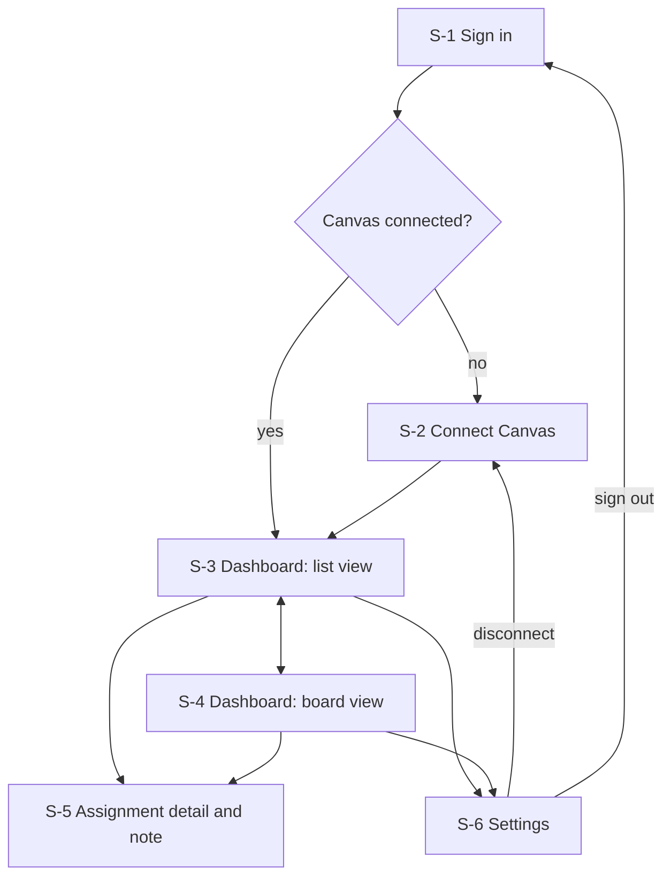
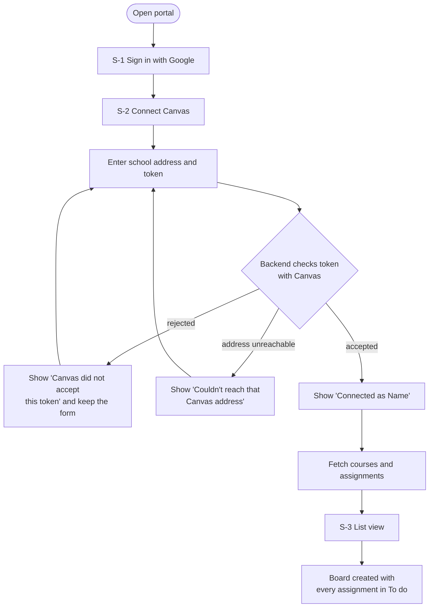
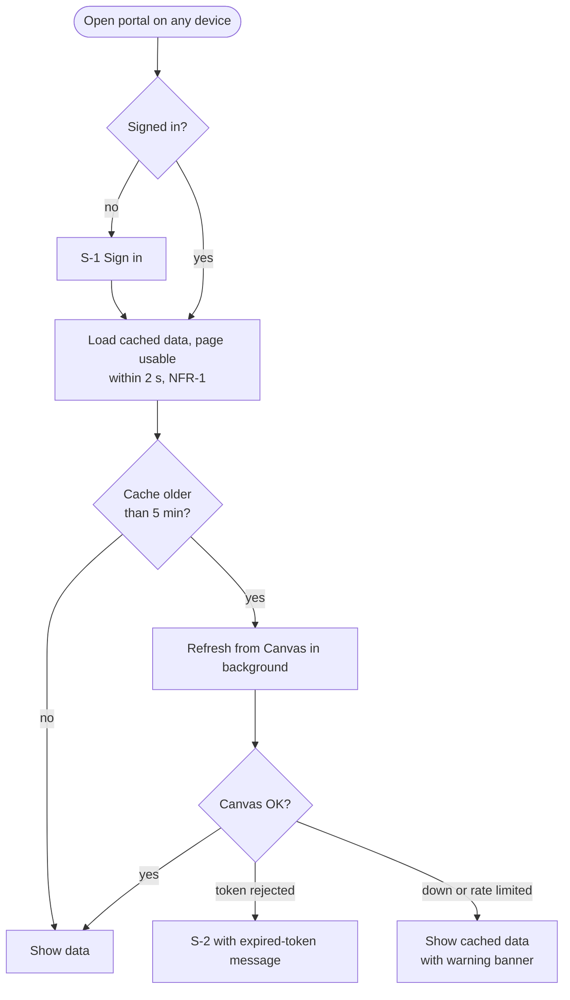
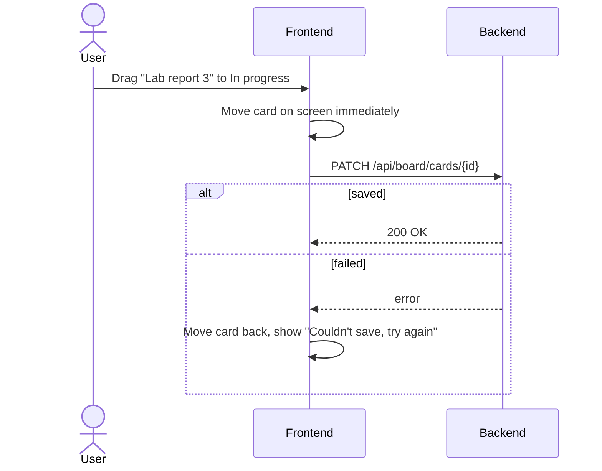
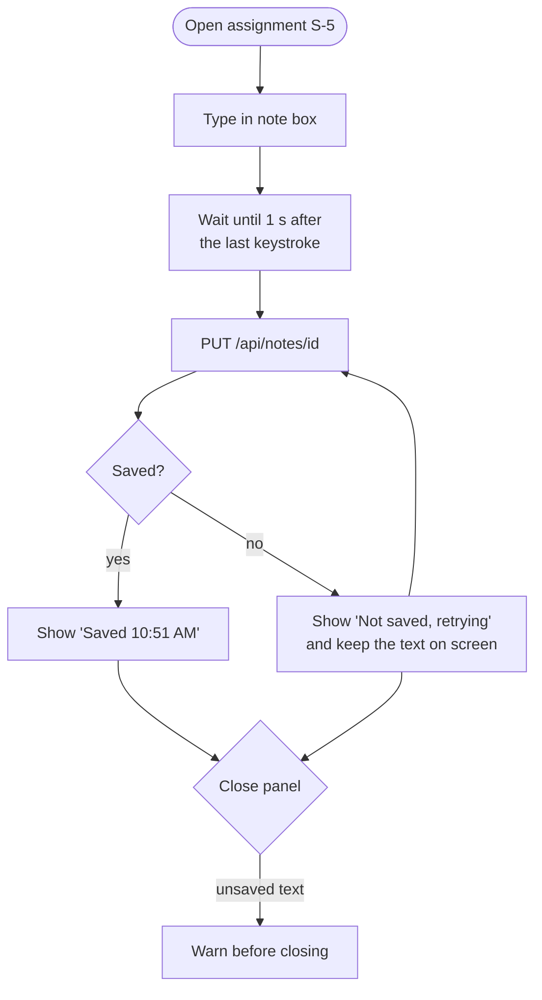
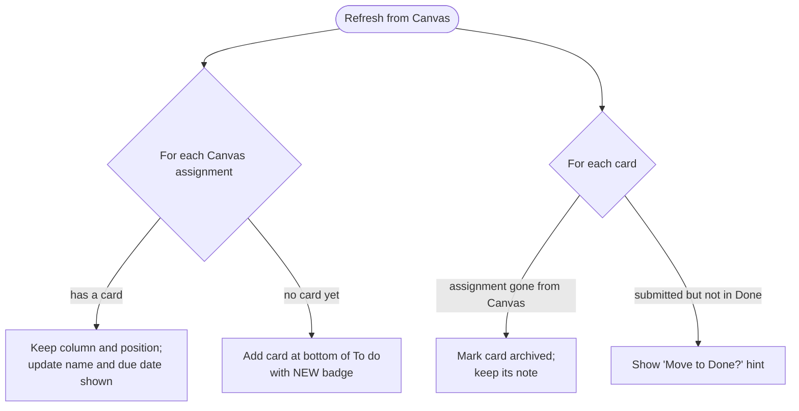

# Wireframes and workflows

**Status:** Draft · **Owner:** Team Lead · **Last updated:** 2026-10-25

Wireframes are rough sketches of each screen: what is on it and where, not
colors or fonts. They are drawn here as text so they can be reviewed and
changed in pull requests. Workflows show how a user moves between screens to
get something done.

Screen IDs (`S-1`, `S-2`, ...) are used by the test procedures.

## 1. Screen map



Every dashboard screen shares a top bar:

```text
+--------------------------------------------------------------------------+
| Canvas Portal      [ List | Board ]      Updated 3 min ago [Refresh]  [⚙] |
+--------------------------------------------------------------------------+
```

## 2. Screens

### S-1 Sign in

Requirements: FR-50, D-7. Shown when no one is signed in.

```text
+--------------------------------------------------+
|                                                  |
|                 Canvas Portal                    |
|                                                  |
|   All your Canvas assignments in one place,      |
|   on a board you can arrange, with your own      |
|   private notes.                                 |
|                                                  |
|          [  G  Sign in with Google  ]            |
|                                                  |
|   We only read from Canvas. We never change      |
|   anything there.                                |
+--------------------------------------------------+
```

### S-2 Connect Canvas

Requirements: FR-1 to FR-3, FR-6. Shown after first sign-in, after
disconnecting, or when Canvas rejects the saved token.

```text
+--------------------------------------------------------------+
|  Connect your Canvas account                                 |
|                                                              |
|  [!] Canvas no longer accepts your saved token.   <- FR-6,   |
|      Please create a new one. Your board and         shown   |
|      notes are safe.                                 only on |
|                                                      error   |
|  School Canvas address                                       |
|  [ https://myschool.instructure.com            ]             |
|                                                              |
|  Access token                                                |
|  [ ••••••••••••••••••••••••••••••••••          ] [show]      |
|                                                              |
|  > How do I get a token?                       <- expands    |
|    1. In Canvas, open Account, then Settings.                |
|    2. Under Approved Integrations, choose                    |
|       New Access Token.                                      |
|    3. Enter a purpose such as "Canvas Portal"                |
|       and generate it.                                       |
|    4. Copy the token and paste it here. Canvas               |
|       only shows it once.                                    |
|                                                              |
|                                  [ Connect ]                 |
+--------------------------------------------------------------+
```

On success the portal shows "Connected as *Name*" (FR-2) and opens S-3.

### S-3 Dashboard: list view

Requirements: FR-13, FR-20 to FR-26, NFR-20.

```text
+--------------------------------------------------------------------------+
| Canvas Portal      [*List*| Board ]      Updated 3 min ago [Refresh]  [⚙] |
+--------------------------------------------------------------------------+
| [!] Canvas isn't responding. Showing data from 10:42 AM.  <- NFR-20 only |
+-------------------+------------------------------------------------------+
| COURSES           | [ Search assignments...   ]  Status: [All      v]    |
| [x] All courses   | [x] Hide finished                                    |
| [ ] BIO 101       +------------------------------------------------------+
| [ ] HIST 210      | DUE SOON                                             |
| [ ] MATH 152      |  Lab report 3          BIO 101   Tue 11:59 PM  20 pt |
|                   |                                  [Due soon]   ✎   ↗  |
|                   |  Problem set 7         MATH 152  Wed 9:00 AM   10 pt |
|                   |                                  [Due soon]       ↗  |
|                   | UPCOMING                                             |
|                   |  Essay draft           HIST 210  Nov 3          50 pt |
|                   |                                  [Upcoming]   ✎   ↗  |
|                   | NO DUE DATE                                          |
|                   |  Reading reflection    HIST 210  —               5 pt |
|                   |                                  [Upcoming]       ↗  |
+-------------------+------------------------------------------------------+
  ✎ = has a note (FR-43)    ↗ = open in Canvas, new tab (FR-26)
  Clicking a row opens S-5.
```

### S-4 Dashboard: board view

Requirements: FR-30 to FR-37, NFR-3, NFR-31.

```text
+--------------------------------------------------------------------------+
| Canvas Portal      [ List |*Board*]      Updated 3 min ago [Refresh]  [⚙] |
+--------------------------------------------------------------------------+
| Course: [All courses v]                                  [+ Add column]  |
+------------------------+------------------------+------------------------+
| To do (3)          […] | In progress (1)    […] | Done (2)           […] |
+------------------------+------------------------+------------------------+
| +--------------------+ | +--------------------+ | +--------------------+ |
| | Problem set 7      | | | Lab report 3     ✎ | | | Quiz 4             | |
| | MATH 152           | | | BIO 101            | | | BIO 101            | |
| | Wed 9:00 AM  [Due  | | | Tue 11:59 PM       | | | [Graded]           | |
| |  soon]             | | | [Due soon]         | | +--------------------+ |
| +--------------------+ | +--------------------+ |                        |
| +--------------------+ |                        |                        |
| | Essay draft      ✎ | |                        |                        |
| | HIST 210  Nov 3    | |                        |                        |
| | [Submitted]        | |                        |                        |
| | Submitted. Move to | |  <- FR-37 hint,        |                        |
| | Done? [Move]       | |     never automatic    |                        |
| +--------------------+ |                        |                        |
| +--------------------+ |                        |                        |
| | NEW  Chapter 5 qs  | |  <- FR-34 new cards    |                        |
| | HIST 210  Nov 8    | |     land at bottom     |                        |
| +--------------------+ |                        |                        |
+------------------------+------------------------+------------------------+
| > Archived (1)    <- FR-45: assignments removed from Canvas              |
+--------------------------------------------------------------------------+
  […] column menu: Rename, Move left/right, Delete (FR-36)
  Keyboard: focus a card, Space to pick up, arrows to move, Space to drop,
  Escape to cancel (NFR-31).
```

### S-5 Assignment detail and note

Requirements: FR-22, FR-26, FR-40 to FR-44, FR-46. Opens as a side panel
over S-3 or S-4 on wide screens, and as a full screen on phones.

```text
                              +------------------------------------------+
                              | Lab report 3                         [x] |
                              | BIO 101 · Due Tue Oct 28, 11:59 PM       |
                              | 20 points · [Due soon]                   |
                              | [ Open in Canvas ↗ ]                     |
                              +------------------------------------------+
                              | MY NOTES (private, never sent to Canvas) |
                              | [B] [I] [•] [link]          <- FR-46     |
                              | +--------------------------------------+ |
                              | | Ask Dr. Lee about graph axes.        | |
                              | | Data is in the shared folder.        | |
                              | |                                      | |
                              | +--------------------------------------+ |
                              | Saved 10:51 AM            <- FR-42       |
                              |                         [Delete note]    |
                              +------------------------------------------+
```

### S-6 Settings

Requirements: FR-4, FR-53, FR-54.

```text
+--------------------------------------------------------------+
| Settings                                                     |
|                                                              |
| Canvas                                                       |
|   Connected as Alex S. at myschool.instructure.com           |
|   [ Disconnect Canvas ]                                      |
|                                                              |
| Your data                                                    |
|   [ Export board and notes (.json) ]                         |
|   [ Delete my account and all data ]   <- asks to confirm    |
|                                                              |
| Account                                                      |
|   Signed in as alex@example.com        [ Sign out ]          |
+--------------------------------------------------------------+
```

### Phone layout

Requirement: NFR-33. Courses move into a filter menu, and the list takes the
full width. The board scrolls sideways one column at a time.

```text
+----------------------------+
| Canvas Portal   [⟳]  [⚙]  |
| [*List*| Board ]           |
| [Search...]   [Filters v]  |
+----------------------------+
| DUE SOON                   |
| Lab report 3            ✎  |
| BIO 101 · Tue 11:59 PM     |
| [Due soon]                 |
|----------------------------|
| Problem set 7              |
| MATH 152 · Wed 9:00 AM     |
| [Due soon]                 |
+----------------------------+
```

## 3. Workflows

### W-1 First-time setup



### W-2 Daily check



### W-3 Move a card



Moving the card on screen before the server answers is called an
*optimistic update*. It keeps dragging fast (NFR-3), and the card snaps back
if the save fails, so the screen never shows a state the server doesn't have.

### W-4 Write a note



### W-5 Assignment changes in Canvas



### W-6 Disconnect and delete data


## Change log

| Date | Change |
|------|--------|
| 2026-10-25 | First draft. |
