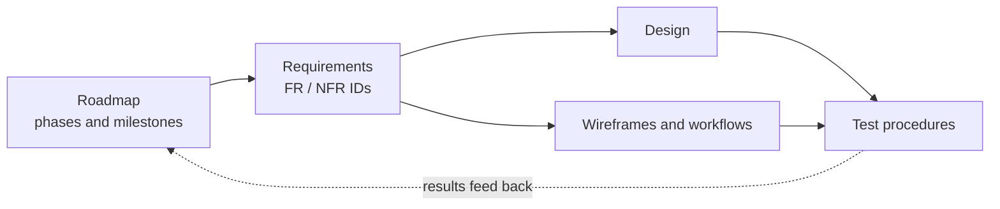

# Canvas Assignments Portal

A personal dashboard where a student connects their Canvas account, sees their
current courses and assignments in one place, arranges assignments on a kanban
board, and keeps private notes on each one.

This folder is the project's formal documentation. Each document has a status
and a change log at the bottom, so it can grow as the project does.

| # | Document | What it answers | Status |
|---|----------|-----------------|--------|
| 1 | [Roadmap](01-roadmap.md) | What gets built, in what order, and how we know a phase is done | Draft |
| 2 | [Requirements](02-requirements.md) | What the app must do, and how well | Draft |
| 3 | Design (`03-design.md`) | How the parts fit together: frontend, backend, data, Canvas API | Not started |
| 4 | Wireframes and workflows (`04-wireframes-workflows.md`) | What each screen looks like and how a user moves through it | Not started |
| 5 | Test procedures (`05-test-plan.md`) | How each requirement is checked, step by step | Not started |

## How these documents work together

Every requirement has an ID such as `FR-12`. The design names the requirement
IDs each part satisfies, and every test procedure names the requirement IDs it
checks. That chain is called *traceability*: for any requirement you can find
the code that implements it and the test that proves it.



## Conventions

- Documents are Markdown so they render on GitHub and diff cleanly in pull
  requests. Diagrams use [Mermaid](https://mermaid.js.org/), which GitHub draws
  from text inside a ```` ```mermaid ```` block.
- A change to the plan goes through a pull request, the same as a code change.
  The PR description says what changed and why.
- A pull request that changes anything a user sees must include screenshots
  of the changed screens in the PR description (before and after when an
  existing screen changes). The test procedures will make this a review step.
- Open decisions are marked **DECISION** with an ID (`D-1`, `D-2`, ...) and are
  collected in the roadmap until they are settled.

## Web terms used in these docs

These come up often. They are explained here once, with a Qt comparison where
one helps.

| Term | Meaning |
|------|---------|
| Frontend | The code that runs in the browser and draws the page. Comparable to the QML layer of a Qt app. |
| Backend | A program that runs on a server, not in the browser. Comparable to the C++ side of a Qt app, but on another machine reached over the network. |
| API | A set of URLs a program can call to get or change data. Canvas has a REST API: you request `https://school.instructure.com/api/v1/courses` and get JSON back. |
| JSON | The text format APIs use for data, like `{"name": "Biology", "id": 42}`. |
| REST | A common style of API where each URL is a thing (a course, an assignment) and HTTP verbs say what to do with it: `GET` reads, `POST` creates, `PUT`/`PATCH` changes, `DELETE` removes. |
| CORS | "Cross-Origin Resource Sharing". A browser rule: a page from site A may only call site B's API if site B explicitly allows it. Canvas does not allow arbitrary sites, which is why this project needs its own backend. |
| Access token | A long secret string that acts like a password for an API. Canvas lets a user generate a *personal access token* in their account settings. |
| OAuth | The "Log in with ..." flow. The user signs in on Canvas itself and Canvas hands the app a token. Needs the school to register the app. |
| Local storage | A small key-value store inside the browser, private to one site on one device. Like `QSettings`, but per browser. |
| Database | Structured storage on the server, shared across the user's devices. SQLite (one file) or Postgres (a database server). |
| Kanban | A board of columns (such as To do, Doing, Done) with cards you drag between them. |
| Component | A reusable piece of UI, like a QML component file. React and Svelte are both built around components. |
| Deploy / hosting | Putting the app on a server on the internet so others can open it. |
| CI | "Continuous integration": GitHub Actions running builds and tests on every push. |
