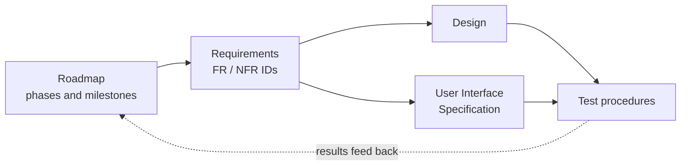

# Canvas Assignments Portal

A personal dashboard where a student connects their Canvas account, sees their
current courses and assignments in one place, and arranges them on a
Trello-style board that stays current with Canvas. Private notes on each
assignment are planned as a future feature. The full list of
project goals is in the [roadmap](/docs/canvas-portal/01-roadmap.md#1-project-goals).

This folder is the project's formal documentation. Each document has a status
and a change log at the bottom, so it can grow as the project does.

| # | Document | What it answers | Status |
|---|----------|-----------------|--------|
| 1 | [Roadmap](/docs/canvas-portal/01-roadmap.md) | What gets built, in what order, and how we know a phase is done | Draft |
| 2 | [Requirements](/docs/canvas-portal/02-requirements.md) | What the app must do, and how well | Draft |
| 3 | [Design](/docs/canvas-portal/03-design.md) | How the parts fit together: frontend, backend, data, Canvas API | Draft |
| 4 | [User Interface Specification](/docs/canvas-portal/04-ui-specification.md) | What each screen looks like and how a user moves through it | Draft |
| 5 | [Test procedures](/docs/canvas-portal/05-test-plan.md) | How each requirement is checked, step by step | Draft |

The [glossary](/docs/canvas-portal/glossary.md) explains the words these documents use: the
board and its lists, Refresh, card statuses, IDs, the team's review terms,
and web terms for readers coming from Qt.

## How these documents work together

Every requirement has an ID such as `FR-12`. The design names the requirement
IDs each part satisfies, and every test procedure names the requirement IDs it
checks. That chain is called *traceability*: for any requirement you can find
the code that implements it and the test that proves it.



## Conventions

- Documents are Markdown so they render on GitHub and diff cleanly in pull
  requests. Diagrams use [Mermaid](https://mermaid.js.org/), which GitHub draws
  from text inside a ```` ```mermaid ```` block.
- A change to the plan goes through a pull request, the same as a code change.
  The PR description says what changed and why.
- A pull request that changes anything a user sees must include screenshots
  of the changed screens in the PR description (before and after when an
  existing screen changes), following the
  [screenshot steps](/team/Development/personas/ui-ux-designer.md#screenshots-in-ui-prs).
  The [test procedures](/docs/canvas-portal/05-test-plan.md) make this a
  review step.
- The project owner is called "Team Lead" in the repo; no personal names.
- A term is defined once, in the [glossary](/docs/canvas-portal/glossary.md), and other
  documents link to it. A PR that adds or changes a term updates the
  glossary too.
- Open decisions are marked **DECISION** with an ID (`D-1`, `D-2`, ...) and are
  collected in the roadmap until they are settled.
